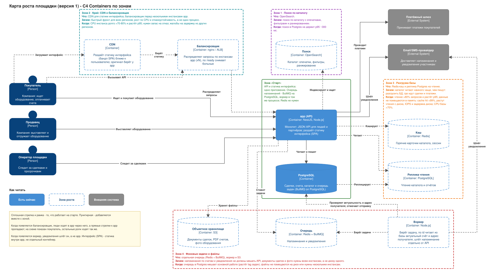
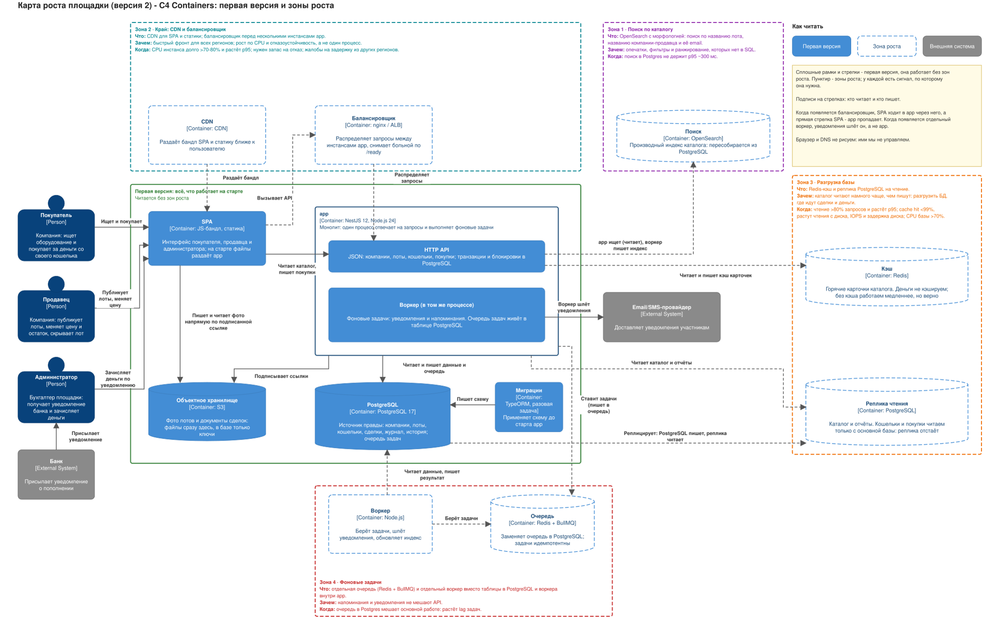

# system-design

Бэкенд на NestJS с Postgres, Redis, OpenSearch и SeaweedFS (S3-совместимое хранилище), запускается через Docker Compose.

## Стек и почему

- **NestJS, созданный через `nest new`** — Nest CLI генерирует стандартную структуру проекта (`nest-cli.json`, `tsconfig*.json`, `src/app.*`, `test/`) и настраивает `nest build`/`nest start`, вместо ручной сборки этой структуры. Это привычная отправная точка для Nest-приложения, знакомая любому Nest-разработчику.
- **Express, а не Fastify, как HTTP-адаптер** — проект использует `@nestjs/platform-express` (`NestFactory.create(AppModule)`), то есть платформу Nest по умолчанию. Fastify (`@nestjs/platform-fastify`, `NestFactory.create<NestFastifyApplication>(AppModule, new FastifyAdapter())`) на уровне Nest заменяется без переделок и обычно быстрее благодаря валидации по схеме, но экосистема готовых middleware у него меньше, а API запроса и ответа менее привычен тем, кто пришёл с чистого Express. Здесь нет задержек, критичных настолько, чтобы нуждаться в преимуществе Fastify, поэтому выигрывают большая экосистема и знакомство с Express.
- **TypeORM** — официальная интеграция `@nestjs/typeorm`, сущности на декораторах, миграции через CLI (`synchronize: false`; схема меняется только миграцией).
- **oxlint, а не ESLint** — линтер на Rust, который работает на порядки быстрее ESLint и покрывает нужные проекту правила корректности и стиля (включая проверки с учётом типов через `oxlint-tsgolint`). Платой за это стала куда меньшая экосистема плагинов ESLint (например, правила для фреймворков или сильно кастомные наборы). Для проекта такого размера скорость важнее.
- **Prettier** — отвечает только за форматирование и отделён от линтера, чтобы правила oxlint касались корректности, а не споров о стиле; `format:check` — проверка в CI, `format` — команда для исправления.
- **Vitest** — нативная поддержка ESM без дополнительных флагов (проект использует `"type": "module"`), быстрый, а `coverage.thresholds` идут из коробки вместе с `@vitest/coverage-v8`.
- **pino через `nestjs-pino`** — структурированные JSON-логи (готовы к отправке в OpenSearch), самый быстрый логгер в экосистеме Node, заменяет встроенный логгер Nest; `pino-pretty` используется только при `NODE_ENV=development`.
- **OpenSearch** вместо Elasticsearch — лицензия Apache 2.0, плагин безопасности для локальной разработки отключается без усилий.
- **SeaweedFS** вместо MinIO — `minio/minio` теперь требует входа в Docker Hub для загрузки; S3-шлюз SeaweedFS (`chrislusf/seaweedfs`) свободно скачивается, активно поддерживается и совместим с S3.
- **Node 24 LTS** (`node:24.21.0-alpine`) — текущая Active LTS.
- **Точные версии образов** — `postgres:17.11-alpine`, `redis:7.4.11-alpine`, `opensearchproject/opensearch:2.19.6`, `chrislusf/seaweedfs:4.48`, `node:24.21.0-alpine`: плавающий тег (`latest`, `17-alpine`) при следующем `pull` молча приносит новую версию, и два разработчика или два прогона CI работают на разных серверах. Версию поднимаем сознательно, отдельным коммитом.

Redis, OpenSearch и SeaweedFS поднимаются в Compose и доступны через переменные окружения с самого начала; клиенты для них в приложении пока не подключены, их добавят, когда они понадобятся какой-нибудь функции.

## Запуск стека

```bash
cp .env.example .env
docker compose up -d --build
```

- Приложение: http://localhost:3000 (`GET /` → `Hello World!`, см. `requests.http`)
- Postgres: localhost:5432
- Redis: localhost:6379
- OpenSearch: http://localhost:9200
- S3 API SeaweedFS: http://localhost:8333, UI filer: http://localhost:8888

`.env.example` рассчитан на хост (для каждого сервиса указан `localhost`), чтобы запускать приложение или TypeORM CLI прямо на хосте. Сервис `app` в `docker-compose.yml` переопределяет нужные переменные, чтобы обращаться к соседним контейнерам по имени сервиса (`postgres`, `redis`, ...).

## Разработка

```bash
npm install
docker compose up -d postgres redis opensearch seaweedfs
npm run start:dev
```

## Проверка

Нужен Docker Compose v2 с поддержкой `up --wait`; Compose v1 эту проверку не поддерживает.

```bash
npm run ci
```

Это единственная команда, которая должна проходить, прежде чем работа считается завершённой: она запускает локальный Postgres через Docker Compose (создаёт `.env` из `.env.example`, если его ещё нет, поэтому работает на свежем клоне), затем выполняет проверку типов, линтинг, проверку форматирования и тесты с порогом покрытия 100% по строкам, ветвям, функциям и операторам. Правило и его обоснование — в `AGENTS.md`, настройки покрытия (включая исключённые файлы, у каждого из которых есть комментарий с причиной) — в `vitest.config.ts`.

Тесты идут на отдельной базе `app_test`, изолированной от базы `app`, с которой работает запущенное приложение. `db:test:reset` (входит в `db:test:up`/`ci`) каждый раз пересоздаёт `app_test` пустой, а `db:test:migrate` накатывает на неё все миграции с нуля, поэтому запускать безопасно даже на томе Postgres, который существовал до добавления `docker/postgres/init/01-create-test-db.sql`: этот init-скрипт выполняется только на совершенно новом томе, а база `app` не затрагивается.

## Миграции

Миграции лежат в `src/migrations/` (рукописный SQL) и применяются **отдельным шагом**, а не приложением при старте (`synchronize: false`):

```bash
npm run build                # миграции и data-source грузятся из dist/
npm run migration:run        # применить новые к базе из .env
npm run migration:revert     # откатить последнюю
```

- **Compose:** одноразовый сервис `migrate` из того же образа выполняет `migration:run` до старта `app` (`depends_on: service_completed_successfully`).
- **CI:** `npm run ci` пересоздаёт `app_test` пустой и накатывает миграции с нуля (`db:test:reset`, `db:test:migrate`).

## Домашка 02 — экосистема Node.js

- **Презентация** «Node.js vs Java»: https://claude.ai/artifact/PEHouDxMP8BRYrUsCc9anV
- **Шпаргалка**: [docs/cheatsheet/node.js.md](docs/cheatsheet/node.js.md)
- **Системный дизайн**: [docs/cheatsheet/system-design.md](docs/cheatsheet/system-design.md)
- **Эксперимент** (один процесс / `cluster` / `worker_threads`): [experiments/02-event-loop](experiments/02-event-loop)

## Домашка 03 — cloud native архитектура

Задание: [tasks/03 - Cloud native архитектура.md](<tasks/03 - Cloud native архитектура.md>).

### Что добавлено

- **Конфиг по 12factor** — схема zod, проверка при старте, `.env.example` в репозитории (`src/config/env.ts`).
- **Health-checks** `/live` и `/ready` на `@nestjs/terminus`; `healthcheck` в `docker-compose.yml` вызывает `/ready` (`src/health/`).
- **Graceful shutdown** — `enableShutdownHooks`, хуки Nest, пауза для балансировщика, ожидание запросов с таймаутом, закрытие базы; ответы с `Connection: close` на время остановки, чтобы keep-alive клиенты не получали обрыв.
- **Структурированные логи** — pino, JSON в stdout, request id; в том же формате логируются старт и ошибки запуска (`src/config/nest-logger.ts`).
- **Нагрузочный скрипт** `scripts/load.mjs` для проверки остановки под нагрузкой (keep-alive и `fresh` режимы).
- **Диаграммы C4** (Context и Containers) в `docs/architecture/`.
- **Системный дизайн сквозного кейса** — карта роста, таблицы компонентов и сигналов, сценарии в `docs/system-design/marketplace-v1/`.
- **Тесты и CI** — 100% покрытие, включая e2e остановки с keep-alive клиентом и проверку `stop_grace_period` в compose.

### Проект: cloud native по 12factor

Контейнер одноразовый: платформа гасит и поднимает его когда хочет.

- **Конфиг** — только из переменных окружения, схема на zod в `src/config/env.ts` проверяется при старте (`main.ts`). Не хватает обязательной переменной — приложение пишет одну JSON-строку `fatal` с именами полей и завершается с кодом 1, не поднимая Nest. В репозитории только `.env.example`.
- **`GET /live`** — liveness, без зависимостей. **`GET /ready`** — readiness на `@nestjs/terminus`: пинг Postgres с таймаутом `HEALTH_TIMEOUT_MS` и индикатор `shutdown`. `healthcheck` в `docker-compose.yml` вызывает `/ready`. Compose не перезапускает unhealthy-контейнер: при падении базы приложение становится `unhealthy`, а когда база вернулась — снова `healthy`, без рестарта.
- **Graceful shutdown** (`src/health/shutdown.service.ts`), порядок хуков Nest: `onModuleDestroy` → `beforeApplicationShutdown(SIGTERM)` → закрытие HTTP-сервера → `onApplicationShutdown`.
  1. `onModuleDestroy` ставит флаг — `/ready` сразу отвечает 503; `beforeApplicationShutdown` ждёт `SHUTDOWN_DRAIN_MS`, чтобы балансировщик снял трафик (остальные запросы ещё обслуживаются);
  2. закрываем listener (новые соединения не принимаются), ждём текущие запросы до `SHUTDOWN_TIMEOUT_MS`, затем принудительно рвём оставшиеся. Keep-alive: с начала shutdown каждый ответ уходит с `Connection: close` (`connection-close.middleware.ts`), а простаивающие сокеты закрываются периодически — иначе клиент, который шлёт запросы по одному сокету, держал бы сервер открытым до таймаута и получил бы обрыв;
  3. `onApplicationShutdown`: закрываем соединения с базой — только после ответа на последний запрос. `TypeOrmCoreModule` делает то же самое в своём хуке; наш хук нужен ради явного лога и идемпотентен (`isInitialized`).

  `stop_grace_period` в compose (30s) должен быть больше `SHUTDOWN_DRAIN_MS + SHUTDOWN_TIMEOUT_MS`.

- **Логи** — pino, JSON в stdout, у каждого запроса `req.id` (берётся из входящего `x-request-id` или генерируется, возвращается в заголовке ответа). Пробы `/live` и `/ready` не логируются.

#### Проверка руками

```bash
docker compose up -d --build

# зависимость упала и вернулась: /ready 503 с именем database, /live 200, без рестарта
docker compose stop postgres
curl -i localhost:3000/ready; curl -i localhost:3000/live
docker compose start postgres
docker inspect -f '{{.State.StartedAt}}' $(docker compose ps -q app)   # не менялось

# graceful shutdown под нагрузкой: ни одного оборванного запроса
node scripts/load.mjs http://localhost:3000 5 &   # по умолчанию keep-alive, как у балансировщика; 4-й аргумент `fresh` — новое соединение на запрос
docker compose stop app
docker compose logs app | grep ShutdownService   # какие хуки и в каком порядке
```

`GET /work` включается `WORK_ENDPOINT_ENABLED=true` (в `.env.example` выключен, в compose включён только для локального стека; выключен — 404). Каждый запрос держит соединение из пула pg (по умолчанию 10), поэтому в `scripts/load.mjs` держите concurrency ниже размера пула, иначе `/ready` может упереться в `HEALTH_TIMEOUT_MS`. Скрипт работает по keep-alive (как балансировщик), режим `fresh` — новое соединение на запрос. Завершается с кодом 1, если хоть один запрос завершился любой ошибкой кроме ECONNREFUSED (в т.ч. ECONNRESET), получил не-2xx или ни один запрос не прошёл успешно. Docker-прокси портов может сбрасывать соединения после закрытия listener — для строгой проверки запускайте скрипт против приложения напрямую.

### Архитектурные диаграммы (C4)

- [Уровень 1 — System Context](<docs/architecture/L1 - System Context.drawio.svg>)
- [Уровень 2 — Containers](<docs/architecture/L2 - Containers.drawio.svg>)
- [Deployment — Docker Compose](<docs/architecture/Deployment - Docker Compose.drawio.svg>): порты, протоколы, образы и тома; на Context и Containers их нет


По замечаниям интервьюера C4-диаграммы переделаны: конкретная система Equipment MarketPlace с реальными ролями, без портов и протоколов (они на Deployment), SPA не отдельный контейнер, у воркера есть доступ к БД. Таблица «замечание → что сделано → где на схеме»: [docs/system-design/marketplace-v2/README.md](docs/system-design/marketplace-v2/README.md#что-изменилось-после-замечаний-интервьюера).

### Системный дизайн: площадка (карта роста)

Сквозной кейс, версия 1: [docs/system-design/marketplace-v1/](docs/system-design/marketplace-v1/README.md) - карта роста по зонам, компоненты, сигналы роста и сценарии.



### Заметка о ревью (домашка 03)

Ревью агентом-критиком провёл в новых сессиях с чистым контекстом; каждую находку проверил отдельно.

| Находка                                                                                                                                                                       | Серьёзность      | Что сделал                                                                                                                                  |
| ----------------------------------------------------------------------------------------------------------------------------------------------------------------------------- | ---------------- | ------------------------------------------------------------------------------------------------------------------------------------------- |
| Последние shutdown-логи терялись при SIGTERM (pino не успевал сбросить буфер)                                                                                                 | P2               | исправлено: `enableShutdownHooks(undefined, { useProcessExit: true })`                                                                      |
| `/ready` при shutdown ждал проверку базы (до 1,5 с при занятом пуле)                                                                                                          | P2               | исправлено: при флаге shutdown сразу 503, без проверок зависимостей                                                                         |
| Нагрузочный скрипт мог ложно проходить (ECONNRESET списывался на «сервер ушёл», нет подтверждения начала нагрузки)                                                            | P2               | исправлено: учитывается только ECONNREFUSED после первого ответа, без успешных запросов - код 1                                             |
| dotenv печатал неструктурированный баннер, ошибка конфига шла в stderr через `console.error`                                                                                  | P2               | исправлено: `quiet: true`, fatal пишется JSON в stdout                                                                                      |
| Keep-alive: `server.close()` не завершается, пока клиент шлёт запросы по одному сокету, затем `closeAllConnections()` рвёт запрос                                             | P1               | исправлено: `Connection: close` на ответах во время остановки и периодическая очистка простаивающих сокетов; e2e-тест с keep-alive клиентом |
| Скрипт нагрузки ходил только по новым соединениям и не ловил keep-alive сценарий                                                                                              | P1               | исправлено: режим keep-alive по умолчанию, `fresh` по желанию                                                                               |
| Логи Nest и TypeORM при старте шли цветным текстом, а не JSON                                                                                                                 | P2               | исправлено: pino-адаптер для логгера Nest, ошибка запуска логируется как `fatal`                                                            |
| Fatal конфига был не в формате pino (уровень строкой, без `time`/`pid`)                                                                                                       | P2               | исправлено: `pino().fatal(...)`                                                                                                             |
| Битые ссылки на шпаргалки, нет ссылок на диаграммы в README                                                                                                                   | P2               | исправлено                                                                                                                                  |
| `WORK_ENDPOINT_ENABLED=true` в `.env.example`; переменные Redis/OpenSearch/S3 не проверялись схемой; `stop_grace_period` нигде не сверялся с таймингами; лишняя строка в хуке | мелкие           | исправлено: `false` в шаблоне, необязательные URL в схеме, тест на тайминги, строка убрана                                                  |
| `loadEnv()` вызывается дважды (в `main.ts` и в `EnvModule`)                                                                                                                   | мелкая           | **не согласен**: функция чистая и дешёвая, а передача `env` через `AppModule` ломает e2e-тесты, которые собирают модуль напрямую            |
| Диаграммы: Docker Engine нарисован внешней системой; имя «Equipment Marketplace» не совпадает с заголовком; подпись стрелки клиента упоминала `/live` и `/ready`              | средние и мелкая | исправлено: платформа убрана с C4-схем, имя `system-design`, подпись `JSON/HTTP`                                                            |
| Диаграммы: Person описан как «разработчик или скрипт»; глагол «читает/пишет» у стрелки app - postgres; упоминание `app_test` в описании Postgres                              | мелкие           | исправлено: L1 и L2 перерисованы под площадку (покупатель, продавец, администратор), `app_test` убран                                       |
| Нет системного дизайна с картой роста площадки                                                                                                                                | высокая          | исправлено: `docs/system-design/marketplace-v1/`                                                                                            |

## Домашка 04 — база данных, транзакции, карта роста v2

Задание: схема данных площадки, миграции, уникальные индексы для целостности, три транзакционные операции, карта роста v2.

- **Схема данных, ER-диаграмма, нормальные формы, таблицы «правило → гарантия → ответ клиенту» и «операция → транзакция → блокировка», ответы на вопросы:** [docs/db/README.md](docs/db/README.md).
- **Системный дизайн, версия 2** (карта, данные → хранилище, ADR): [docs/system-design/marketplace-v2/](docs/system-design/marketplace-v2/README.md).
- Миграции (шесть, список и что в каждой - в [docs/db/README.md](docs/db/README.md)): [`InitMarketplace`](src/migrations/1760400000000-InitMarketplace.ts), [`DealLedgerInvariant`](src/migrations/1760500000000-DealLedgerInvariant.ts), [`AppendOnlyLedger`](src/migrations/1760600000000-AppendOnlyLedger.ts), [`EnforceDealRules`](src/migrations/1760700000000-EnforceDealRules.ts), [`CompanyWalletJournalTime`](src/migrations/1760800000000-CompanyWalletJournalTime.ts), [`LotsCatalogIndex`](src/migrations/1760900000000-LotsCatalogIndex.ts); код: модули `src/companies/`, `src/lots/`, `src/wallets/`, `src/deals/` (по одному feature-модулю на домен: controller, service, schemas, module), общий шов `src/common/tx-hooks/`, `src/db/` (ошибки Postgres → 409/422), тесты: `test/marketplace/`.



### API

| Метод и путь                            | Что делает                                                                                                                           |
| --------------------------------------- | ------------------------------------------------------------------------------------------------------------------------------------ |
| `POST /companies`, `GET /companies/:id` | компания и её кошелёк в одной транзакции; дубль email без учёта регистра - 409                                                       |
| `POST /companies/:id/wallet/deposits`   | **пополнение** по банковскому уведомлению (администратор): журнал и баланс в одной транзакции; повтор - 409                          |
| `GET /lots`                             | **каталог**: только опубликованные лоты, новые сверху; `q` ищет в названии лота, имени и email продавца; страницы по курсору `after` |
| `POST /lots`                            | лот, первые строки истории, способы доставки                                                                                         |
| `PATCH /lots/:id/publication`, `/stock` | публикация или скрытие; остаток меняется на **дельту** (`{ "delta": 5 }`), не на итог; каждое изменение пишется в историю            |
| `PATCH /lots/:id/price`                 | **смена цены**: новая цена и строка истории вместе                                                                                   |
| `POST /deals`                           | **покупка**: транзакция и `SELECT ... FOR UPDATE` лота и кошельков; нет остатка или денег - 409                                      |

Ошибки всегда `{ statusCode, code, message }`: `400` валидация, `404` нет записи, `409` нарушено правило (уникальность, остаток, деньги), `422` связанной записи нет или покупка своего лота. Примеры запросов - в `requests.http`.

### Что покрывают тесты

- **Двойное пополнение**: два одинаковых пополнения по одному уведомлению одновременно - `201` и `409`, одна строка журнала, баланс вырос один раз.
- **Откат пополнения**: ошибка после записи в журнал - строки нет, баланс прежний. То же для смены цены.
- **Покупка без блокировки** даёт две сделки на одну штуку (шаг 2, на отдельной базе без одного триггера цепочки остатка: две сделки и деньги списаны дважды; на обычной базе схема сама не даёт продать лишнее - шаг 2б), **с `FOR UPDATE`** - одну, второй покупатель получает 409 (шаг 3). Ожидание блокировки в тестах - по `pg_blocking_pids`, без `sleep`. Плюс: денег на один лот при двух разных; смена цены во время покупки; встречные покупки A↔B ×20 без дедлока, сумма денег не меняется.
- **Схема**: каждое из четырёх правил целостности и дополнительные ограничения проверяются прямыми запросами к базе, в том числе баланс только через журнал, условия сделки, цепочка истории остатка, append-only всех пяти журналов и тайм-ауты на соединениях.
- **Склад**: изменение остатка дельтой, отказ при уходе ниже нуля, два изменения одновременно не теряются.
- **Каталог**: скрытые лоты не видны, порядок «новые сверху», поиск по продавцу без учёта регистра, `%` и `_` в запросе ищутся буквально, курсор не пропускает и не повторяет лоты, даже если между страницами добавили новый.

### Приёмочный прогон

Критерии из задания и что именно проверено:

| Критерий                                                                        | Результат                                                                                                                                                                                                                |
| ------------------------------------------------------------------------------- | ------------------------------------------------------------------------------------------------------------------------------------------------------------------------------------------------------------------------ |
| ER-диаграмма: компании, лоты, фото, кошельки, сделки, журнал; ограничения в БД  | выполнено: [docs/db/README.md](docs/db/README.md)                                                                                                                                                                        |
| Три задачи на схему решены; у каждой таблицы форма и почему её хватает          | выполнено, вместе с 4НФ по способам доставки                                                                                                                                                                             |
| Миграции накатываются с нуля на пустую базу                                     | проверено: `npm run ci` пересоздаёт `app_test` и накатывает; вручную `migration:revert` и повторный `migration:run` прошли                                                                                               |
| Четыре правила закрыты индексами или ограничениями в миграции                   | выполнено, в таблице README: по выражению, простой, частичный, составной                                                                                                                                                 |
| Тест двойного пополнения: 409, одна строка, баланс вырос один раз               | выполнено: `test/marketplace/deposit.e2e-spec.ts`                                                                                                                                                                        |
| README: таблица «правило → как гарантировано → что видит клиент»                | выполнено                                                                                                                                                                                                                |
| Три операции в API; покупка без блокировки даёт две сделки, с `FOR UPDATE` одну | выполнено; таблица «операция → транзакция → блокировка → почему» в [docs/db/README.md](docs/db/README.md)                                                                                                                |
| C4 System Context и Containers доделаны или причёсаны                           | нарисованы заново для площадки: [L1](<docs/system-design/marketplace-v2/L1 - System Context.drawio.svg>), [L2](<docs/system-design/marketplace-v2/L2 - Containers.drawio.svg>)                                           |
| Приёмочный прогон пройден, найденное исправлено                                 | `npm run ci` зелёный (покрытие 100%); `docker compose up --build`: `migrate` завершился с кодом 0, `app` healthy, сценарий через curl (компания, лот, пополнение, повтор → 409, покупка, повторная покупка → 409) прошёл |
| Ревью агентом-критиком проведено, результаты в заметке о ревью                  | проведено, три круга: результаты и исправления в заметке о ревью ниже                                                                                                                                                    |
| Систем-дизайн: карта доработана, приведена к единому виду, на ней данные        | выполнено: [docs/system-design/marketplace-v2/](docs/system-design/marketplace-v2/README.md); защита в паре на занятии 05 впереди                                                                                        |

Ограничения: загрузка фото в S3, поиск в OpenSearch и пользователи с JWT из «продвинутого» не сделаны (для фото и поиска есть схема и решения в ADR); поиск и кэш по заданию не трогаем.

### Заметка о ревью (домашка 04)

Ревью строгим агентом-критиком; находки проверены вручную (мутациями кода), ложных не было. Только medium, critical и high не найдено.

| #   | Находка                                                                                                                   | Серьёзность | Что сделано                                                                                                                          |
| --- | ------------------------------------------------------------------------------------------------------------------------- | ----------- | ------------------------------------------------------------------------------------------------------------------------------------ |
| 1   | UUID заглавными в теле `POST /deals`: покупатель не находился (`===` со строчным из БД), 404 вместо покупки или `OWN_LOT` | medium      | исправлено: `uuid()` в `src/common/uuid.ts` приводит id к нижнему регистру; тест «accepts ids in upper case»                         |
| 2   | Тест «цена меняется во время покупки» проходил и без блокировок: сумма сделки и списание считались из одной переменной    | medium      | исправлено: тест проверяет, что запись новой цены в истории появилась не раньше сделки; проверено мутацией (без `FOR UPDATE` падает) |
| 3   | Небезопасный режим покупки `lock: false` жил в боевом коде, `DealsService` экспортировался                                | medium      | исправлено: параметр убран, блокировка — `protected rowLock`, небезопасная версия только в тесте (подкласс), экспорт убран           |
| 4   | Денежные инварианты сделки (кому какая строка журнала, сумма = `total`, ровно две строки) держались только кодом          | medium      | исправлено: отложенный constraint-триггер, миграция `1760500000000-DealLedgerInvariant`, 5 тестов                                    |

Второй круг ревью (коммит `3c47991`, новая сессия): 1 high и 4 medium, каждая проверена по коду; все подтвердились.

| #   | Находка                                                                                                                                                    | Серьёзность | Что сделано                                                                                                                                                                                         |
| --- | ---------------------------------------------------------------------------------------------------------------------------------------------------------- | ----------- | --------------------------------------------------------------------------------------------------------------------------------------------------------------------------------------------------- |
| 5   | Покупка считала баланс `bigint` через `Number` и писала обратно абсолютное значение: при балансе выше 2^53 деньги терялись (баланс не менялся, журнал рос) | high        | исправлено: `balance = balance ± $total` считает база, сравнение с суммой через `BigInt`; баланс в ответах API (`GET /companies/:id`, пополнение) теперь строка; тест на балансе `9007199254740992` |
| 6   | Constraint-триггер журнала срабатывал только на `INSERT`: сумму можно было изменить, строку журнала удалить, сделку переоценить                            | medium      | исправлено: миграция `1760600000000-AppendOnlyLedger`, `deals`, `wallet_operations`, `lot_stock_history` append-only (`UPDATE`/`DELETE`/`TRUNCATE` запрещены триггером); тесты на каждую операцию   |
| 7   | `lot_stock_history` не связывала запись с лотом и количеством сделки, допускала несколько записей на одну сделку                                           | medium      | исправлено в той же миграции: составной внешний ключ `(deal_id, lot_id)`, триггер `delta = -quantity`, частичный уникальный индекс по `deal_id`; тест                                               |
| 8   | Тест гонки «два лота сразу» использовал одного продавца: его блокировка сама сериализовала покупки и скрывала отсутствие блокировки покупателя             | medium      | исправлено: у лотов разные продавцы, сверка баланса с журналом сохранена. Мутацией не проверял                                                                                                      |
| 9   | docs/db/README.md неверно объяснял, почему условный `UPDATE` не подходит (будто нельзя проверить кошелёк и записать связанные строки в одной транзакции)   | medium      | исправлено: описано, как это делается в одной транзакции, и настоящая причина выбора `FOR UPDATE` (проверки по одному согласованному состоянию и точные коды отказа)                                |

Третий круг (новая сессия, коммит `a61271c`): 8 находок medium, critical и high нет. Находки 1 и 2 проверены SQL-запросом к `app_test` внутри транзакции, которая откатилась; остальные - по коду. После исправлений проверено мутацией: без `FOR UPDATE` падают четыре теста, включая «два лота сразу», который раньше мутацией не проверялся.

| #   | Находка                                                                                                                                                                    | Серьёзность | Что сделано                                                                                                                                                                                                                                                                                             |
| --- | -------------------------------------------------------------------------------------------------------------------------------------------------------------------------- | ----------- | ------------------------------------------------------------------------------------------------------------------------------------------------------------------------------------------------------------------------------------------------------------------------------------------------------- |
| 10  | База принимала сделку на 999 999 штук лота с остатком 1, на неопубликованном лоте и по цене, не равной цене лота; остаток, история остатка и баланс держались только кодом | medium      | исправлено: миграция `EnforceDealRules`: баланс пишет триггер по журналу и прямое изменение запрещено; `BEFORE INSERT` триггер сделки (публикация, цена); цепочка `lot_stock_history`; отложенные проверки «у сделки есть строка склада» и «остаток лота = конец истории»; тесты в `schema.e2e-spec.ts` |
| 11  | `lot_price_history` и `lot_publication_history` можно было править и удалять, хотя документация называла их append-only                                                    | medium      | исправлено: обе таблицы под тем же триггером `forbid_change` (`UPDATE`, `DELETE`, `TRUNCATE`); тесты                                                                                                                                                                                                    |
| 12  | Нормальные формы `deals` и `wallet_operations` описаны неполно: не названа зависимость `total` и дубль `amount = ±total`                                                   | medium      | исправлено: таблица в `docs/db/README.md`                                                                                                                                                                                                                                                               |
| 13  | `PATCH /lots/:id/stock` перезаписывал остаток абсолютным числом: изменение между чтением и записью продавца терялось                                                       | medium      | исправлено: запрос принимает `delta`, `UPDATE ... SET stock = stock + $delta`; новая причина `writeoff`; отказ ниже нуля - 409; тест на два одновременных изменения. **Изменился контракт API** (`stock` заменён на `delta`)                                                                            |
| 14  | Нет `lock_timeout`, `statement_timeout`, `idle_in_transaction_session_timeout`: зависшая транзакция с `FOR UPDATE` останавливает все покупки и забирает пул                | medium      | исправлено: три лимита на соединениях приложения (`DB_*_TIMEOUT_MS`, не на CLI миграций); `55P03` -> `409 RETRY`, `57014` -> `503 DB_TIMEOUT`                                                                                                                                                           |
| 15  | Тесты гонки держались на `sleep` и барьере с тихим таймаутом: на медленном CI могли пройти без настоящей гонки                                                             | medium      | исправлено: `waitUntilBlockedBy` по `pg_blocking_pids`, барьер падает по таймауту; `TxHooks` получает `EntityManager`                                                                                                                                                                                   |
| 16  | Нет теста для ответа «почему пополнению блокировка не нужна»                                                                                                               | medium      | исправлено: два одновременных пополнения одного кошелька по разным уведомлениям - оба 201, баланс равен сумме                                                                                                                                                                                           |
| 17  | README расходился с кодом: «одна миграция», коды `409` для `CHECK`, статус ревью, комментарий «арифметика только в SQL» при расчёте `total` в `Number`                     | medium      | исправлено: перечень миграций, таблица правил, статус ревью; `total` считается в `bigint`, в `Number` только в ответе                                                                                                                                                                                   |

Следствие находки 10, о котором стоит знать на защите: схема теперь сама не даёт продать лишнее даже без блокировки, поэтому шаг 2 («две сделки») воспроизводится только на соединении с выключенными триггерами (`session_replication_role = replica`; в четвёртом круге заменено на отдельную базу, см. находку 21), а на обычном - шаг 2б: сделка одна, проигравший получает ошибку правила вместо понятного `OUT_OF_STOCK`. Блокировка осталась ради ответа клиенту и чтобы не делать работу зря.

Ограничение: переполнение `bigint` на балансе продавца (больше 9.2·10^18 центов) по-прежнему даёт 500 от базы; практически недостижимо, не обрабатывается.

Дополнительно по замечанию к структуре: плоская папка `src/marketplace` разнесена на feature-модули по домену (рекомендация документации NestJS: [Modules](https://docs.nestjs.com/modules)). С чем не согласен: ни с чем.

Четвёртый круг (новая сессия, коммит `4267ac2`): 8 находок medium, critical и high нет. Находки 18, 19 и 21 проверены на `app_test` (транзакции с откатом и сверочный запрос после прогона), остальные - по коду. Исправлены три, две названы в [известных ограничениях](docs/db/README.md#известные-ограничения), три оставлены.

| #   | Находка                                                                                                                                                                                                           | Серьёзность | Что сделано                                                                                                                                                                                                                                                                                         |
| --- | ----------------------------------------------------------------------------------------------------------------------------------------------------------------------------------------------------------------- | ----------- | --------------------------------------------------------------------------------------------------------------------------------------------------------------------------------------------------------------------------------------------------------------------------------------------------- |
| 18  | База не требовала кошелёк у компании (`UNIQUE` давал только «не больше одного»): покупка у продавца без кошелька падала с 500, `GET /companies/:id` отвечал 404                                                   | medium      | исправлено: миграция `CompanyWalletJournalTime`, отложенная проверка `companies_wallet_required`, кошелёк нельзя удалить или передать (`wallets_keep_company`); тест                                                                                                                                |
| 19  | `wallet_operations.created_at DEFAULT now()`: строка покупки, ждавшей блокировку, получала время раньше пополнения, которого она ждала; баланс «на момент T» по журналу мог уйти в минус                          | medium      | исправлено в той же миграции: `DEFAULT clock_timestamp()`; тест                                                                                                                                                                                                                                     |
| 20  | `valid_from` и `changed_at` историй ставит код, база их не проверяет: строку можно дописать задним числом, и «цена на момент сделки» по времени разойдётся с `lots.price`                                         | medium      | не исправлено                                                                                                                                                                                                                                                                                       |
| 21  | Тест шага 2 шёл на `session_replication_role = replica`: кроме цепочки остатка выключались внешние ключи и триггер баланса, деньги не двигались, а в `app_test` оставались кошельки с балансом, не равным журналу | medium      | исправлено: тест создаёт отдельную базу `app_test_step2`, накатывает все миграции и удаляет один триггер `lot_stock_history_state`; проверяет и деньги; после теста база удаляется. Мутацией: с триггером тест падает. Список миграций для такой базы сверяется с `app_test` в `schema.e2e-spec.ts` |
| 22  | Приложение подключается суперпользователем: все гарантии базы снимаются его же учёткой (`session_replication_role`, `DISABLE TRIGGER`)                                                                            | medium      | не исправлено: роли - тема занятия 09                                                                                                                                                                                                                                                               |
| 23  | Нет проверки при старте, что миграции применены: код без миграции `EnforceDealRules` пишет журнал, но не двигает баланс                                                                                           | medium      | описано в известных ограничениях                                                                                                                                                                                                                                                                    |
| 24  | Покупка не идемпотентна: повтор `POST /deals` - вторая сделка и второе списание                                                                                                                                   | medium      | описано в известных ограничениях                                                                                                                                                                                                                                                                    |
| 25  | Тест на дедлок не ловит неверный порядок блокировок: пауза стоит после того, как оба кошелька уже заблокированы                                                                                                   | medium      | не исправлено                                                                                                                                                                                                                                                                                       |
