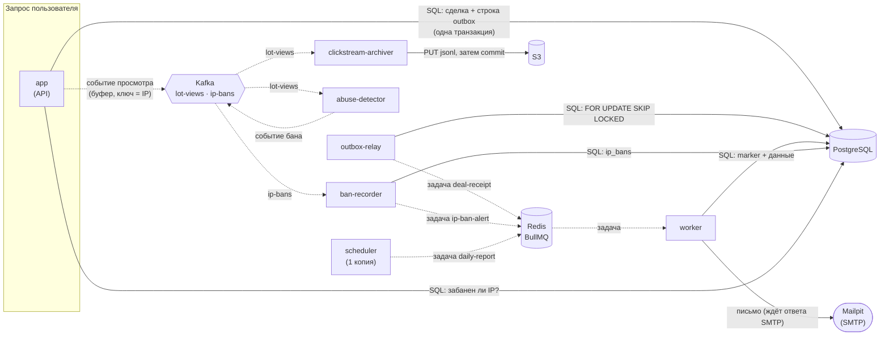

# Фоновые задачи: outbox, BullMQ, Kafka

Домашка 05. Что делает площадка вне запроса пользователя: письмо-чек после сделки, кликстрим просмотров лотов с архивом в S3, детектор абьюза с баном по IP и ежедневный отчёт администратору. Задание: [tasks/05 - Фоновые задачи.md](<../../tasks/05 - Фоновые задачи.md>). Архитектура и решения: [docs/system-design/marketplace-v3](../system-design/marketplace-v3/README.md). Шпаргалка к теории: [docs/cheatsheet/queues.md](../cheatsheet/queues.md).

## Что запущено

Каждый процесс — отдельный контейнер Compose из того же образа, с собственной командой (`dist/entrypoints/<имя>.js`). API ни от Redis, ни от Kafka не зависит: упали они — запросы обслуживаются.



Сплошная стрелка — синхронный вызов (ответа ждут), пунктир — асинхронная передача (задача или событие).

| Процесс                | Группа / очередь              | Что делает                                                                                |
| ---------------------- | ----------------------------- | ----------------------------------------------------------------------------------------- |
| `app`                  | —                             | API; пишет outbox в транзакции сделки; шлёт просмотры в Kafka; отвечает 429 забаненным IP |
| `outbox-relay`         | очередь `mail` (пишет)        | строки `outbox` → задачи BullMQ                                                           |
| `worker`               | очередь `mail` (читает)       | чек покупателю, письмо о бане, ежедневный отчёт                                           |
| `clickstream-archiver` | группа `clickstream-archiver` | `lot-views` → файлы JSONL в S3                                                            |
| `abuse-detector`       | группа `abuse-detector`       | `lot-views` → окно 60 с по IP → `ip-bans`                                                 |
| `ban-recorder`         | группа `ip-ban-recorder`      | `ip-bans` → таблица `ip_bans` + задача `ip-ban-alert`                                     |
| `scheduler`            | очередь `mail` (пишет)        | раз в сутки ставит задачу `daily-report`; **ровно одна копия**                            |
| `kafka-init`           | —                             | разовая задача: создаёт топики (как `migrate` для Postgres)                               |

Запуск: `docker compose up -d --build`. Письма смотрим в Mailpit: http://localhost:8025 (настоящая почта никуда не уходит; Mailpit взят вместо MailHog из ресурсов: MailHog не развивается с 2020 года, а Mailpit — его живая замена с теми же портами).

## 2.1. Чек покупателю: outbox и BullMQ

### Две ловушки двойной записи

Сделка пишется в Postgres, задача — в Redis. Это два хранилища, общей транзакции у них нет, и «записать в оба» ломается двумя способами:

| Ловушка                      | Что происходит                                                                                                            | Чем кончается                                          |
| ---------------------------- | ------------------------------------------------------------------------------------------------------------------------- | ------------------------------------------------------ |
| Задача **внутри** транзакции | `BEGIN` → сделка → `queue.add` → ... → `ROLLBACK` (не хватило денег, дедлок, таймаут). Задача в Redis откатиться не может | чек о сделке, которой нет; воркер находит пустое место |
| Задача **после** коммита     | `COMMIT` → процесс упал (деплой, OOM) → `queue.add` не выполнился                                                         | сделка есть, чек не придёт никогда                     |

(У BullMQ 6 есть бэкенд на Postgres: задача лежала бы в той же транзакции, и проблемы не было бы. Мы взяли Redis, поэтому проблема настоящая.)

### Outbox

Сделка и **строка в таблице `outbox`** — в одной транзакции (`DealsService.purchase`): либо есть обе, либо нет ни одной. Отдельный процесс, релей (`src/outbox/outbox-relay.service.ts`), переносит строки в очередь:

```text
BEGIN
  SELECT id, aggregate_id FROM outbox WHERE published_at IS NULL
   ORDER BY id LIMIT 100 FOR UPDATE SKIP LOCKED      -- строки заняты нами
  для каждой: queue.add('deal-receipt', {dealId}, {jobId: 'deal-receipt-<dealId>'})
              UPDATE outbox SET published_at = now()
COMMIT
```

- `FOR UPDATE SKIP LOCKED`: несколько релеев не берут одни строки и не ждут друг друга.
- **Redis лежит** — `add` не отвечает за `QUEUE_ADD_TIMEOUT_MS` (3 с), проход откатывается, строки остаются неотправленными. Релей повторяет с растущей паузой (до 30 с). Сделки при этом проходят как обычно.
- **Релей упал между `add` и `COMMIT`** — строка осталась неотправленной, после перезапуска задача поставится ещё раз. Идентификатор задачи — id сделки, поэтому BullMQ второй `add` игнорирует.
- Строка уникальна по `(kind, aggregate_id)` (`outbox_kind_aggregate_id_key`): одна сделка — одно событие, как бы код ни повторялся.
- **Redis потерял данные** — это не то же самое, что «лежит». Релей помечает строку отправленной, как только `add` ответил, и повторно её не поставит. Поэтому требование такое: задача, которую Redis принял, переживает перезапуск и падение Redis. Для этого в Compose Redis запущен с `--appendonly yes --appendfsync always` (журнал на диске синхронизируется до ответа на команду) и томом `redis-data`; по умолчанию у Redis только периодические снимки, и всё добавленное после последнего пропало бы вместе со строкой, которой уже нет в очереди на отправку. Цена — синхронизация диска на каждую команду очереди; для чеков, писем и отчётов это незаметно. Остаётся потеря самого тома. Тогда задачи восстанавливаются из базы: `UPDATE outbox SET published_at = NULL WHERE published_at > <время потери>`, релей поставит их заново, `jobId` и идемпотентный воркер отбросят дубли (для `ip-ban-alert` и `daily-report` строки outbox нет: их письма не восстанавливаются, бан остаётся в `ip_bans`).

Чего outbox **не** гарантирует: доставку ровно один раз. Он даёт «хотя бы раз» (после сбоя задача может прийти второй раз), поэтому за ним стоит идемпотентный обработчик. И порядок: строки забирают пачками, несколько релеев перемешают их.

### Воркер

Отдельный контейнер `worker`, `@Processor('mail')`, до 5 задач одновременно. Тип задачи — по имени: `deal-receipt`, `ip-ban-alert`, `daily-report`.

### Повторы и упавшие задачи

Очередь создаётся с политикой (`src/queue/queue.module.ts`): `attempts: 5` (всего запусков, первый включительно), `backoff: exponential` от `JOB_BACKOFF_MS` (1 с, 2 с, 4 с, 8 с). Число попыток ограничено: исчерпав их, задача остаётся в состоянии `failed` (`removeOnFail: false`). `UnrecoverableError` (сделки нет, неизвестный тип) пропускает повторы — повторять бессмысленно.

Упавшие задачи видно и можно запустить заново:

```bash
node scripts/jobs.mjs counts            # сколько задач в каждом состоянии
node scripts/jobs.mjs failed            # упавшие: id, имя, попытки, причина, данные
node scripts/jobs.mjs retry all         # вернуть все упавшие в очередь (или retry <id>)
```

Проверено на стенде (Mailpit остановлен — SMTP недоступен):

```text
attempts  reason                                   data
'5/5'     'connect EHOSTUNREACH 172.19.0.5:1025'   {"dealId":"57f365bf-..."}
1 failed job(s)
-- docker compose start mailpit; node scripts/jobs.mjs retry all
1 job(s) put back to the queue            -> письмо в Mailpit, failed: 0
```

### Идемпотентный воркер

Чек по сделке уходит один раз, даже если задача пришла дважды или трижды. Ключ — id сделки, замок — первичный ключ таблицы `deal_receipts` (`src/receipts/receipt.job.ts`). Принцип «сначала пометь, потом делай»:

```text
BEGIN
  SELECT сделка, лот, e-mail покупателя          -- нет сделки → UnrecoverableError
  INSERT INTO deal_receipts (deal_id, recipient)
     VALUES (...) ON CONFLICT (deal_id) DO NOTHING RETURNING deal_id
  строки нет → чек уже ушёл: выходим, письма нет
  отправить письмо (Message-ID: <receipt-<dealId>@...>)   -- упало → ROLLBACK, задачу повторит BullMQ
COMMIT
```

Гонка «проверил, что не обработано — обработал» исчезает: проверки нет, есть одна атомарная вставка. Два воркера одновременно: второй `INSERT` встаёт на уникальном индексе и ждёт конца первой транзакции. Первая закоммитилась — второй получает конфликт и выходит. Первая откатилась (SMTP упал) — второй получает слот и сам шлёт письмо.

Остаётся одно окно, и оно сознательное: SMTP-сервер **принял** письмо, а `COMMIT` не прошёл (обрыв связи с Postgres, падение процесса). Повтор отправит вторую копию. Закрыть его до конца может только получатель-провайдер, который дедуплицирует по `Message-ID` (он постоянный: `receipt-<сделка>`). Это то же ограничение, что у любого «exactly-once» с внешним миром.

Окно зависит от таймаутов. Письмо уходит внутри открытой транзакции, и пока воркер ждёт SMTP-сервер, транзакция простаивает: Postgres рвёт сессию через `DB_IDLE_IN_TRANSACTION_TIMEOUT_MS` (30 с). Если SMTP-сервер завис дольше, письмо могло дойти, а `COMMIT` уже невозможен, и повтор отправит вторую копию. Библиотека по умолчанию ждёт сервер минуты, поэтому таймауты клиента заданы явно: `MAIL_TIMEOUT_MS` (10 с) на соединение, приветствие и тишину в сокете; он обязан быть меньше таймаута простоя транзакции. Тест `SmtpMailer … says nothing` проверяет, что молчащий сервер отваливается быстро. При `concurrency: 5` зависший SMTP держит до пяти соединений пула: ещё одна причина держать таймаут коротким.

**Тест:** [test/background/receipt.e2e-spec.ts](../../test/background/receipt.e2e-spec.ts) — «одна задача трижды, письмо одно» в трёх вариантах: три запуска подряд, три запуска одновременно (письмо задержано на 150 мс, чтобы остальные встали на индексе), три разные задачи через настоящую очередь (без дедупликации по `jobId`, держит только сам обработчик).

### Способы идемпотентности

На занятии показали один — ключ идемпотентности. Вот они все, и где у каждого гонка:

| #   | Способ                                                    | Как работает                                                                                                | Когда брать                                                             | Где гонка                                                                                                                                                                                                                                                           | У нас                                                                       |
| --- | --------------------------------------------------------- | ----------------------------------------------------------------------------------------------------------- | ----------------------------------------------------------------------- | ------------------------------------------------------------------------------------------------------------------------------------------------------------------------------------------------------------------------------------------------------------------- | --------------------------------------------------------------------------- |
| 1   | Ключ идемпотентности + уникальный индекс                  | клиент или отправитель задаёт ключ; вставка с ключом, повтор упирается в `UNIQUE`; `ON CONFLICT DO NOTHING` | платежи, чеки, любые «сделай один раз»; ключ известен заранее           | если сначала `SELECT`, потом `INSERT` — оба видят «нет». Уникальный индекс убирает её; ключ без индекса — нет                                                                                                                                                       | `bank_notification_id` (пополнение кошелька), `outbox (kind, aggregate_id)` |
| 2   | Таблица обработанных сообщений (inbox)                    | потребитель пишет `message_id` в таблицу **в той же транзакции**, что и эффект; повтор находит запись       | брокер доставляет «хотя бы раз», эффект — в той же БД                   | эффект вне БД (письмо, HTTP-вызов) не откатывается вместе с транзакцией: окно «сделал, но не записал»                                                                                                                                                               | `deal_receipts`: маркер «чек по сделке ушёл» (ключ — `deal_id`)             |
| 3   | Естественно идемпотентная операция                        | операция даёт одинаковый результат при повторе: `SET x = 5`, upsert, `PUT` по тому же ключу, удаление       | можно выразить операцию «установить», а не «изменить на»                | ломается, как только результат зависит от состояния: `stock = stock - 1`, `counter + 1`                                                                                                                                                                             | имя файла архива `<партиция>-<первый>-<последний оффсет>`, `PUT` в S3       |
| 4   | Условное обновление / машина состояний                    | `UPDATE ... SET status='sent' WHERE id=$1 AND status='new'`; 0 строк — уже сделано                          | у объекта есть жизненный цикл (заказ: новый → оплачен → отправлен)      | атомарно в самом `UPDATE`; гонка возникает, если эффект выполнен **до** смены статуса                                                                                                                                                                               | не используем (у чека нет статусов)                                         |
| 5   | Версия (оптимистичная блокировка)                         | команда несёт версию объекта: `UPDATE ... WHERE id=$1 AND version=$2`; устаревшая команда не применяется    | повтор или запоздавшая команда не должна затирать более новое состояние | нет, если версия проверяется в самом `UPDATE`; требует от клиента хранить и присылать версию                                                                                                                                                                        | не используем                                                               |
| 6   | Дедупликация на брокере                                   | брокер сам отбрасывает дубль: `jobId` в BullMQ, idempotent producer в Kafka (producer id + sequence)        | дубль создаёт сам отправитель (ретрай `add`, перезапуск релея)          | окно ограничено: BullMQ помнит `jobId`, пока задача хранится (мы держим выполненные сутки); не защищает от повторной **доставки** потребителю                                                                                                                       | `jobId = deal-receipt-<сделка>`, `ip-ban-<id>`                              |
| 7   | Распределённая блокировка (Redis `SET NX`, advisory lock) | один обрабатывает ключ за раз, остальные ждут или пропускают                                                | нужно сериализовать, а нет места для уникального индекса                | срок замка истёк, пока обработчик жив: два держателя. Нужен fencing token. Замок сам по себе идемпотентности **не** даёт, он только сериализует                                                                                                                     | не используем: индекс проще и надёжнее                                      |
| 8   | Оффсет в той же транзакции, что и эффект                  | потребитель Kafka пишет эффект и «следующий оффсет» одной транзакцией в БД, при старте читает оффсет из БД  | нужен точно-один-раз «Kafka → БД», эффект целиком внутри БД             | нет; цена — привязка к одной БД и свой учёт оффсетов вместо групп Kafka                                                                                                                                                                                             | не используем (дубли отбрасывает индекс)                                    |
| 9   | Детерминированное событие + ограничение в БД              | событие целиком определяется входом (без `now()` и случайностей), БД не пускает пересекающиеся дубли        | поток событий, который могут проиграть заново                           | событие определяется просмотром, пересёкшим порог; после перезапуска окно восстанавливается перечитыванием, и тот же просмотр пересекает порог снова: событие то же. Дубль безвреден благодаря ограничению, а не детерминизму; случайный id в событии ломает способ | бан: время и срок берутся из просмотра; `EXCLUDE` в `ip_bans`               |

`Message-ID` письма (`receipt-<сделка>`) — дедупликация **на стороне получателя**, а не брокера: мы его выставляем, но почтовый провайдер вправе его не учитывать, поэтому полагаться на него нельзя.

### Проверка руками: Redis остановлен

```bash
docker compose stop redis
# провести сделку (покупка через API) — проходит, 201
docker compose exec -T postgres psql -U app -d app -c \
  "select o.kind, o.published_at, (select count(*) from deals d where d.id = o.aggregate_id) as deal_exists from outbox o where o.aggregate_id = '<id сделки>'"
```

```text
     kind     | published_at | deal_exists
--------------+--------------+-------------
 deal.receipt |              |           1          <- сделка есть, строка outbox есть, не отправлена
```

```bash
docker compose start redis
# через ~4 секунды релей поставил задачу, воркер отправил чек
curl -s "http://localhost:8025/api/v1/search?query=to:<e-mail покупателя>"
```

```text
mails to buyer in Mailpit: 1 (after ~4s)           <- письмо одно; в outbox published_at заполнен, в deal_receipts одна строка
Чек по сделке 7201825e-... | Сделка 7201825e-... Лот: Токарный станок Количество: 2 Цена за штуку: 2500.00 Итого списано: ...
```

То же в автоматическом тесте: [test/background/outbox.e2e-spec.ts](../../test/background/outbox.e2e-spec.ts) («Redis is down ...», «the relay dies after adding the job ...», «two relays at once ...», «end to end»).

## 2.2. Кликстрим: продюсер Kafka

`GET /lots/:id` — карточка опубликованного лота. Каждый просмотр — событие в топик `lot-views`:

```json
{
  "viewId": "2babc92f-…",
  "lotId": "4118581a-…",
  "ip": "10.0.0.15",
  "userId": null,
  "viewedAt": "2026-10-21T05:30:35.309Z"
}
```

`userId` пока `null`: пользователей нет, поле заполнится после аутентификации на занятии 09. `viewId` — уникальный id просмотра: после ребаланса группы один просмотр может оказаться в архиве дважды, аналитика убирает копии по нему.

IP берётся из `req.ip`. За балансировщиком это адрес балансировщика, пока Express не знает, каким прокси верить, поэтому есть `TRUST_PROXY` (`src/config/http.ts`). В локальном стенде он `true`, чтобы скрипт нагрузки мог подставлять адреса через `X-Forwarded-For`; **в проде — только адреса своих балансировщиков**, иначе клиент выбирает себе IP сам и обходит бан.

### Топик: три партиции, ключ — IP

`lot-views` читают две группы: архив и детектор.

- **Архиву ключ не важен.** Он пишет пачки по партициям как есть.
- **Детектору ключ важен.** Он считает просмотры по IP в памяти. Если все просмотры одного IP лежат в одной партиции, то их читает ровно одна копия детектора, и счётчик верный без общего хранилища. Партиций три — детекторов можно запустить до трёх, каждый видит свои IP целиком.
- **Почему не `lotId`.** Ключ `lotId` разложит один IP по всем партициям: просмотры одного скрипта, обходящего каталог, попадут в разные партиции, а значит, к разным копиям детектора. Каждая увидит лишь долю и не доберёт до порога (при трёх копиях — по ~100 из 300). Ключ `lotId` ещё и перекошен: популярный лот — «горячая» партиция. Ключ по IP распределён ровно (адресов тысячи) и даёт нужную группировку.

Цена выбора: массовый запрос с **одного** IP грузит одну партицию (это же и есть абьюз, который мы ловим). Пока считать просмотры лота по ключу `lotId` не нужно; понадобится — это задача для архива, он читает всё.

### Kafka недоступна — карточка открывается

Запрос не ждёт Kafka: `record()` кладёт событие в ограниченный буфер в памяти (`CLICKSTREAM_BUFFER_MAX = 10 000`) и возвращается. Таймер раз в `CLICKSTREAM_LINGER_MS` (200 мс) отправляет буфер одной пачкой. Kafka не отвечает — пачка отбрасывается и считается, в лог идёт предупреждение; буфер переполнился — новые просмотры отбрасываются. Это допустимо: просмотры — аналитика, не деньги. Продюсер подключается лениво, поэтому API стартует без Kafka и `/ready` её не проверяет.

Проверено тестом `Kafka is unreachable: the card still opens, fast` (пять карточек за < 2 с при адресе `127.0.0.1:1`) и на стенде: `docker compose stop kafka` — `GET /lots/<id>` отвечает 200.

### Retention: срок и диск

Kafka стирает сегменты по времени (`retention.ms`) или по объёму (`retention.bytes`). Мы ограничиваем по **времени, 7 дней** (`src/kafka/topics.ts`, `RETENTION_MS`):

- архиватор — потребитель, который может остановиться (деплой, падение S3, выходные); 7 дней — это запас, чтобы он вернулся и ничего не потерял, до того как Kafka сотрёт непрочитанное;
- детектору при первом запуске нужен «хвост» для разгона, а главное — ему нужна возможность догнать отставание;
- долговременная копия — в S3, Kafka служит буфером, а не хранилищем.

Объёмный лимит — не основной, а **предохранитель**: `retention.bytes` = 8 ГиБ на партицию (`RETENTION_BYTES`). Без него всплеск нагрузки мог бы заполнить диск и остановить брокер для всех топиков сразу; с ним брокер удалит самые старые сегменты (быстрее срока, зато жив). 8 ГиБ — примерно вдвое больше, чем расчётная нагрузка пишет в партицию за неделю, поэтому в обычной жизни работает именно срок.

**Расчёт диска:** `просмотров в секунду × размер события × срок хранения × число реплик`.

Размер события измерен: после нагрузки в 100 000 просмотров (`node scripts/clickstream-load.mjs`) `kafka-log-dirs.sh --describe --topic-list lot-views` показал 18 510 239 байт на 100 000 событий, то есть **≈ 185 байт на событие** (JSON ≈ 160 байт плюс заголовок записи, без сжатия).

| Нагрузка (просмотров/с) | В сутки | За 7 дней, 1 реплика | За 7 дней, 3 реплики (прод) |
| ----------------------- | ------- | -------------------- | --------------------------- |
| 20                      | 0,32 ГБ | 2,2 ГБ               | 6,7 ГБ                      |
| **100 (допущение)**     | 1,6 ГБ  | 11,2 ГБ              | **33,6 ГБ**                 |
| 1 000 (наш генератор)   | 16,0 ГБ | 112 ГБ               | 336 ГБ                      |

100 просмотров/с — **допущение** (≈ 8,6 млн просмотров в сутки): реального трафика у площадки нет, а формула позволяет подставить настоящую цифру. Опорные точки: 1 000/с — пик нашего генератора, 20/с — спокойная площадка. Для 100 просмотров/с: `100 × 185 Б × 604 800 с × 3 = 33,6 ГБ`; с запасом 30% на индексы сегментов и неполные сегменты — **около 45 ГБ на кластер**. Предохранитель `retention.bytes` ограничивает это сверху: 3 партиции × 8 ГиБ × 3 реплики = 72 ГиБ на топик. Рычаг, если дорого: сжатие продюсера (`lz4`/`zstd` обычно сокращают такой JSON в 3–5 раз) или более короткий срок. В Compose одна реплика и один брокер: `replicas: 1` (`TOPIC_REPLICAS`).

### Нагрузка

```bash
node scripts/clickstream-load.mjs                       # 100 000 просмотров, пул из 2000 IP
node scripts/clickstream-load.mjs --ip 198.51.100.7 --total 400   # один IP: показать бан
```

Результат на стенде: `{"total":100000,"ok":100000,"banned":0,"seconds":98.9,"rps":1011}`; в `lot-views` 100 000 сообщений (`kafka-get-offsets.sh`), в архиве столько же строк.

## 2.3. Архив кликстрима: консьюмер в S3

`src/clickstream/archiver.service.ts`, группа `clickstream-archiver`.

1. Читает `lot-views` и копит **отдельную пачку на каждую партицию**. Пачка уходит в S3, когда в ней набралось `ARCHIVE_BATCH_SIZE` (1000) сообщений или прошло `ARCHIVE_FLUSH_MS` (60 с) с первого сообщения пачки.
2. Файл: `clickstream/date=2026-10-20/<партиция>-<первый оффсет>-<последний оффсет>.jsonl`; папка — день первого просмотра пачки (UTC).
3. **Оффсет коммитится после записи файла.** Сначала `PutObject`, потом `commit(последний оффсет + 1)`. Упали до записи — Kafka отдаст пачку снова, ничего не потеряно. Упали между записью и коммитом — см. следующий пункт.
4. **Повторная пачка не создаёт второй файл.**
   - Консьюмер записал файл и упал, не успев закоммитить. После перезапуска Kafka отдаёт те же сообщения ещё раз.
   - Будь имя файла случайным, в S3 появились бы два файла с одними просмотрами и аналитика посчитала бы их дважды.
   - Имя строится из данных: партиция, первый и последний оффсет. Если повторная пачка нарезана так же, имя то же и `PUT` перезаписывает тот же объект (способ 3 в таблице выше).
   - Нарезка может отличаться: границу пачки задаёт то размер, то таймер. Тогда у повтора другой последний оффсет, а значит другое имя. После **успешного коммита** повтор удаляет остальные файлы, которые начинаются с того же первого оффсета: это префиксы или копии того, что он только что записал, а недостающее Kafka отдаст заново с закоммиченного оффсета. Если удалить не вышло, остаётся файл-дубль, потерь нет.
5. **Следующая пачка партиции пишется только после коммита предыдущей.** Записи одной партиции идут строго по очереди, а коммит повторяется с паузой, как и запись, а не пропускается. Поэтому «записано, но не закоммичено» бывает не больше чем у одной пачки на партицию, и повтор после падения всегда начинается с первого оффсета именно этой пачки. Раньше после неудачного коммита писались следующие пачки; файлы `0–4` и `5–9`, перечитанные как `0–9`, давали 15 строк на 10 событий. S3 или коммит не отвечают — пауза 1 с, 2 с, 4 с … до 30 с, оффсет не двигается, а чтение останавливается, как только набирается следующая пачка (обратное давление).
6. **Ребаланс.** Незаписанные пачки в памяти сбрасываются: Kafka после ребаланса отдаст эти сообщения заново с закоммиченных оффсетов. Каждый ребаланс увеличивает номер «поколения» (`generation`), а пачка помнит поколение, в котором собрана. Пачка старого поколения не пишется и не коммитится: её партиция уже могла достаться другой копии, и старый владелец не должен ни перезаписывать её файлы, ни двигать её оффсет. Остаётся узкое окно: `PUT`, который уже ушёл в S3, не отозвать. Раньше имя не содержало последнего оффсета, и опоздавший `PUT` пачки `0–4` затирал файл нового владельца `0–9`: оффсет 10 закоммичен, в S3 пять строк, остальные потеряны. Теперь у опоздавшего другое имя (`…-0-4`), он ложится рядом и затереть ничего не может. Худший случай — просмотры в двух файлах (в `…-0-4` и в `…-0-9`): дубль, но не потеря. Поэтому в событии есть `viewId`, по нему аналитика убирает копии. Тесты: `a batch collected before a rebalance is neither written nor committed`, `a rebalance while the file is being written`, `a rebalance while the commit is being retried`, `a PUT of the previous owner that lands late`.
7. При остановке пачка, которая уже пишется, дописывается и коммитится (консьюмер закрывается последним, тест `stopping while a file is being written`); пачки, которые стоят за ней, и недособранные не пишутся и не коммитятся: Kafka отдаст их при следующем запуске.

Тесты падения: [test/clickstream/archiver.e2e-spec.ts](../../test/clickstream/archiver.e2e-spec.ts) — «crash after the file is written but before the offset is committed»: commit подменён на отказ (процесс «убит» сразу после записи), второй процесс той же группы переписывает **тот же файл**: в S3 один файл, строки совпадают. «a replay cut at other places replaces the first run's file»: повтор нарезан по 5 вместо 10, файл первого запуска заменён двумя, 10 уникальных строк. «a commit that keeps failing holds the next batch back»: вторая пачка не пишется, пока не закоммичена первая.

### Отставание группы

```bash
docker compose stop clickstream-archiver
node scripts/clickstream-load.mjs --total 6000
docker compose exec -T kafka /opt/kafka/bin/kafka-consumer-groups.sh \
  --bootstrap-server localhost:9092 --describe --group clickstream-archiver
```

```text
GROUP                TOPIC      PARTITION  CURRENT-OFFSET  LOG-END-OFFSET  LAG
clickstream-archiver lot-views  0          35000           37153           2153
clickstream-archiver lot-views  1          31000           33655           2655
clickstream-archiver lot-views  2          33000           35192           2192
```

```bash
docker compose start clickstream-archiver      # через несколько секунд
```

```text
clickstream-archiver lot-views  0          37153           37153           0
clickstream-archiver lot-views  1          33655           33655           0
clickstream-archiver lot-views  2          35192           35192           0
```

Консьюмер догнал. Всего в S3 за день: 108 файлов, 106 000 строк, 106 000 уникальных `viewId` — столько же, сколько сообщений в топике.

## 2.4. Детектор абьюза: бан по IP

Простой лимит запросов можно сделать и в API. Мы строим отдельную систему: она слушает события, не трогает код API, и завтра в неё добавят другие сигналы (неудачные входы, подозрительные покупки).

```text
lot-views ──► abuse-detector ──► ip-bans ──► ban-recorder ──► ip_bans (Postgres)
              окно 60 с по IP    событие      + задача "письмо админу"      │
                                                                             ▼
                                              API: IP в ip_bans? → 429 + Retry-After
```

1. **Детектор** (`abuse-detector`, группа `abuse-detector`) читает тот же `lot-views`. Считает просмотры по IP в скользящем окне `ABUSE_WINDOW_MS` (60 с) — `src/abuse/sliding-window.ts`.
2. **Правило:** больше `ABUSE_MAX_VIEWS` (300) просмотров за окно — бан на `ABUSE_BAN_MS` (1 час). Порог, окно и срок — в настройках.
3. **Событие о бане** — в топик `ip-bans`: `{ip, bannedFrom, bannedUntil, views}`, ключ — IP, `acks=all`.
4. **Консьюмер `ip-bans`** (`ban-recorder`) записывает бан в Postgres и ставит задачу BullMQ `ip-ban-alert`: письмо администратору «IP забанен». Факт из Kafka становится задачей с повторами (те же 5 попыток).
5. **API проверяет бан** (`BanMiddleware`): один индексный запрос на запрос (`ip = $1 AND период @> now()`), ответ `429` с `Retry-After`. Бан наступает не сразу, а через секунды: детектор работает от Kafka. Пробы `/live` и `/ready` бану не подчиняются.
6. **Детектор упал — сайт работает.** Он не стоит на пути запроса. Поднялся — догнал отставание и забанил с опозданием.
7. **Тест:** 301 просмотр за минуту с одного IP — следующий запрос получает 429; 299 — бана нет ([test/abuse/abuse.e2e-spec.ts](../../test/abuse/abuse.e2e-spec.ts), весь путь API → Kafka → детектор → Kafka → регистратор → Postgres → 429, плюс письмо администратору).

**Как считаем просмотры.** Окно считается по **времени события** (`viewedAt`), а не по часам: детектор, догоняющий часовой хвост, видит просмотры такими, какими они были, а не все сразу. Окно заканчивается на новейшем просмотре IP. Время отслеживается **по партициям**: порядок Kafka есть только внутри партиции, и отстающая партиция отдаёт старые просмотры, когда соседняя уже ушла вперёд. IP забывается, когда его собственная партиция ушла на целое окно от его последнего просмотра (раньше хватало самого свежего события любой партиции, и счётчик IP из отстающей партиции пропадал: 200 просмотров, событие другой партиции, ещё 101 просмотр — бана не было, хотя 301 просмотр уложился в минуту). Цена: IP из партиции, в которой давно нет событий, остаётся в памяти до следующего события этой партиции. Состояние — только в памяти, и это верно ровно потому, что ключ топика — IP: все просмотры одного адреса в одной партиции, у одной копии детектора.

Событие бана определяется просмотром, пересёкшим порог: `bannedFrom` — время этого просмотра, `bannedUntil` = оно + срок, без `now()` и случайностей. Поэтому проигрыш **тех же** событий с тем же состоянием окна даёт то же событие.

**Перезапуск.** Окно живёт в памяти, поэтому детектор коммитит не «после последнего обработанного просмотра», а оффсет **самого старого просмотра, который ещё в окне** (`WindowTail`, по партициям). После перезапуска он перечитывает просмотры последней минуты и восстанавливает счётчики. Раньше оффсет шёл за последним просмотром: после 300 обработанных и закоммиченных просмотров перезапуск обнулял счётчик, и 301-й становился первым. Бана не было вообще, если посетитель на этом остановился. Цена: у группы всегда `LAG` порядка окна (это не отставание), а баны просмотров из перечитанного хвоста публикуются снова. Событие то же самое побайтно, поэтому безопасным повтор делает `ban-recorder`: ограничение `EXCLUDE` не пускает пересекающиеся баны, `jobId` не даёт второго письма. Тесты: `300 views, a restart, the 301st view`, `commits the start of the window`.

**Догон.** Если бан к моменту обработки уже закончился (детектор отстал больше чем на час), событие не публикуется. Проверено на стенде: детектор остановлен, 400 просмотров с одного IP — сайт отвечает 200, бана нет; детектор запущен — через ~3 с `429`.

**Запись бана идемпотентна.** `ip_bans` защищена ограничением `EXCLUDE USING gist (ip WITH =, период WITH &&)`: два пересекающихся бана одного IP невозможны. Второе то же событие — `INSERT ... ON CONFLICT DO NOTHING` ничего не добавит; задача на письмо ставится по `jobId = ip-ban-<id>`, повтор не создаст второй. Если консьюмер упал между записью и постановкой задачи, повтор события найдёт уже существующий бан и поставит задачу, так что письмо не потеряется.

Проверено на стенде: 301 просмотр → через ~2 с `429` (`Retry-After: 3599`), в `ip_bans` одна строка, в Mailpit письмо `admin@marketplace.local`: «IP 198.51.100.129 забанен: 301 просмотров ...»; другой посетитель при этом получает 200.

## 2.5. Ежедневный отчёт: планировщик

1. **Отдельный контейнер `scheduler`, одна копия.** API и воркеры масштабируются, планировщик — нет. Таймер живёт в памяти процесса: у каждой копии свой, и N копий пошлют N отчётов за сутки. Масштабировать нужно то, что делает работу (воркеры); то, что только решает _когда_, должно быть одно. В `docker-compose.yml` у него нет `replicas`, а тест `compose.spec.ts` следит, чтобы они не появились. Цена: упал планировщик — отчёта в этот момент нет (`restart: unless-stopped` поднимет его, пропущенный отчёт не догоняется).
2. **Раз в сутки — письмо администратору** (`DAILY_REPORT_CRON`, по умолчанию `0 9 * * *`, пояс `DAILY_REPORT_TZ`): сколько лотов опубликовано сейчас, сколько опубликовано за сутки, сколько сделок за сутки и на какую сумму. Планировщик только кладёт задачу `daily-report`, письмо собирает воркер (`src/reports/daily-report.ts`).
3. **Гарантии не нужны.** Отчёт ушёл дважды или не ушёл — не страшно, outbox не нужен.
   - **Чек** привязан к деньгам и к конкретной сделке: потерянный чек — потерянное подтверждение покупки, лишний — путаница у клиента. Его нельзя потерять и нельзя размножить, поэтому есть outbox (чтобы факт «сделка» не разошёлся с задачей) и идемпотентный обработчик.
   - **Отчёт** — сводка, которая сама устареет через сутки и которую завтра заменит следующая. Нет события, которое надо удержать вместе с транзакцией, и нет денег; цена ошибки — одно лишнее письмо или один пропущенный день.

Проверено на стенде с `DAILY_REPORT_CRON='0 * * * * *'`: в Mailpit письмо `Отчёт площадки за сутки до 2026-10-21T05:36:00.006Z` с четырьмя числами.

## Гарантии доставки по потокам

| Поток                              | Гарантия                 | Откуда дубли                                    | Откуда потери                                             | Чем закрыто                                                                                |
| ---------------------------------- | ------------------------ | ----------------------------------------------- | --------------------------------------------------------- | ------------------------------------------------------------------------------------------ |
| сделка → чек                       | хотя бы раз, эффект один | релей упал после `add`; задача пришла повторно  | нет: строка outbox живёт, пока не отправлена              | `jobId`, `deal_receipts` (индекс как замок); остаётся окно «SMTP принял, COMMIT не прошёл» |
| просмотр → `lot-views`             | не более одного раза     | нет                                             | Kafka недоступна, буфер полон, падение API (≤ 200 мс)     | допустимо: аналитика; счётчик `droppedCount`, лог                                          |
| `lot-views` → S3                   | хотя бы раз, файл один   | падение между записью и коммитом; ребаланс      | нет: коммит после записи                                  | имя файла из партиции и оффсетов, чистка файлов прежнего запуска; `viewId` для ребаланса   |
| `lot-views` → детектор → `ip-bans` | хотя бы раз              | перезапуск детектора (бан публикуется повторно) | нет: коммит держится на начале окна, хвост перечитывается | `EXCLUDE` в `ip_bans` гасит дубль бана; `acks=all`                                         |
| `ip-bans` → Postgres + задача      | хотя бы раз, эффект один | повтор сообщения                                | нет: коммит после записи и постановки                     | `EXCLUDE` на `ip_bans`, `jobId = ip-ban-<id>`                                              |
| расписание → отчёт                 | как получится            | две копии планировщика                          | планировщик не работал в момент срабатывания              | не закрыто сознательно                                                                     |

## Настройки

Все в `.env.example` с комментариями; проверяются схемой в `src/config/env.ts` при старте.

| Переменная                                             | По умолчанию          | Что                                                      |
| ------------------------------------------------------ | --------------------- | -------------------------------------------------------- |
| `MAIL_TIMEOUT_MS`                                      | 10000                 | таймаут SMTP-клиента; меньше таймаута простоя транзакции |
| `JOB_ATTEMPTS` / `JOB_BACKOFF_MS`                      | 5 / 1000              | число запусков задачи и начальная пауза (растёт вдвое)   |
| `QUEUE_ADD_TIMEOUT_MS`                                 | 3000                  | сколько ждём ответа Redis при `add`                      |
| `OUTBOX_POLL_MS` / `OUTBOX_BATCH`                      | 500 / 100             | пауза релея при пустой очереди и размер пачки            |
| `CLICKSTREAM_LINGER_MS` / `CLICKSTREAM_BUFFER_MAX`     | 200 / 10000           | как часто и сколько просмотров держим в памяти           |
| `ARCHIVE_BATCH_SIZE` / `ARCHIVE_FLUSH_MS`              | 1000 / 60000          | пачка архива: по числу сообщений или по времени          |
| `ABUSE_MAX_VIEWS` / `ABUSE_WINDOW_MS` / `ABUSE_BAN_MS` | 300 / 60000 / 3600000 | порог, окно и срок бана                                  |
| `DAILY_REPORT_CRON` / `DAILY_REPORT_TZ`                | `0 9 * * *` / UTC     | когда и в каком поясе слать отчёт                        |
| `TRUST_PROXY`                                          | не задан              | каким прокси верить в `X-Forwarded-For`                  |

## Известные ограничения

Сделаны сознательно или оставлены; всё это видно на защите.

- **Окно «SMTP принял, COMMIT не прошёл»** в чеке: возможна вторая копия письма (см. выше).
- **Таблица `outbox` растёт.** Отправленные строки не удаляются. Нужна фоновая чистка («старше N дней»), пока её нет; частичный индекс по неотправленным строкам держит выборку релея быстрой при любом размере таблицы.
- **Нет DLQ для Kafka.** Сообщение, которое нельзя разобрать, или которое база отвергает как значение (классы Postgres 22 и 23, например период бана «конец раньше начала»), пишется в лог и пропускается (коммит идёт дальше), чтобы одно битое сообщение не остановило партицию. Нужен отдельный топик `*.dlq` с оригиналом и причиной; для временных сбоев (БД, Redis) сообщение повторяется на месте.
- **`REDIS_URL`, S3 и SMTP обязательны в настройках каждого процесса**, даже API, которому они не нужны: одна схема `.env` и падение на старте при опечатке важнее раздельных конфигов. Подключаются же только нужные: детектор, архиватор и планировщик не открывают соединение с Postgres (`CoreModule` без `DatabaseModule`, тест `processes that never touch Postgres`).
- **Детектор держит окно в памяти и восстанавливает его перечитыванием.** После перезапуска он читает последнюю минуту заново (оффсет закоммичен на начало окна), поэтому бан не теряется, но группа всегда показывает `LAG` порядка окна, а бан из перечитанного хвоста публикуется повторно. IP из партиции без новых событий остаётся в памяти до её следующего события. Если окно станет часами, перечитывание дорого: тогда счётчики в Redis.
- **Ребаланс архиватора** может оставить просмотры в двух файлах: опоздавший `PUT` прежнего владельца ложится отдельным файлом рядом с файлом нового (см. `viewId`). Потери нет.
- **Читающий цикл консьюмера не перезапускается внутри процесса.** Если поток Kafka упал не при остановке (например, не прошёл `message.commit()` вне повтора), процесс логирует `fatal`, закрывается и завершается с кодом 1 (`ProcessFailure`, `runContext`), а `restart: unless-stopped` поднимает новый. Раньше ошибка только логировалась: контейнер оставался «живым» и ничего не читал.
- **Проверка бана — запрос к БД на каждый запрос API.** Для масштаба — кэш (зона роста 3).
- **Брокер один, реплик один.** В проде — три брокера, `replication.factor=3`, `min.insync.replicas=2`.
- **Остановка архиватора** не дописывает пачки: они перечитываются. Корректно, но отставание после деплоя видно в `LAG`.
- **Письма администратору о бане не группируются:** волна из тысячи IP — тысяча писем.
- **`scripts/jobs.mjs`** ходит в Redis с хоста (порт опубликован); из боевого окружения нужен доступ к Redis.
