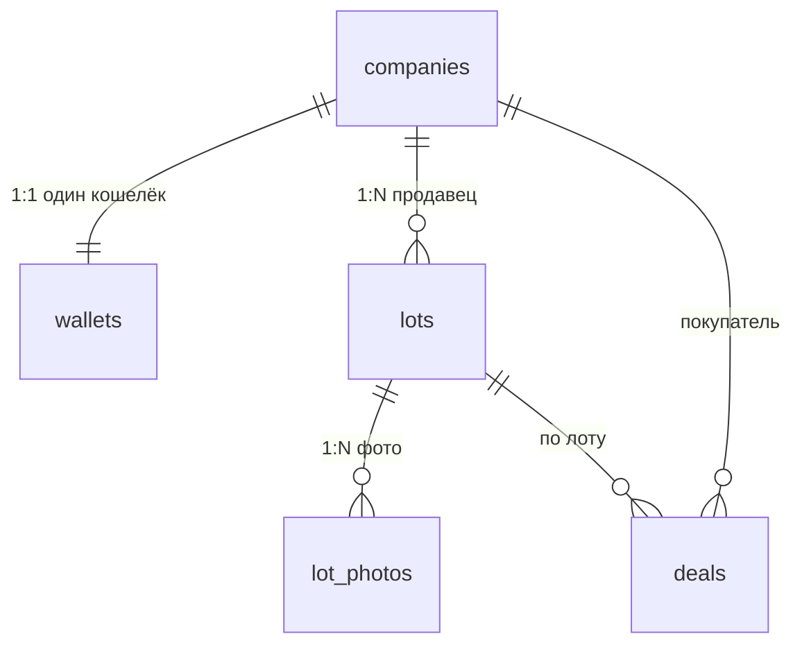

# Базы данных: шпора к интервью

Ответы на 15 вопросов из `tasks/04 - Хранилища данных.md`, в том же порядке, что и в трекере. У каждого вопроса: короткий ответ вслух, объяснение и пример из схемы площадки ([`docs/db/README.md`](../db/README.md)). Диалект — PostgreSQL.

## Оглавление

- [1. SQL или NoSQL](#1-sql-или-nosql)
- [2. Индекс и два его назначения](#2-индекс-и-два-его-назначения)
- [3. ACID](#3-acid)
- [4. Изоляция транзакций и последняя штука](#4-изоляция-транзакций-и-последняя-штука)
- [5. Уровни изоляции в PostgreSQL](#5-уровни-изоляции-в-postgresql)
- [6. Двойное списание денег](#6-двойное-списание-денег)
- [7. Запрос тормозит, хотя индекс есть](#7-запрос-тормозит-хотя-индекс-есть)
- [8. Нормализация и аномалии](#8-нормализация-и-аномалии)
- [9. Первые три нормальные формы](#9-первые-три-нормальные-формы)
- [10. Денормализация и её цена](#10-денормализация-и-её-цена)
- [11. Связи между таблицами](#11-связи-между-таблицами)
- [12. JOIN](#12-join)
- [13. Транзакция: когда её хватает, а когда нужна блокировка](#13-транзакция-когда-её-хватает-а-когда-нужна-блокировка)
- [14. Составной индекс](#14-составной-индекс)
- [15. Частичный индекс](#15-частичный-индекс)
- [Проверь себя](#проверь-себя)
- [Наизусть](#наизусть)

---

## 1. SQL или NoSQL

> По умолчанию я беру PostgreSQL: связи, ограничения целостности и транзакции нужны почти любому бизнесу, а JSONB, полнотекстовый поиск и расширения закрывают многие «NoSQL-задачи». NoSQL выбираю под конкретный паттерн доступа, который реляционная база тянет плохо: огромный поток записей с шардированием по ключу, документы с разной структурой, которые всегда читаются целиком, граф, временные ряды. MongoDB вместо PostgreSQL — когда данные это самостоятельные вложенные документы без жёстких связей между ними и схема часто меняется.

«NoSQL» — не одна технология, а зонтик над разными моделями данных:

| Тип         | Примеры               | Для чего                                                        |
| ----------- | --------------------- | --------------------------------------------------------------- |
| Документная | MongoDB               | вложенные документы разной структуры, читаются целиком по ключу |
| Key-value   | Redis, DynamoDB       | кеш, сессии, счётчики, доступ только по ключу                   |
| Wide-column | Cassandra, ScyllaDB   | очень много записей, шардирование по ключу, простые запросы     |
| Граф        | Neo4j                 | запросы по связям: рекомендации, соцграф                        |
| Time series | TimescaleDB, InfluxDB | метрики и события во времени                                    |

| Критерий    | SQL (PostgreSQL)                                                    | NoSQL                                                                                             |
| ----------- | ------------------------------------------------------------------- | ------------------------------------------------------------------------------------------------- |
| Схема       | задаётся в базе, меняется миграциями                                | обычно гибкая, проверяется приложением                                                            |
| Связи       | внешние ключи, `JOIN`                                               | обычно денормализация: данные кладут так, как читают                                              |
| Гарантии    | ACID-транзакции по многим строкам и таблицам                        | зависит от базы: у MongoDB есть транзакции по нескольким документам, у многих других гарантии уже |
| Целостность | `CHECK`, `UNIQUE`, `FOREIGN KEY` держит сама база                   | как правило, держит код                                                                           |
| Масштаб     | вертикально плюс реплики на чтение; шардирование — отдельная работа | шардирование по ключу обычно заложено в модель                                                    |

**Когда MongoDB вместо PostgreSQL:**

- документы вложенные и разной формы (каталог товаров с разными атрибутами, CMS, профили), читаются и пишутся целиком по одному ключу;
- нет сложных связей и инвариантов между документами, нет денег и остатков;
- схема в начале продукта меняется каждую неделю;
- нужна запись с шардированием «из коробки».

**Когда остаться на PostgreSQL:** деньги, остатки, заказы, любые правила вида «сумма равна» и «не больше, чем осталось». Миф «NoSQL быстрее и масштабируется лучше» неверен вообще: PostgreSQL держит терабайты и десятки тысяч запросов в секунду, а упираются обычно в схему и индексы, а не в тип базы.

**Площадка:** кошельки, сделки и журнал операций — PostgreSQL, потому что нужны транзакции и ограничения. Фото лотов — объектное хранилище S3, в базе метаданные и ключ. Поиск по каталогу с морфологией — OpenSearch как производная копия данных, источник правды остаётся в PostgreSQL.

---

## 2. Индекс и два его назначения

> Индекс — отдельная структура данных, чаще всего B-tree, которая хранит значения колонок и ссылки на строки таблицы. Вместо полного прохода по таблице (`Seq Scan`) база быстро находит нужные строки. Два назначения: ускорение чтения (`WHERE`, `JOIN`, `ORDER BY`) и гарантия уникальности (`UNIQUE`, `PRIMARY KEY`). Цена индекса — место и замедление записи, поэтому индексы создают под реальные запросы и проверяют через `EXPLAIN ANALYZE`.

### Два назначения

1. **Скорость чтения.** `WHERE`, `JOIN`, `ORDER BY`, `GROUP BY`. Поиск по B-tree занимает `O(log N)` вместо `O(N)`.
2. **Целостность.** `UNIQUE`-индекс не даёт записать дубликат, даже когда два запроса приходят одновременно. Так устроены четыре правила площадки: email без учёта регистра, один кошелёк, одно уведомление — одно пополнение, одна цена на момент.

### Виды индексов

| Вид          | Что делает                                                                             |
| ------------ | -------------------------------------------------------------------------------------- |
| Primary key  | уникальный индекс по ключу, `NULL` запрещён                                            |
| Unique       | запрещает дубликаты                                                                    |
| Composite    | индекс по нескольким колонкам `(a, b)`, подробнее в [вопросе 14](#14-составной-индекс) |
| Partial      | только строки, подходящие под `WHERE`, подробнее в [вопросе 15](#15-частичный-индекс)  |
| По выражению | `CREATE INDEX ON companies (lower(email))`                                             |
| Covering     | `CREATE INDEX ON t (a) INCLUDE (b)`: запрос берёт всё из индекса (`Index Only Scan`)   |

Про clustered / non-clustered: в MySQL InnoDB таблица физически хранится в порядке первичного ключа. В PostgreSQL кластерных индексов нет: таблица (heap) лежит отдельно, все индексы вторичные. Команда `CLUSTER` один раз переупорядочивает таблицу по индексу и потом порядок не поддерживает.

### Типы по структуре

| Тип    | Когда использовать                                                     |
| ------ | ---------------------------------------------------------------------- |
| B-tree | равенство, диапазоны, сортировка. По умолчанию                         |
| Hash   | только точное равенство `=`                                            |
| GIN    | массивы, JSONB, полнотекстовый поиск, `pg_trgm`                        |
| GiST   | геоданные, диапазоны и специализированные операторы                    |
| BRIN   | огромные таблицы, где значения коррелируют с физическим порядком строк |

### Примеры

```sql
-- обычный
CREATE INDEX lots_seller_id_idx ON lots (seller_id);

-- уникальный, по выражению: email без учёта регистра
CREATE UNIQUE INDEX companies_email_lower_key ON companies (lower(email));

-- составной
CREATE INDEX wallet_operations_wallet_id_idx ON wallet_operations (wallet_id, id);

-- частичный
CREATE INDEX lots_catalog_idx ON lots (created_at DESC, id DESC) WHERE is_published;
```

### Когда создавать и чем платим

- Колонка часто стоит в `WHERE`, `JOIN`, `ORDER BY`, таблица большая, запрос медленный.
- Нужна уникальность.
- Индекс замедляет `INSERT`, `UPDATE`, `DELETE`, занимает место и память.
- PostgreSQL сам создаёт индексы под `PRIMARY KEY` и `UNIQUE`, но **не** под `FOREIGN KEY`. Колонку внешнего ключа индексируют вручную, иначе `JOIN` по ней и удаление родителя будут сканировать таблицу.
- Индекс по колонке с низкой селективностью (`is_active`) обычно бесполезен целиком, но может пригодиться как частичный.
- Проверять эффект надо планом: `EXPLAIN (ANALYZE, BUFFERS)`.

---

## 3. ACID

> ACID — четыре гарантии транзакции. **A**tomicity: всё или ничего. **C**onsistency: после транзакции не нарушены ограничения и инварианты. **I**solation: параллельные транзакции не мешают друг другу. **D**urability: после `COMMIT` данные не пропадут даже при сбое, в PostgreSQL это журнал WAL. Больше всего вопросов вызывает изоляция: это компромисс между строгостью и скоростью, у него есть уровни, и транзакция сама по себе не защищает от гонок.

| Буква | Что гарантирует                                                 | Как на площадке                                                                             |
| ----- | --------------------------------------------------------------- | ------------------------------------------------------------------------------------------- |
| A     | транзакция выполняется целиком или откатывается целиком         | покупка: остаток, деньги, сделка и журнал записываются вместе                               |
| C     | данные остаются корректными: `CHECK`, `FOREIGN KEY`, `UNIQUE`   | `balance >= 0`, составной внешний ключ сделки, триггер сверки журнала сделки                |
| I     | параллельные транзакции не видят чужие промежуточные результаты | два покупателя на последнюю штуку, см. [вопрос 4](#4-изоляция-транзакций-и-последняя-штука) |
| D     | после `COMMIT` данные переживают сбой питания                   | WAL пишется на диск до подтверждения (`fsync`, `synchronous_commit = on`)                   |

**Нюансы:**

- Consistency в ACID — это «ограничения не нарушены», и половина этого обеспечивается самим приложением. Не путать с consistency из CAP-теоремы: там это согласованность реплик (линеаризуемость).
- Durability можно ослабить: при `synchronous_commit = off` последние транзакции могут пропасть при сбое, зато запись быстрее. Это осознанный компромисс, по умолчанию он выключен.

**Какая буква вызывает больше всего вопросов — Isolation.** Атомарность и долговечность работают без усилий. Изоляция требует выбора уровня и приёмов защиты, потому что при слабой изоляции возникают аномалии:

| Аномалия            | Что происходит                                                                                                                                                             |
| ------------------- | -------------------------------------------------------------------------------------------------------------------------------------------------------------------------- |
| Dirty read          | прочитали данные, которые другая транзакция ещё не подтвердила                                                                                                             |
| Non-repeatable read | повторное чтение той же строки в одной транзакции вернуло другое значение                                                                                                  |
| Phantom read        | повторный запрос по условию вернул другой набор строк                                                                                                                      |
| Lost update         | две транзакции прочитали одно значение и записали результат в **одну и ту же строку**, второе затёрло первое                                                               |
| Write skew          | две транзакции прочитали общие данные, а записали **в разные строки**, и вместе нарушили правило (пример: двое врачей одновременно снялись с дежурства, и на смене никого) |

---

## 4. Изоляция транзакций и последняя штука

> Изоляция определяет, как параллельные транзакции видят изменения друг друга. Два покупателя купили последнюю штуку, потому что транзакция сама по себе не ставит их в очередь. На уровне `READ COMMITTED` обычный `SELECT` ничего не блокирует: оба прочитали `stock = 1`, оба проверили `1 >= 1`, оба записали `stock = 0`. Это потерянное обновление. Лечится атомарным условным `UPDATE`, `SELECT ... FOR UPDATE`, оптимистичной блокировкой с версией или уровнем `SERIALIZABLE` с повтором.

Isolation — буква **I** из ACID: правило, при котором одновременные транзакции дают результат, как будто шли по очереди (полностью — только на `SERIALIZABLE`).

### Почему транзакция не спасла

| Время | Транзакция A          | Транзакция B          |
| ----- | --------------------- | --------------------- |
| T1    | `SELECT stock` → 1    |                       |
| T2    |                       | `SELECT stock` → 1    |
| T3    | проверяет `stock > 0` | проверяет `stock > 0` |
| T4    | `UPDATE stock = 0`    |                       |
| T5    | `COMMIT`              |                       |
| T6    |                       | `UPDATE stock = 0`    |
| T7    |                       | `COMMIT`              |

Обе покупки подтверждены, хотя штука была одна. Транзакция гарантирует атомарность и видимость только закоммиченного, но не запрещает двум транзакциям прочитать **одно и то же** значение и принять решение по устаревшим данным. Это гонка «прочитал — подумал — записал» (read-modify-write).

`CHECK (stock >= 0)` здесь молчит: записан `0`, а не `-1`. Если бы приложение писало `stock = stock - 1`, второй `UPDATE` дождался бы первого, получил `-1` и упал на `CHECK`. Но тогда покупка падает ошибкой правила, а не понятным отказом.

### Как решить

**1. Атомарный условный `UPDATE`** (лучший вариант для простого счётчика):

```sql
UPDATE products
   SET stock = stock - 1
 WHERE id = 123 AND stock > 0
RETURNING id;
```

`UPDATE` блокирует строку, а транзакция, дождавшаяся блокировки, перечитывает последнюю закоммиченную версию и заново проверяет `WHERE`. Первый покупатель получает строку, второй получает 0 строк — отказ.

**2. Пессимистичная блокировка `SELECT ... FOR UPDATE`:**

```sql
BEGIN;
SELECT stock FROM products WHERE id = 123 FOR UPDATE;
-- в коде: stock > 0, иначе ROLLBACK и отказ
UPDATE products SET stock = stock - 1 WHERE id = 123;
COMMIT;
```

Второй покупатель ждёт на `SELECT ... FOR UPDATE`, потом видит актуальный остаток. Подходит, когда решение зависит от нескольких строк или логики.

**3. Оптимистичная блокировка (версия):**

```sql
UPDATE products
   SET stock = stock - 1, version = version + 1
 WHERE id = 123 AND version = 5 AND stock > 0;
```

Если запись успели изменить, версия не совпадёт, затронуто 0 строк. Приложение проверяет `rowCount` и повторяет или отказывает.

**4. `SERIALIZABLE`:** PostgreSQL сам находит опасные зависимости и отменяет одну транзакцию с ошибкой `40001`. Приложение повторяет транзакцию целиком, см. [вопрос 5](#5-уровни-изоляции-в-postgresql).

**На площадке:** покупка идёт на `READ COMMITTED` с `FOR UPDATE` на лот и оба кошелька. Тест без блокировки показывает две сделки на одну штуку, с блокировкой — одну.

**Запомнить:** `BEGIN` и `COMMIT` сами не защищают от гонок. Если покупка пишет заказ, остаток и платёж, их согласует транзакция. Если при этом вызывается внешний платёжный сервис, нужны ещё идемпотентность и обработка сбоев.

---

## 5. Уровни изоляции в PostgreSQL

> В стандарте SQL четыре уровня, в PostgreSQL три разных поведения: `READ UNCOMMITTED` работает как `READ COMMITTED`. По умолчанию стоит `READ COMMITTED`. Если поднять уровень до `SERIALIZABLE`, в коде появляется повтор: PostgreSQL может отменить транзакцию с ошибкой `40001`, и приложение обязано повторить её целиком — с ограничением числа попыток, паузой с jitter и без побочных эффектов внутри транзакции.

| Уровень          | Что видит транзакция                                                      |
| ---------------- | ------------------------------------------------------------------------- |
| Read Uncommitted | в PostgreSQL ведёт себя как Read Committed, грязного чтения нет           |
| Read Committed   | **по умолчанию.** Каждая команда видит данные, закоммиченные до её начала |
| Repeatable Read  | один снимок на всю транзакцию (snapshot isolation)                        |
| Serializable     | результат как при последовательном выполнении (SSI)                       |

Какие аномалии возможны:

| Уровень         | Dirty read | Non-repeatable | Phantom    | Lost update                         | Write skew |
| --------------- | ---------- | -------------- | ---------- | ----------------------------------- | ---------- |
| Read Committed  | нет        | да             | да         | да, если читаешь и пишешь раздельно | да         |
| Repeatable Read | нет        | нет            | нет (в PG) | нет: транзакция падает с `40001`    | да         |
| Serializable    | нет        | нет            | нет        | нет                                 | нет        |

Поэтому на `REPEATABLE READ` в PostgreSQL второй покупатель из [вопроса 4](#4-изоляция-транзакций-и-последняя-штука) получил бы `could not serialize access due to concurrent update`, а не тихую двойную продажу. Повтор нужен и там.

### Что изменится в коде при `SERIALIZABLE`

PostgreSQL использует SSI (Serializable Snapshot Isolation): транзакции идут параллельно, без блокировок на чтение, но база следит за опасными зависимостями чтения и записи и отменяет «лишнюю». Ошибка может прийти и на `COMMIT`:

```text
SQLSTATE 40001
could not serialize access due to read/write dependencies among transactions
```

1. **Повтор всей транзакции**, а не последнего запроса.
2. **Ограничение попыток** (3–5) и экспоненциальная пауза с jitter.
3. **Контролируемая ошибка** (`503` или `409`), когда попытки кончились.
4. **Транзакция безопасна для повтора:** внутри нет писем, вызовов платёжного API; для клиента нужен ключ идемпотентности.
5. **Мониторинг** числа serialization failures.

```ts
// pool (pg.Pool) и sleep (пауза в мс) определены в приложении
async function withSerializableRetry<T>(
  fn: (client: PoolClient) => Promise<T>,
  attempts = 3,
): Promise<T> {
  for (let attempt = 1; ; attempt++) {
    const client = await pool.connect();
    try {
      await client.query('BEGIN ISOLATION LEVEL SERIALIZABLE');
      const result = await fn(client);
      await client.query('COMMIT'); // 40001 может прийти и здесь
      return result;
    } catch (error) {
      await client.query('ROLLBACK');
      const code = (error as { code?: string }).code;
      if ((code !== '40001' && code !== '40P01') || attempt >= attempts)
        throw error;
      await sleep(50 * 2 ** (attempt - 1) + Math.random() * 100); // backoff + jitter
    } finally {
      client.release();
    }
  }
}
```

### Недостатки `SERIALIZABLE`

- Больше откатов при высокой конкуренции за одни и те же данные, в том числе **ложных срабатываний**, когда транзакции на деле друг другу не мешали.
- Накладные расходы на отслеживание зависимостей.
- Выше задержка из-за повторов.
- Серьёзное ограничение на побочные эффекты внутри транзакции.

`SERIALIZABLE` не значит, что PostgreSQL выполняет транзакции по очереди. Они идут параллельно, а база отменяет те, которые нарушили бы эквивалентность последовательному порядку. В приведённом примере с остатком хватило бы и атомарного условного `UPDATE` на `READ COMMITTED`; `SERIALIZABLE` нужен, когда инвариант охватывает много строк и блокировать заранее нечего.

---

## 6. Двойное списание денег

> Без защиты случится потерянное обновление: обе транзакции прочитают один баланс, каждая посчитает остаток в коде и запишет; вторая затрёт первую, деньги «появятся из воздуха», а проверка «хватает ли денег» пройдёт у обоих. Защита: атомарный условный `UPDATE ... WHERE balance >= X`, пессимистичная блокировка `SELECT ... FOR UPDATE`, оптимистичная блокировка с версией. Для списания с одного счёта по умолчанию атомарный `UPDATE`. `FOR UPDATE` — когда решение зависит от нескольких строк или логики. Версия — при низкой конкуренции и когда чтение и запись разнесены по времени.

### Что пойдёт не так

Баланс 1000. Пользователь A списывает 400, пользователь B — 700.

1. A читает баланс: 1000.
2. B читает баланс: 1000.
3. A считает в коде 1000 − 400 = 600 и пишет `balance = 600`.
4. B считает 1000 − 700 = 300 и пишет `balance = 300`.

Баланс стал 300. Выплачено 1100, а со счёта ушло только 700, то есть 400 потерялись. Правильный исход при последовательном выполнении: второй платёж отклонён (600 < 700). `CHECK (balance >= 0)` не поможет, потому что записанное 300 корректно само по себе. Если бы писали `balance = balance - 700`, получилось бы −100 и сработал бы `CHECK` — ошибка, а не понятный отказ.

### Способы защиты

**1. Атомарный условный `UPDATE`.** Проверка и списание в одном операторе:

```sql
UPDATE wallets
   SET balance = balance - $2
 WHERE id = $1 AND balance >= $2
RETURNING balance;
-- 0 строк: денег не хватило
```

`UPDATE` берёт блокировку строки; конкурент ждёт и затем перечитывает последнюю закоммиченную версию, проверяя `WHERE` заново. 0 строк значит только «не хватает денег», а не «баланс поменялся».

**2. Пессимистичная блокировка:**

```sql
BEGIN;
SELECT balance FROM wallets WHERE id = $1 FOR UPDATE; -- второй ждёт здесь
-- в коде: balance >= amount, иначе ROLLBACK и отказ
UPDATE wallets SET balance = balance - $2 WHERE id = $1;
COMMIT;
```

**3. Оптимистичная блокировка:**

```sql
SELECT balance, version FROM wallets WHERE id = $1;   -- balance = 1000, version = 5

UPDATE wallets
   SET balance = balance - 400, version = version + 1
 WHERE id = $1 AND version = 5;
-- 0 строк: кто-то успел раньше, перечитать и повторить либо отказать
```

Версию можно заменить на `updated_at`, но точность времени ненадёжна, колонка `version` проще.

Ещё один вариант — `SERIALIZABLE` с повтором, см. [вопрос 5](#5-уровни-изоляции-в-postgresql).

### Когда какой брать

| Способ                 | Когда брать                                                                                                                                | Цена                                                                                                                    |
| ---------------------- | ------------------------------------------------------------------------------------------------------------------------------------------ | ----------------------------------------------------------------------------------------------------------------------- |
| Атомарный `UPDATE`     | **по умолчанию** для баланса, остатка, счётчика: условие выражается в `WHERE`. При высокой конкуренции просто ждёт в очереди, повторов нет | причину отказа надо выяснять отдельным чтением; не годится, если решение зависит от нескольких строк или внешних данных |
| `FOR UPDATE`           | прочитал, проверил по нескольким строкам, записал: лот и два кошелька, нужны точные коды отказа                                            | очередь на строке; транзакция должна быть короткой; единый порядок блокировок, иначе дедлок; без внешних вызовов внутри |
| Оптимистичная (версия) | низкая конкуренция; между чтением и записью проходит время (пользователь редактирует форму), держать блокировку нельзя                     | конфликт превращается в ошибку и повтор; при высокой конкуренции повторов лавина                                        |
| `SERIALIZABLE`         | инвариант по набору строк, блокировать заранее нечего                                                                                      | повтор всей транзакции, ложные срабатывания                                                                             |

**Дедлоки:** причина — разный порядок блокировок (A затем B против B затем A), а не длительность. Защита — единый порядок: на площадке лот, затем оба кошелька одним запросом `ORDER BY id`.

**На площадке:** покупка берёт `FOR UPDATE` на лот и оба кошелька, потому что решение зависит от трёх строк и нужны точные коды `OUT_OF_STOCK` и `INSUFFICIENT_FUNDS`. `CHECK (balance >= 0)` остаётся последним рубежом. Пополнению блокировка не нужна: там нет «прочитал — записал», триггер делает `balance = balance + amount` атомарно.

---

## 7. Запрос тормозит, хотя индекс есть

> Сначала смотрю план, а не гадаю: `EXPLAIN (ANALYZE, BUFFERS)` на реальных параметрах. Ищу самый дорогой узел, проверяю, используется ли индекс, сравниваю оценку строк с фактом. Типичные причины: индекс не подходит под запрос (порядок колонок, функция над колонкой, ведущий `%` в `LIKE`, разные типы), планировщик считает `Seq Scan` дешевле, устарела статистика, раздутая таблица, лишний поход в таблицу за строками, медленная не поисковая часть (сортировка на диске, `OFFSET`, N+1) или проблема среды (блокировки). Исправляю запрос или индекс, создаю через `CREATE INDEX CONCURRENTLY` и перемеряю.

**Первым делом план:**

```sql
EXPLAIN (ANALYZE, BUFFERS) SELECT ...;
```

`ANALYZE` **реально выполняет** запрос. Для `UPDATE` и `DELETE` оборачивай в `BEGIN; ... ROLLBACK;`.

Что смотреть:

- какой узел занимает больше всего времени (`actual time`);
- есть ли индекс вообще: `Index Scan`, `Index Only Scan`, `Bitmap Heap Scan` или `Seq Scan`;
- расхождение `rows` (оценка) и `actual rows` (факт): в десятки раз значит, что планировщик ошибся из-за статистики;
- `Buffers: shared read` (с диска) против `shared hit` (из кеша);
- `Rows Removed by Filter`: индекс нашёл много строк, а фильтр отбросил почти все.

### Частые причины

**1. Индекс не подходит под запрос**

- Составной индекс `(a, b)`, а фильтр только по `b`.
- Порядок колонок не совпадает с условием и сортировкой. Для `WHERE seller_id = ? ORDER BY created_at DESC LIMIT 20` нужен `(seller_id, created_at DESC)`.

**2. Условие обходит индекс**

- Функция над колонкой: `WHERE lower(email) = ...`, `WHERE date(created_at) = ...`. Нужен индекс по выражению либо условие переписывают диапазоном по `created_at`.
- Несовпадение типов, из-за которого колонка приводится к другому типу: `bigint`-колонка против `numeric`-параметра, `timestamp` против `timestamptz`. (Литерал `'123'` для колонки `integer` проблемой не является: он приводится к типу колонки. А `varchar = integer` в PostgreSQL даёт ошибку, а не молчаливый пропуск индекса — это поведение MySQL.)
- `LIKE '%abc'` с ведущим `%`: B-tree не поможет, нужен `pg_trgm` и GIN.
- `LIKE 'abc%'` на базе с локалью, отличной от `C`: нужен индекс с `text_pattern_ops`.
- `OR` по разным колонкам, `NOT IN`, `!=` часто не используют индекс (для `OR` возможен `BitmapOr` из двух индексов).

**3. Планировщик решил, что `Seq Scan` дешевле**

- Условие возвращает большую долю таблицы (грубо 10–20% и выше): последовательное чтение быстрее. Это нормально.
- Таблица маленькая.
- Устарела статистика: `ANALYZE table_name;`. При сильном перекосе данных `ALTER TABLE ... ALTER COLUMN ... SET STATISTICS 500`.

**4. Раздутие таблицы или индекса (bloat)**

Много `UPDATE` и `DELETE`, давно не работал autovacuum. Смотрю `pg_stat_user_tables` (`n_dead_tup`, `last_autovacuum`). Помогают `VACUUM (ANALYZE)`, настройка autovacuum, при сильном раздутии `REINDEX CONCURRENTLY`.

**5. За каждой найденной строкой поход в таблицу**

Много `Heap Fetches` — случайное чтение. Покрывающий индекс `INCLUDE (...)` даст `Index Only Scan`. Нужен свежий visibility map, то есть vacuum.

**6. Медленна не сама выборка**

- `Sort` на диске (`Sort Method: external merge`): индекс под `ORDER BY` или больше `work_mem`.
- `JOIN` без индекса по внешнему ключу на другой стороне: PostgreSQL его не создаёт.
- Большой `OFFSET`: база читает и выбрасывает пропущенные строки. Заменить на keyset-пагинацию `WHERE id < $last ORDER BY id DESC LIMIT 20`.
- `COUNT(*)` по большой таблице.
- N+1 на стороне приложения: запрос быстрый, но их тысяча.

**7. Проблема среды**

- Ожидание блокировок, долгие висящие транзакции: `pg_stat_activity`, `wait_event`.
- Мало памяти, холодный кеш.
- Параметризованный запрос получил generic plan, который хуже конкретного (`plan_cache_mode`).

### Порядок действий

1. Воспроизвести запрос с реальными параметрами на данных, похожих на прод.
2. `EXPLAIN (ANALYZE, BUFFERS)`, найти самый дорогой узел.
3. Сверить оценку и факт строк; при расхождении `ANALYZE`.
4. Проверить индекс: колонки, порядок, выражение.
5. Исправить запрос или индекс. Индекс создавать через `CREATE INDEX CONCURRENTLY`, чтобы не блокировать запись.
6. Перемерить планом и временем, а не на глаз.
7. Для постоянного контроля включить `pg_stat_statements` и `auto_explain` (порог `auto_explain.log_min_duration`).

**На площадке:** каталог `GET /lots` берёт опубликованные лоты страницами по курсору. Под него частичный составной индекс `lots (created_at DESC, id DESC) WHERE is_published`, запрос повторяет то же условие и ту же сортировку, поэтому идёт по индексу без отдельной сортировки.

---

## 8. Нормализация и аномалии

> Нормализация — разбиение данных на связанные таблицы так, чтобы каждый факт хранился в одном месте. Зачем: убрать избыточность, чтобы данные не расходились сами с собой. Защищает от трёх аномалий: вставки (нельзя добавить товар без заказа), обновления (email клиента нужно менять во многих строках) и удаления (вместе с последним заказом пропадают данные о клиенте и товаре). На практике доводят до третьей нормальной формы.

### Зачем

1. **Нет избыточности:** значение не размножено по строкам, меньше места, проще поддержка.
2. **Целостность:** изменение факта делается в одном месте, данные не расходятся.
3. **Нет аномалий модификации.**

### Три аномалии на примере

Ненормализованная таблица заказов:

| order_id | client_name | client_email  | product_name | product_price |
| -------- | ----------- | ------------- | ------------ | ------------- |
| 1        | Иван        | ivan@test.com | Ноутбук      | 1000          |
| 2        | Иван        | ivan@test.com | Мышь         | 20            |
| 3        | Ольга       | olga@test.com | Клавиатура   | 50            |

- **Аномалия вставки.** Нельзя добавить товар «Монитор», пока его никто не заказал: ключ `order_id` не может быть пустым. С нормализацией товар создаётся в `products`.
- **Аномалия обновления.** Иван сменил email: надо обновить все его строки. Обновили заказ 1, на заказе 2 сбой — в базе два разных email одного клиента. С нормализацией email лежит в одной строке `clients`.
- **Аномалия удаления.** Ольга отменила единственный заказ 3, строку удалили — потеряны и клиент Ольга, и товар «Клавиатура» с ценой 50. С нормализацией удаление заказа не трогает `clients` и `products`.

### Нормальные формы коротко

- **1НФ:** значения атомарны, нет повторяющихся групп (список телефонов в одной ячейке — нарушение).
- **2НФ:** 1НФ, и каждый неключевой атрибут зависит от **всего** составного ключа.
- **3НФ:** 2НФ, и нет транзитивных зависимостей: неключевые атрибуты зависят только от ключа, а не друг от друга.

Подробно — в [вопросе 9](#9-первые-три-нормальные-формы). Отступления от нормализации — в [вопросе 10](#10-денормализация-и-её-цена).

---

## 9. Первые три нормальные формы

> Мнемоника: каждый неключевой атрибут зависит от ключа (1НФ), от всего ключа (2НФ) и ни от чего, кроме ключа (3НФ). 1НФ — одно значение в ячейке. 2НФ — нет зависимости от части составного ключа. 3НФ — нет зависимости одного неключевого атрибута от другого. Третьей обычно хватает, потому что она убирает большинство аномалий вставки, обновления и удаления, а следующие формы нужны для редких зависимостей и сильно усложняют схему.

### 1НФ: одно значение в ячейке

| order_id | customer | products        |
| -------- | -------- | --------------- |
| 1        | Alex     | iPhone, MacBook |
| 2        | Bob      | iPad            |

Список товаров в одной ячейке: его не найти, не обновить и не удалить по элементу. Приводим к 1НФ:

| order_id | customer | product |
| -------- | -------- | ------- |
| 1        | Alex     | iPhone  |
| 1        | Alex     | MacBook |
| 2        | Bob      | iPad    |

Ключ — `(order_id, product)`.

### 2НФ: нет зависимости от части составного ключа

Таблица с ключом `(order_id, product_id)`:

| order_id | product_id | customer | product_name | quantity |
| -------- | ---------- | -------- | ------------ | -------- |
| 1        | 101        | Alex     | iPhone       | 2        |
| 1        | 102        | Alex     | MacBook      | 1        |
| 2        | 101        | Bob      | iPhone       | 1        |

`customer` зависит только от `order_id`, `product_name` — только от `product_id` (частичные зависимости), `quantity` — от обоих. Делим на `orders (order_id, customer)`, `products (product_id, product_name)` и `order_items (order_id, product_id, quantity)`.

2НФ имеет смысл только для составных ключей. Если у таблицы одноколоночный ключ (`id`), она в 2НФ автоматически.

### 3НФ: нет транзитивных зависимостей

| order_id | customer_id | customer_name | customer_phone |
| -------- | ----------- | ------------- | -------------- |
| 1        | 10          | Alex          | 111            |
| 2        | 10          | Alex          | 111            |
| 3        | 20          | Bob           | 222            |

`order_id → customer_id → customer_phone`: телефон зависит от клиента, а не от заказа. Сменит телефон — менять в нескольких заказах. Выносим `customers (id, name, phone)`, в заказе остаётся `customer_id`.

### Почему обычно хватает третьей

3НФ убирает большинство аномалий вставки, обновления и удаления и сохраняет схему понятной для запросов. Более строгие формы нужны для специфических зависимостей:

- **BCNF** — усиление 3НФ: каждая зависимость должна идти от возможного ключа. Расходится с 3НФ только на таблицах с несколькими пересекающимися возможными ключами.
- **4НФ** — независимые многозначные факты не хранят в одной таблице. На площадке: у лота несколько фото и несколько способов доставки, поэтому `lot_photos` и `lot_delivery_methods` — две таблицы. В одной таблице «лот, фото, способ доставки» строк стало бы произведение, а не сумма.

Но и 3НФ не гарантирует отсутствие любых аномалий.

| Форма | Правило                       | Что устраняет                         |
| ----- | ----------------------------- | ------------------------------------- |
| 1НФ   | одно значение в ячейке        | списки в ячейке, повторяющиеся группы |
| 2НФ   | нет частичных зависимостей    | зависимость от части составного ключа |
| 3НФ   | нет транзитивных зависимостей | зависимость через неключевой атрибут  |

---

## 10. Денормализация и её цена

> От нормализации отступают осознанно, когда чтение важнее записи или когда факт надо зафиксировать на момент времени: дорогие `JOIN` и агрегаты на горячем пути, хранимые итоги (баланс, счётчики), аналитика (витрины, звезда). Платят тем, что копии могут разойтись: нужно следить за согласованностью, запись становится сложнее, места нужно больше. Поэтому отступление делают с комментарием «зачем», а расхождение закрывают базой: триггером, составным внешним ключом, `GENERATED`, сверочным запросом.

### Когда отступают

- **Дорогое чтение:** `JOIN` пяти-десяти таблиц или `SUM` по миллионам строк на каждый запрос страницы.
- **Хранимый итог:** баланс вместо суммы журнала, счётчик вместо `COUNT(*)`.
- **Аналитика и отчёты:** плоские витрины и схема «звезда», материализованные представления.
- **Копия для поиска или кеша:** данные в OpenSearch, Redis.

### Чем платят

- **Рассогласование:** копия и источник расходятся после сбоя или ручной правки.
- **Сложнее запись:** одно изменение пишет в несколько мест, нужна транзакция.
- **Больше места и работы** на `INSERT`/`UPDATE`.
- **Больше правил**, которые надо держать: кто и как обновляет копию, как проверить сходимость.

### Как удержать цену под контролем

1. Один писатель копии (триггер или одна транзакция), не «как получится».
2. Ограничения базы, которые не дают копии разойтись.
3. Журнал как источник правды плюс сверочный запрос.
4. Комментарий в схеме: что продублировано и зачем.

### Примеры с площадки

| Что                                   | Почему отступление                                           | Чем удержано                                                                             |
| ------------------------------------- | ------------------------------------------------------------ | ---------------------------------------------------------------------------------------- |
| `wallets.balance`                     | чтение баланса не суммирует журнал; строку можно блокировать | меняет только триггер по журналу; сверка `balance = SUM(amount)`; `CHECK (balance >= 0)` |
| `lots.price`, `stock`, `is_published` | текущее состояние для каталога, `CHECK` и блокировки         | отложенные триггеры при `COMMIT` сверяют лот с последней строкой истории                 |
| `deals.seller_id`                     | сделка читается без `JOIN` с лотом, список продаж по индексу | составной внешний ключ `(lot_id, seller_id) → lots (id, seller_id)`                      |
| `deals.total`                         | сумма нужна журналу и сверке                                 | `GENERATED ALWAYS AS (quantity * unit_price) STORED`                                     |

`deals.unit_price` — **не** денормализация: цена лота меняется, а сделка — факт «купили по 250 000», это отдельное знание на момент сделки.

---

## 11. Связи между таблицами

> Три вида: «один к одному», «один ко многим» и «многие ко многим». 1:1 — внешний ключ с `UNIQUE` (у компании один кошелёк). 1:N — внешний ключ на стороне «многих» (у продавца много лотов, у лота много фото). M:N невозможна напрямую в реляционной базе, её раскладывают на две связи 1:N через связующую таблицу с двумя внешними ключами (сделки связывают покупателей и лоты).

| Связь | Как реализуется                                                 |
| ----- | --------------------------------------------------------------- |
| 1:1   | внешний ключ плюс `UNIQUE` на нём (или общий первичный ключ)    |
| 1:N   | внешний ключ в таблице «многих»                                 |
| M:N   | связующая таблица с двумя внешними ключами и уникальностью пары |



На схеме площадки:

- **1:1:** `companies` — `wallets`. `wallets.company_id` с `UNIQUE` не даёт завести второй кошелёк. «Ровно один» (не ноль) добавлен отложенным триггером, проверяющим наличие кошелька при `COMMIT`: одного `UNIQUE` для этого мало.
- **1:N:** `companies` → `lots` (`lots.seller_id`), `lots` → `lot_photos`, `wallets` → `wallet_operations`. Внешний ключ индексируют вручную: `lots_seller_id_idx`.
- **M:N:** покупатель — лот. Компания покупает много лотов, лот покупают много компаний, поэтому связь выражена таблицей `deals` с двумя внешними ключами и своими атрибутами (количество, цена, время). Ещё один пример — `lot_delivery_methods (lot_id, method)` с составным первичным ключом: лот и способ доставки из ограниченного набора.

Связующая таблица часто становится полноценной сущностью со своими атрибутами: у сделки есть количество, цена, время и свой `id`.

Нюансы: `ON DELETE CASCADE` удобен для зависимых данных (фото лота), но для финансовых таблиц (сделки, журнал) удаление запрещают, и данные только дописывают.

---

## 12. JOIN

> `INNER JOIN` — только пары, у которых есть совпадение в обеих таблицах. `LEFT JOIN` — все строки левой таблицы плюс совпадения справа, а где пары нет — `NULL`. `RIGHT JOIN` — то же зеркально, на практике его заменяют на `LEFT`, поменяв таблицы местами. `FULL OUTER JOIN` — все строки обеих таблиц, несовпавшие дополняются `NULL`. Беру `INNER`, когда нужны только связанные данные; `LEFT`, когда нужны все строки главной таблицы даже без пары; `FULL`, когда сверяю два набора.

Пример на данных: `companies` (A, B, C) и `deals` (две сделки у A, одна у B; у C сделок нет).

| JOIN         | Что возвращает                                 | Результат на примере                   | Когда брать                    |
| ------------ | ---------------------------------------------- | -------------------------------------- | ------------------------------ |
| `INNER`      | только пары с совпадением                      | A, A, B                                | нужны только связанные данные  |
| `LEFT`       | все слева, справа `NULL`, если пары нет        | A, A, B, C (у C сделка `NULL`)         | все компании, даже без покупок |
| `RIGHT`      | все справа, слева `NULL`, если пары нет        | как `LEFT` с переставленными таблицами | почти не используется          |
| `FULL OUTER` | все строки обеих, несовпавшие дополнены `NULL` | A, A, B, C (и строки справа без пары)  | сверка двух наборов            |
| `CROSS`      | все комбинации (произведение)                  | N × M строк                            | генерация сочетаний, редко     |

```sql
-- все компании и число их покупок, включая компании без покупок
SELECT c.id, count(d.id) AS purchases
  FROM companies c
  LEFT JOIN deals d ON d.buyer_id = c.id
 GROUP BY c.id;

-- компании, у которых нет ни одной покупки (anti-join)
SELECT c.id
  FROM companies c
  LEFT JOIN deals d ON d.buyer_id = c.id
 WHERE d.id IS NULL;

-- сверка баланса с журналом: кошельки без операций тоже нужны
SELECT w.id, w.balance, coalesce(sum(o.amount), 0) AS journal
  FROM wallets w
  LEFT JOIN wallet_operations o ON o.wallet_id = w.id
 GROUP BY w.id;
```

**Ловушки:**

- Условие на правую таблицу в `WHERE` превращает `LEFT JOIN` в `INNER`: строки с `NULL` отбрасываются. Условие по правой таблице, которое не должно убивать левые строки, кладут в `ON`.
- `count(d.id)` считает только непустые, `count(*)` посчитает и «пустую» строку левой таблицы.
- `JOIN` по неиндексированному внешнему ключу делает `Seq Scan`: колонку индексируют вручную.

---

## 13. Транзакция: когда её хватает, а когда нужна блокировка

> Транзакция — группа операций, которые выполняются как одно целое: либо все (`COMMIT`), либо ни одной (`ROLLBACK`); она даёт атомарность, согласованность, изоляцию и долговечность. Транзакции хватает, когда нужно записать несколько вещей вместе и конфликтов «прочитал — записал» нет: пополнение кошелька, смена цены. Нужна ещё и блокировка, когда решение принимается по прочитанным данным, которые за это время может изменить другой: покупка — проверка остатка и денег, потом запись.

### Что это

```sql
BEGIN;
-- операции
COMMIT;      -- зафиксировать
-- или
ROLLBACK;    -- отменить всё
```

Без явного `BEGIN` каждая команда идёт в своей неявной транзакции. В PostgreSQL даже DDL (`ALTER TABLE`, `CREATE INDEX`, кроме `CONCURRENTLY`) транзакционный. Если команда внутри транзакции упала, вся транзакция считается проваленной: до `ROLLBACK` любая команда вернёт `current transaction is aborted`. Для частичного отката есть `SAVEPOINT`.

### Операция, которой хватает транзакции

**Пополнение кошелька.** Вставка строки в журнал и увеличение баланса должны произойти вместе. Здесь нет «прочитал, подумал, записал»: код только вставляет строку, а баланс прибавляет триггер оператором `balance = balance + amount`. PostgreSQL блокирует строку кошелька на время этого `UPDATE`, два пополнения идут по очереди, обе суммы учитываются. Единственная опасность — повтор уведомления, и её закрывает уникальный индекс, а не блокировка.

**Смена цены.** Новая цена лота и строка в истории цены появляются вместе. Одиночный `UPDATE` сам берёт блокировку строки.

### Операция, которой нужна ещё и блокировка

**Покупка.** Читаем лот и кошельки, проверяем остаток и деньги, пишем остаток, сделку, журнал. Без блокировки две покупки прочитают одну штуку и обе пройдут проверку. Решение: `SELECT ... FOR UPDATE` на лот и оба кошелька (кошельки одним запросом `ORDER BY id`, чтобы не получить дедлок).

| Операция            | Транзакция | Блокировка                        | Почему                                                              |
| ------------------- | ---------- | --------------------------------- | ------------------------------------------------------------------- |
| Пополнение кошелька | да         | нет                               | запись всё-или-ничего; нет чтения-решения; повтор отсекает `UNIQUE` |
| Смена цены          | да         | нет явной                         | цена и история вместе; `UPDATE` сам блокирует строку                |
| Покупка             | да         | да, `FOR UPDATE` лота и кошельков | прочитал, проверил, записал: нужно запретить параллельное изменение |

### Чего не делать

- Держать транзакцию открытой во время вызова внешнего API или ожидания пользователя: блокировки и соединение заняты, настоящая причина зависаний.
- Забывать `ROLLBACK`/`release` в `finally`: соединение остаётся в состоянии `idle in transaction`.
- Делать транзакцию длиннее необходимого: на площадке заданы `lock_timeout`, `statement_timeout` и `idle_in_transaction_session_timeout`.

---

## 14. Составной индекс

> Составной индекс — индекс по нескольким колонкам, например `(wallet_id, id)`. Он сортирует сначала по первой колонке, внутри по второй и так далее, поэтому работает как «телефонная книга»: эффективен по префиксу `(a)` и `(a, b)`, но обычно не помогает при фильтре только по `b`. Порядок колонок важен: сначала колонки с равенством, потом диапазон или сортировка. Один составной индекс обычно лучше двух одиночных. На площадке он нужен для журнала кошелька, каталога и для правил уникальности по паре колонок.

### Правило левого префикса

Индекс `(a, b)` хранится как сортировка по `a`, внутри — по `b`.

| Запрос                                      | Использует индекс `(a, b)`?                                                                    |
| ------------------------------------------- | ---------------------------------------------------------------------------------------------- |
| `WHERE a = 1`                               | да                                                                                             |
| `WHERE a = 1 AND b = 2`                     | да, идеально                                                                                   |
| `WHERE a = 1 AND b > 5`                     | да: равенство по `a`, диапазон по `b`                                                          |
| `WHERE b = 2`                               | обычно нет или неэффективно (в PostgreSQL 18 есть skip scan, но рассчитывать на него не стоит) |
| `WHERE a > 1 AND b = 2`                     | частично: диапазон по `a`, `b` проверяется внутри диапазона                                    |
| `ORDER BY a, b` / `ORDER BY a DESC, b DESC` | да, индекс отдаёт нужный порядок (B-tree читается и назад)                                     |
| `ORDER BY a, b DESC`                        | нужен индекс `(a, b DESC)`: порядок должен совпасть целиком                                    |

**Как выбрать порядок колонок:** сначала колонки с условием равенства, затем колонка с диапазоном или сортировкой. Для `WHERE seller_id = ? AND created_at > ?` — `(seller_id, created_at)`. Селективность важна, но не главное: порядок диктуют запросы.

### Где нужен на площадке

```sql
-- журнал одного кошелька в порядке вставки: WHERE wallet_id = ? ORDER BY id
CREATE INDEX wallet_operations_wallet_id_idx ON wallet_operations (wallet_id, id);

-- каталог с курсорной пагинацией: ORDER BY created_at DESC, id DESC
CREATE INDEX lots_catalog_idx ON lots (created_at DESC, id DESC) WHERE is_published;

-- правило «одна запись истории цены на лот и момент»
ALTER TABLE lot_price_history ADD CONSTRAINT lot_price_history_lot_id_valid_from_key
  UNIQUE (lot_id, valid_from);
```

Составной `UNIQUE` бывает и ради целостности: пара `(lot_id, valid_from)` уникальна, хотя каждая колонка по отдельности повторяется. Составной внешний ключ `(lot_id, seller_id) → lots (id, seller_id)` в `deals` требует в `lots` составного `UNIQUE (id, seller_id)`.

### Цена и ограничения

- Каждый индекс замедляет запись и занимает место: не создавай индекс «на всякий случай».
- Индекс `(a, b)` уже покрывает `(a)`: отдельный индекс по `a` лишний.
- Два одиночных индекса планировщик иногда объединяет через `BitmapAnd`, но один составной обычно быстрее.
- Покрывающая версия: `(a, b) INCLUDE (c)` позволит `Index Only Scan`.

---

## 15. Частичный индекс

> Частичный индекс строится только по строкам, подходящим под условие `WHERE`: он меньше, дешевле в записи и может держать уникальность лишь на подмножестве строк. «Одно банковское уведомление — одно пополнение» закрывается уникальным частичным индексом по `bank_notification_id` с условием `WHERE bank_notification_id IS NOT NULL`: номер есть только у пополнений. Повтор уведомления даёт нарушение уникальности, приложение ловит `23505` и отвечает `409`, а не проверяет заранее.

```sql
CREATE UNIQUE INDEX wallet_operations_bank_notification_key
    ON wallet_operations (bank_notification_id)
 WHERE bank_notification_id IS NOT NULL;
```

**Что это даёт на площадке:**

- Номер уведомления заполнен только у `deposit`; у покупок и продаж он `NULL`. Индекс содержит только пополнения, а не весь журнал.
- Индекс **глобальный**, а не «по кошельку»: то же уведомление нельзя зачесть двум компаниям.
- Гарантия на уровне базы выдерживает два одновременных запроса, чего проверка «а нет ли такого уже» перед вставкой не умеет. Приложение вставляет и ловит ошибку `23505`, отвечая `409 ALREADY_EXISTS`. Тест: два одинаковых пополнения одновременно, один `201`, второй `409`, в журнале одна строка, баланс вырос один раз.

В PostgreSQL по умолчанию `NULL`-ы в уникальном индексе считаются разными, поэтому второй `NULL` не конфликтует и без условия `IS NOT NULL`. Здесь условие делает индекс компактнее и фиксирует намерение «только для пополнений». Настоящая необходимость в частичном `UNIQUE` возникает, когда уникальность нужна только для части строк:

```sql
-- пример (в схеме площадки такой колонки нет): email уникален только среди неудалённых компаний
CREATE UNIQUE INDEX companies_email_active_key ON companies (lower(email)) WHERE deleted_at IS NULL;
```

**Второй сценарий — скорость.** Каталог читает только опубликованные лоты:

```sql
CREATE INDEX lots_catalog_idx ON lots (created_at DESC, id DESC) WHERE is_published;
```

Скрытые лоты в индекс не попадают, он меньше и быстрее. Тот же приём подходит для «только активных», «только необработанных», «только не `NULL`».

**Важно:** планировщик использует частичный индекс, только если условие запроса логически влечёт условие индекса. Запрос каталога обязан содержать `WHERE is_published`, иначе индекс не подойдёт. Условие индекса не должно быть слишком сложным или зависеть от параметров.

---

## Проверь себя

<details><summary>Почему NoSQL не «быстрее» SQL?</summary>

Скорость определяют модель доступа, индексы и схема. PostgreSQL держит терабайты; NoSQL выигрывает на шардировании по ключу и специфических паттернах, а не вообще.

</details>

<details><summary>Какие два назначения у индекса?</summary>

Ускорение чтения и гарантия уникальности.

</details>

<details><summary>Создаёт ли PostgreSQL индекс под <code>FOREIGN KEY</code>?</summary>

Нет, только под `PRIMARY KEY` и `UNIQUE`. Колонку внешнего ключа индексируют вручную.

</details>

<details><summary>Какая буква ACID вызывает больше всего вопросов и почему?</summary>

Isolation: это компромисс между строгостью и скоростью, у него есть уровни и аномалии, и транзакция сама по себе от гонок не защищает.

</details>

<details><summary>Почему в транзакции два покупателя купили последнюю штуку?</summary>

На `READ COMMITTED` оба прочитали `stock = 1` и записали `0`. Транзакция гарантирует атомарность, но не очередь. Нужен атомарный `UPDATE`, `FOR UPDATE`, версия или `SERIALIZABLE`.

</details>

<details><summary>Какой уровень изоляции стоит по умолчанию в PostgreSQL?</summary>

`READ COMMITTED`. `READ UNCOMMITTED` работает как он же.

</details>

<details><summary>Что изменится в коде при <code>SERIALIZABLE</code>?</summary>

Повтор всей транзакции при `40001` с ограничением попыток и jitter, транзакция безопасна для повтора (без писем и внешних вызовов).

</details>

<details><summary>Чем <code>UPDATE ... WHERE balance &gt;= X</code> лучше «прочитал, посчитал, записал»?</summary>

Проверка и списание атомарны: конкурент ждёт блокировки строки и перечитывает актуальный баланс.

</details>

<details><summary>Почему дедлок — не про длительность транзакции?</summary>

Он возникает из-за разного порядка блокировок. Долгая транзакция даёт ожидание, а не цикл. Защита — единый порядок блокировок.

</details>

<details><summary>Первое действие при медленном запросе с индексом?</summary>

`EXPLAIN (ANALYZE, BUFFERS)`; для `UPDATE`/`DELETE` внутри `BEGIN ... ROLLBACK`.

</details>

<details><summary>Назови три аномалии, от которых защищает нормализация</summary>

Вставки, обновления, удаления.

</details>

<details><summary>Чем 2НФ отличается от 3НФ?</summary>

2НФ — нет зависимости от **части** составного ключа. 3НФ — нет зависимости неключевого атрибута от другого неключевого.

</details>

<details><summary>Чем платят за денормализацию?</summary>

Копии могут разойтись, запись сложнее, больше места. Удерживают триггером, составным FK, `GENERATED`, сверкой.

</details>

<details><summary>Как реализовать M:N?</summary>

Связующая таблица с двумя внешними ключами и уникальностью пары. На площадке — `deals`.

</details>

<details><summary>Почему условие на правую таблицу в <code>WHERE</code> ломает <code>LEFT JOIN</code>?</summary>

Строки с `NULL` справа отбрасываются, и он превращается в `INNER`. Условие кладут в `ON`.

</details>

<details><summary>Почему пополнению кошелька блокировка не нужна?</summary>

Нет «прочитал — записал»: баланс прибавляет триггер атомарно, повтор отсекает `UNIQUE`.

</details>

<details><summary>Поможет ли индекс <code>(a, b)</code> запросу <code>WHERE b = 2</code>?</summary>

Обычно нет: работает правило левого префикса.

</details>

<details><summary>Зачем в правиле «одно уведомление — одно пополнение» частичный индекс?</summary>

Индекс содержит только пополнения, а не весь журнал; уникальность держит база даже при двух одновременных запросах. `NULL`-ы в PostgreSQL и так не конфликтуют.

</details>

## Наизусть

1. **По умолчанию PostgreSQL, NoSQL — под конкретный паттерн доступа**
2. **Индекс: скорость и уникальность; цена — запись и место**
3. **ACID: A, C, I, D; вопросов больше всего про I**
4. **Транзакция не защищает от гонки «прочитал — записал»**
5. **По умолчанию `READ COMMITTED`; `SERIALIZABLE` = повтор при `40001`**
6. **Списание: атомарный `UPDATE` → `FOR UPDATE` → версия**
7. **Медленный запрос: сначала `EXPLAIN (ANALYZE, BUFFERS)`**
8. **Аномалии: вставки, обновления, удаления**
9. **1НФ атомарность, 2НФ весь ключ, 3НФ ничего кроме ключа**
10. **Денормализация: осознанно, с комментарием и защитой от расхождения**
11. **1:1 — FK + UNIQUE, 1:N — FK у «многих», M:N — связующая таблица**
12. **`LEFT JOIN`: условие на правую таблицу — в `ON`, а не в `WHERE`**
13. **Транзакция — всё или ничего; блокировка — когда решение по прочитанному**
14. **Составной индекс: левый префикс, равенство перед диапазоном**
15. **Частичный индекс: `WHERE` в индексе, запрос повторяет условие**
