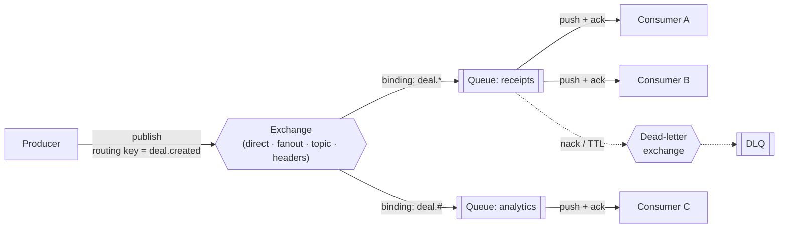
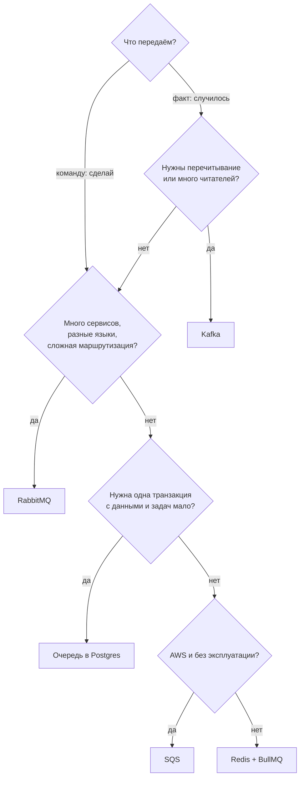
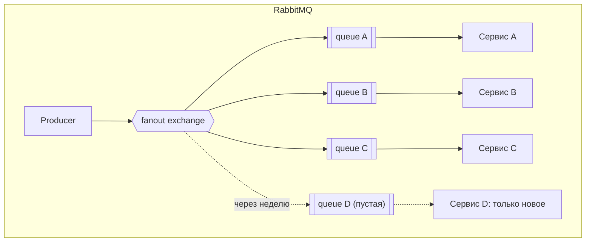
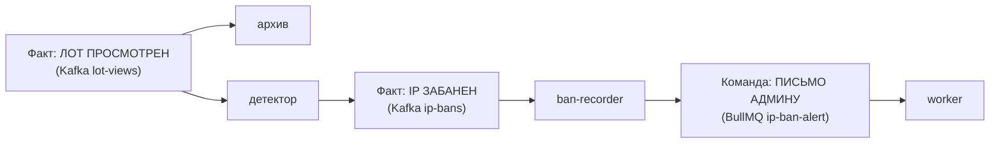
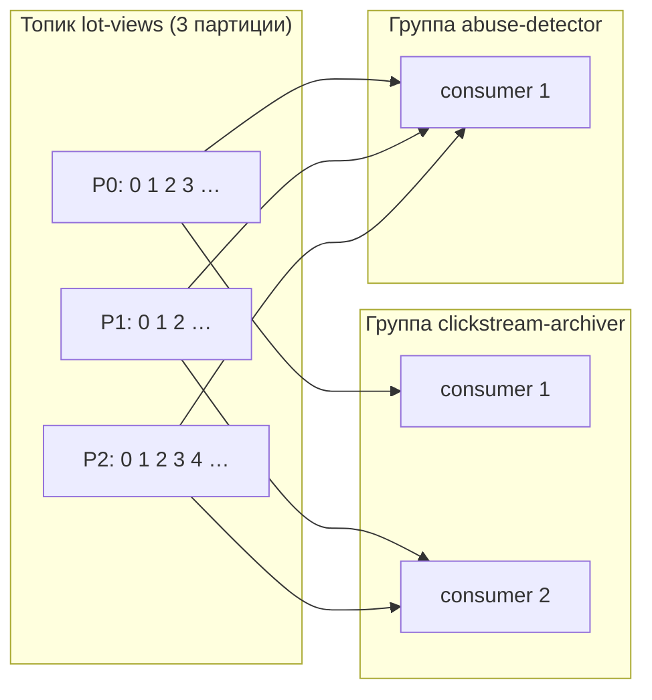
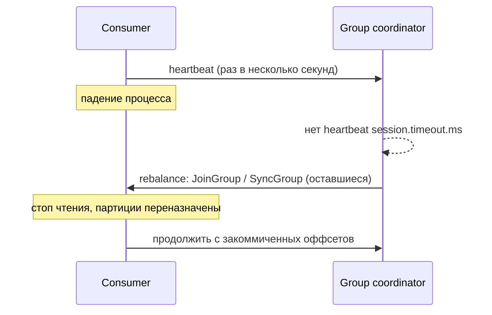
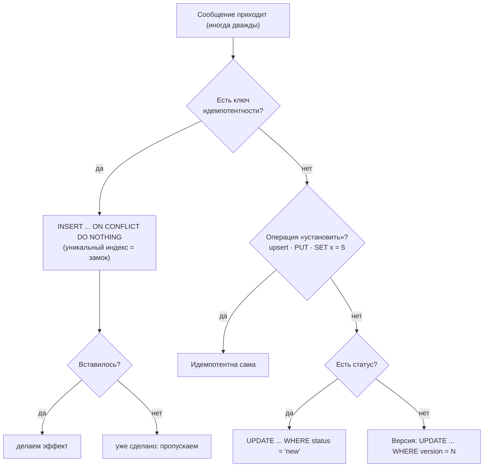
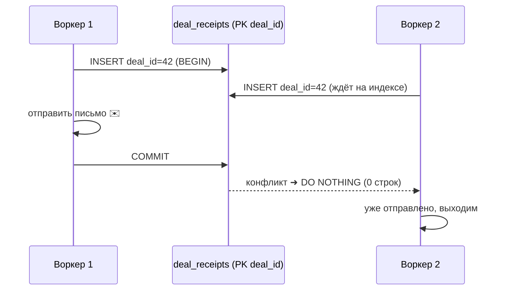
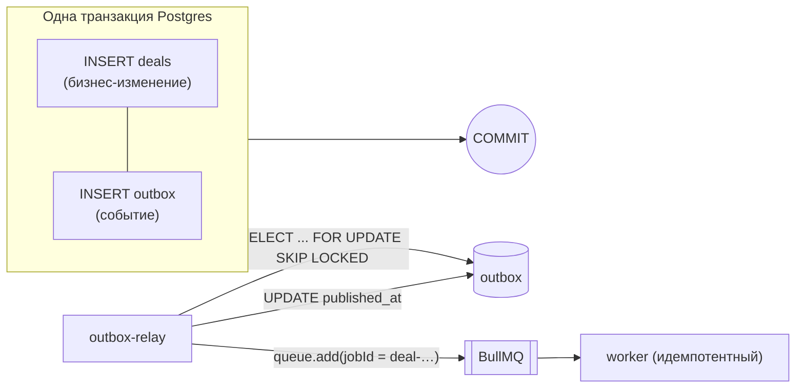
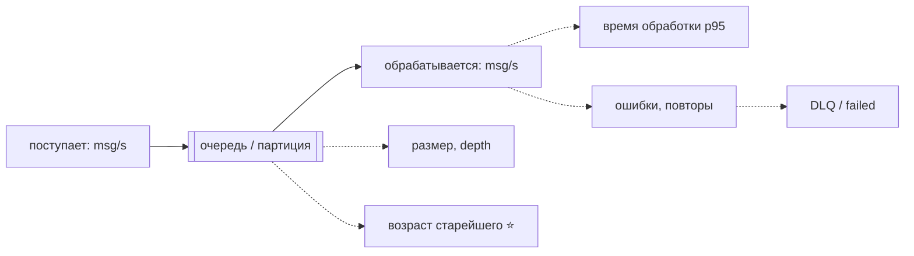

# Брокеры, очереди и идемпотентность: шпора к интервью

Ответы на 15 вопросов из `tasks/05 - Фоновые задачи.md`, в том же порядке, что и в задании. У каждого вопроса: **ответ вслух на минуту** (цитата), картинка для запоминания, объяснение и пример из нашей площадки ([`docs/background`](../background/README.md)). Диалект брокеров: RabbitMQ 3/4, Kafka 4, BullMQ 6 на Redis.

> [!TIP]
> Как учить: сначала закрой всё, кроме цитаты, и скажи ответ вслух. Потом открой картинку и сверь. Значки помогают искать глазами: 🧠 запомни, ⚠️ ловушка интервью, 🏗️ пример с площадки, 🎯 одной фразой.

## Оглавление

- [1. Как работает RabbitMQ](#1-как-работает-rabbitmq)
- [2. Kafka и RabbitMQ: разница моделей](#2-kafka-и-rabbitmq-разница-моделей)
- [3. Postgres, BullMQ, RabbitMQ, Kafka, SQS: когда что](#3-postgres-bullmq-rabbitmq-kafka-sqs-когда-что)
- [4. at-most-once, at-least-once, exactly-once](#4-at-most-once-at-least-once-exactly-once)
- [5. Одно событие — три сервиса](#5-одно-событие--три-сервиса)
- [6. Чем очередь задач отличается от лога событий](#6-чем-очередь-задач-отличается-от-лога-событий)
- [7. Топик, партиция, оффсет, consumer group](#7-топик-партиция-оффсет-consumer-group)
- [8. Как выбрать ключ сообщения в Kafka](#8-как-выбрать-ключ-сообщения-в-kafka)
- [9. Три партиции, пять консьюмеров, ребалансировка](#9-три-партиции-пять-консьюмеров-ребалансировка)
- [10. Когда коммитить оффсет](#10-когда-коммитить-оффсет)
- [11. Что такое идемпотентность. Пять способов](#11-что-такое-идемпотентность-пять-способов)
- [12. Гонка «не обработано ли сообщение?»](#12-гонка-не-обработано-ли-сообщение)
- [13. Transactional outbox](#13-transactional-outbox)
- [14. DLQ и «ядовитое» сообщение](#14-dlq-и-ядовитое-сообщение)
- [15. Метрики очереди](#15-метрики-очереди)
- [Проверь себя](#проверь-себя)
- [Наизусть](#наизусть)

---

## 1. Как работает RabbitMQ

> RabbitMQ — брокер сообщений по протоколу AMQP. Продюсер публикует сообщение **не в очередь, а в exchange**. Exchange по **binding'ам** и ключу маршрутизации раскладывает его по **очередям**. Консьюмер читает очередь, брокер сам **толкает** ему сообщения (push) и ждёт **ack**: получил подтверждение — удаляет сообщение, нет — отдаёт другому. Сообщение живёт, пока его не подтвердили.

🧠 **Почта:** exchange — сортировочный узел, binding — правило адресации, queue — почтовый ящик, consumer — получатель, ack — «расписался в получении».



| Часть                    | Что делает                                                                            |
| ------------------------ | ------------------------------------------------------------------------------------- |
| **Producer**             | публикует сообщение в exchange                                                        |
| **Exchange**             | маршрутизатор, сообщений не хранит; тип определяет правило                            |
| **Binding**              | связь exchange → queue с ключом или шаблоном                                          |
| **Queue**                | хранилище сообщений (FIFO); `durable` переживает перезапуск                           |
| **Consumer**             | подписчик очереди; несколько на одной очереди делят сообщения (competing consumers)   |
| **Ack / Nack**           | подтверждение или отказ; нет ack до разрыва соединения — сообщение вернётся в очередь |
| **Prefetch**             | сколько неподтверждённых сообщений брокер выдаст консьюмеру разом                     |
| **DLX**                  | exchange для «мёртвых» сообщений (отказ без requeue, TTL, переполнение)               |
| **vhost**                | изолированное пространство имён внутри одного брокера                                 |
| **Connection / channel** | одно TCP-соединение, много лёгких каналов поверх него                                 |

Типы exchange:

| Тип       | Правило                                          | Пример                     |
| --------- | ------------------------------------------------ | -------------------------- |
| `direct`  | точное совпадение ключа                          | `error` → очередь `errors` |
| `fanout`  | во все привязанные очереди, ключ не важен        | событие всем подписчикам   |
| `topic`   | шаблон: `*` — одно слово, `#` — любое число слов | `deal.*.paid`              |
| `headers` | по заголовкам сообщения                          | редко                      |

> [!WARNING]
> ⚠️ Надёжность — это три галочки, а не одна: `durable` очередь **и** `persistent` сообщения **и** `publisher confirms` у продюсера (иначе брокер мог принять и потерять). А у консьюмера — ack **после** обработки.

🏗️ **Площадка:** RabbitMQ у нас нет; чек — задача в BullMQ (очередь задач, как RabbitMQ без exchange'ей), события просмотров — в Kafka (лог). Если бы чек читали разные языки и нужна гибкая маршрутизация — взяли бы RabbitMQ.

🎯 Одной фразой: _exchange раскладывает, очередь хранит, ack удаляет._

---

## 2. Kafka и RabbitMQ: разница моделей

> Принципиальная разница — в том, **что такое сообщение после прочтения**. В RabbitMQ это задание: брокер хранит его до ack и удаляет, умный брокер маршрутизирует и следит за доставкой каждому консьюмеру. В Kafka это запись в **журнале**: брокер ничего не удаляет по факту чтения, а хранит по сроку; каждый консьюмер сам помнит свою позицию (оффсет) и сам тянет данные. Отсюда: в Kafka можно перечитать историю и подключить новую группу задним числом, в RabbitMQ — нет. «Kafka быстрее» — не ответ: это следствие модели (последовательная запись, pull пачками), а не её суть.

```text
RabbitMQ  (очередь)                     Kafka  (журнал)

  [m3][m2][m1] ──► consumer               offset: 0  1  2  3  4  5
        ▲  ack → сообщение УДАЛЕНО        log:   [a][b][c][d][e][f] ← append
        │                                          ▲        ▲
  умный брокер, тупой консьюмер            группа A┘  группа B┘  (у каждой свой оффсет)
                                          тупой брокер, умный консьюмер
```

| Критерий                  | RabbitMQ                                             | Kafka                                            |
| ------------------------- | ---------------------------------------------------- | ------------------------------------------------ |
| Модель                    | очередь сообщений                                    | распределённый лог                               |
| После чтения              | ack → **удалено**                                    | остаётся до конца срока (`retention`)            |
| Кто хранит позицию        | брокер (по каждому сообщению)                        | консьюмер/группа (оффсет на партицию)            |
| Доставка                  | **push** брокером                                    | **pull** консьюмером, пачками                    |
| Несколько читателей       | копия на каждую очередь (через exchange)             | сколько угодно групп читают один и тот же журнал |
| Перечитать историю        | ❌ нет                                               | ✅ да, в пределах срока хранения                 |
| Порядок                   | в одной очереди, ломается при нескольких консьюмерах | **внутри партиции**, по ключу                    |
| Масштаб консьюмеров       | любое число на очередь                               | не больше числа партиций в группе                |
| Маршрутизация             | богатая: exchange'и, шаблоны, заголовки              | простая: топик и ключ                            |
| Задержка, приоритеты, TTL | ✅ из коробки                                        | ❌ нет (делают поверх)                           |
| Типичная роль             | команды, задачи, RPC                                 | события, потоки данных, аналитика                |

> [!WARNING]
> ⚠️ Ловушка: «Kafka быстрее, поэтому берём её». Оба держат десятки тысяч сообщений в секунду. Выбор делает **модель**: нужно ли перечитывать, много ли независимых читателей, нужен ли порядок по ключу.

🏗️ **Площадка:** просмотры лотов читают две независимые системы (архив и детектор) и позже ещё одна — значит лог (Kafka). Чек читает один потребитель и удаляется — очередь задач (BullMQ).

🎯 Одной фразой: _RabbitMQ — почтовый ящик, Kafka — журнал в архиве._

---

## 3. Postgres, BullMQ, RabbitMQ, Kafka, SQS: когда что

> Берут по задаче, а не по моде. **Очередь в Postgres** — когда задач единицы-сотни и важна транзакция с данными (`SKIP LOCKED`, pg-boss). **Redis + BullMQ** — фоновые задачи в Node: повторы, задержки, лимиты, быстро и просто, но память и надёжность Redis. **RabbitMQ** — маршрутизация между сервисами и языками, RPC, приоритеты, DLX. **Kafka** — поток событий: много независимых читателей, перечитывание, большой объём, аналитика. **SQS** — когда мы в AWS и не хотим эксплуатировать брокер: управляемая очередь «хотя бы раз» с DLQ.

| Нужно                                           | Postgres | BullMQ (Redis) | RabbitMQ | Kafka |    SQS    |
| ----------------------------------------------- | :------: | :------------: | :------: | :---: | :-------: |
| Задача в **одной транзакции** с данными         |    ✅    |       ❌       |    ❌    |  ❌   |    ❌     |
| Повторы, backoff, отложенные задачи из коробки  |    ➖    |       ✅       |    ➖    |  ❌   |    ✅     |
| Гибкая маршрутизация (exchange, шаблоны)        |    ❌    |       ❌       |    ✅    |  ➖   |    ➖     |
| Несколько независимых читателей одного события  |    ➖    |       ❌       |    ➖    |  ✅   |    ➖     |
| Перечитать историю                              |    ➖    |       ❌       |    ❌    |  ✅   |    ❌     |
| Порядок (по ключу)                              |    ➖    |       ➖       |    ➖    |  ✅   | ➖ (FIFO) |
| Очень большой объём (сотни тысяч сообщений/с)   |    ❌    |       ➖       |    ➖    |  ✅   |    ➖     |
| Не нужно эксплуатировать (managed)              |    ➖    |       ➖       |    ➖    |  ➖   |    ✅     |
| Минимум новых компонентов (уже есть база/Redis) |    ✅    |       ✅       |    ❌    |  ❌   |    ➖     |

✅ да · ➖ частично или с оговорками · ❌ нет.



🏗️ **Площадка:** чек — BullMQ (Node, повторы нужны, Redis уже есть) + outbox, чтобы закрыть двойную запись; просмотры — Kafka (две группы, перечитывание, объём); для стартовой версии допускали очередь в Postgres (ADR 0005 и v2).

> [!NOTE]
> BullMQ 6 умеет и бэкенд на Postgres: тогда задача лежит в транзакции с данными и outbox не нужен. На Redis проблема двойной записи настоящая.

🎯 Одной фразой: _транзакция — Postgres, фон на Node — BullMQ, маршрутизация — RabbitMQ, журнал — Kafka, «не хочу админить» — SQS._

---

## 4. at-most-once, at-least-once, exactly-once

> **At-most-once** — не больше одного раза: подтвердили до обработки, при сбое сообщение теряется, дублей нет. **At-least-once** — не меньше одного: подтверждаем после обработки, при сбое придёт снова, потерь нет, но бывают дубли. **Exactly-once** — ровно один раз; в распределённой системе доставку так не получить, получают **эффект**: at-least-once плюс идемпотентный обработчик. «Exactly-once» у Kafka работает внутри Kafka (идемпотентный продюсер и транзакции), но не распространяется на письма и вызовы во внешний мир. На практике выбирают at-least-once и делают обработчик идемпотентным.

```text
at-most-once    ack ──► обработка ──► 💥   сообщение потеряно, дублей нет
at-least-once   обработка ──► 💥 ──► ack   придёт снова: дубль, но не потеря
exactly-once    at-least-once  +  идемпотентный обработчик  = эффект один раз
```

| Гарантия      | Когда ломается   | Потери | Дубли | Цена                                | Берут, когда                            |
| ------------- | ---------------- | :----: | :---: | ----------------------------------- | --------------------------------------- |
| at-most-once  | ack до обработки |   ✅   |  ❌   | дёшево, быстро                      | метрики, просмотры, логи                |
| at-least-once | ack после работы |   ❌   |  ✅   | обработчик нужно сделать безопасным | **по умолчанию**: заказы, чеки, события |
| exactly-once  | —                |   ❌   |  ❌   | сложно, только внутри системы       | счётчики и потоки внутри Kafka          |

🏗️ **На площадке все три:**

| Поток            | Гарантия                        | Почему                                                             |
| ---------------- | ------------------------------- | ------------------------------------------------------------------ |
| просмотр → Kafka | at-most-once                    | `acks=1`, буфер, при сбое просмотры отбрасываются: это аналитика   |
| сделка → чек     | at-least-once + идемпотентность | outbox + `jobId` + метка `deal_receipts` → эффект один раз         |
| `lot-views` → S3 | at-least-once                   | коммит после записи; повтор заменяет файл с тем же первым оффсетом |

> [!WARNING]
> ⚠️ Не говори «у нас exactly-once», если в цепочке есть письмо, платёж или HTTP-вызов. Говори: «at-least-once и идемпотентный обработчик».

🎯 Одной фразой: _exactly-once — это at-least-once, которому не страшны повторы._

---

## 5. Одно событие — три сервиса

> **RabbitMQ:** публикую событие в exchange типа `fanout` или `topic`; **у каждого сервиса своя очередь**, привязанная к exchange, — каждый получает свою копию, и ack одного не мешает другим. Сервис, подключённый через неделю, создаёт свою очередь и binding и получает **только новые** события: старых в его очереди нет, они ушли в очереди других и там удалены (а если очередей не было — сообщение выброшено). **Kafka:** одно событие пишется в топик один раз, три сервиса — **три consumer group** с разными `group.id`, каждая читает со своим оффсетом. Сервис через неделю заводит новую группу и при `auto.offset.reset=earliest` прочитает всю **сохранившуюся** историю (в пределах retention), при `latest` — только новое.



```text
Kafka:   топик ─ [e0][e1][e2][e3][e4][e5][e6] ← retention 7 суток
                  ▲A          ▲B        ▲C     у каждой группы свой оффсет
                  ▲D (новая группа, earliest) ──► прочитает с e0 до конца
```

| Вопрос                           | RabbitMQ                                    | Kafka                                    |
| -------------------------------- | ------------------------------------------- | ---------------------------------------- |
| Сколько копий события хранится   | по копии в каждой очереди                   | **одна**, читают все группы              |
| Новая подписка получает историю? | ❌ нет, только новое                        | ✅ да, в пределах retention (`earliest`) |
| Что если сервис лежит            | очередь копит сообщения (риск переполнения) | журнал хранится по сроку, группа догонит |
| Добавить читателя                | создать очередь и binding                   | создать группу                           |

🏗️ **Площадка:** `lot-views` читают архив и детектор (две группы, у каждой оффсет); третий потребитель добавится заведением ещё одной группы без изменения продюсера. Новая группа детектора на старте читает всю неделю, но бан за давно закончившийся период не публикуется.

> [!NOTE]
> Если RabbitMQ'шным подписчикам нужна история, делают RabbitMQ Streams (журнал внутри RabbitMQ) или ставят Kafka.

🎯 Одной фразой: _RabbitMQ — копия на очередь, Kafka — один журнал и группа на читателя._

---

## 6. Чем очередь задач отличается от лога событий

> **Очередь задач** хранит **команды** «сделай X»: каждая задача достаётся одному воркеру, после выполнения исчезает, есть повторы, задержки, приоритеты, состояния «ждёт / в работе / упала». **Лог событий** хранит **факты** «случилось X»: запись неизменна, её читают сколько угодно потребителей независимо, она остаётся на срок хранения и её можно перечитать. Задача «отправить чек» — очередь: исполнить один раз и забыть. Событие «лот просмотрели» — лог: его хотят видеть архив, детектор, будущая аналитика.

| Признак              | Очередь задач (BullMQ, SQS, RabbitMQ) | Лог событий (Kafka)                    |
| -------------------- | ------------------------------------- | -------------------------------------- |
| Что внутри           | команда: «сделай»                     | факт: «случилось»                      |
| Адресат              | известен, один исполнитель            | неизвестен, читателей может быть много |
| После выполнения     | удаляется                             | остаётся до конца срока                |
| Повторы, задержка    | встроены                              | не встроены                            |
| Перечитать           | нельзя                                | можно                                  |
| Порядок              | не гарантируется                      | по ключу, внутри партиции              |
| Масштаб исполнителей | любое число воркеров                  | ≤ числа партиций                       |



🏗️ **Площадка:** цепочка выше показывает, как факт превращается в команду. `ip-bans` читают разные (запись, будущие сигналы), а письмо — задача для одного воркера с повторами: «Факт из Kafka становится задачей с повторами».

🎯 Одной фразой: _задача — «сделай и забудь», событие — «случилось, читайте все»._

---

## 7. Топик, партиция, оффсет, consumer group

> **Топик** — именованный журнал сообщений. Он делится на **партиции** — независимые упорядоченные append-only логи; порядок гарантируется только внутри партиции. **Оффсет** — порядковый номер сообщения в партиции, позиция чтения. **Consumer group** — набор консьюмеров с одним `group.id`: партиции топика делятся между ними, каждая партиция читается **ровно одним** членом группы, а разные группы читают независимо. Закоммиченный оффсет группы хранится в Kafka (`__consumer_offsets`) и говорит, откуда продолжить после перезапуска.

```text
topic lot-views
 ├─ partition 0: [0][1][2][3][4][5]…      ◄── consumer A  (группа archiver)
 ├─ partition 1: [0][1][2][3]…            ◄── consumer B  (группа archiver)
 └─ partition 2: [0][1][2][3][4]…         ◄── consumer B  (группа archiver)
                                               ▲ у каждой партиции свой оффсет: [0,1,2,…]
 та же топик, другая группа detector читает те же партиции со СВОИМИ оффсетами
```



| Термин           | Одной фразой                                                   |
| ---------------- | -------------------------------------------------------------- |
| Топик            | название потока; логическая группа партиций                    |
| Партиция         | упорядоченный лог; единица параллелизма и хранения             |
| Оффсет           | номер записи в **партиции** (не во всём топике!)               |
| Consumer group   | «одна команда читателей»: делят партиции между собой           |
| Committed offset | «читать дальше с N+1»; хранится на брокере для группы          |
| Lag              | `последний оффсет − закоммиченный`: сколько группа не дочитала |

> [!WARNING]
> ⚠️ Порядок сообщений **между** партициями не гарантируется. Если нужен порядок «всё про один IP/заказ/лот» — это вопрос ключа (следующий вопрос).

🏗️ **Площадка:** `lot-views` — 3 партиции, группы `clickstream-archiver` и `abuse-detector` читают его независимо; `kafka-consumer-groups.sh --describe --group clickstream-archiver` показывает `CURRENT-OFFSET`, `LOG-END-OFFSET` и `LAG` по партициям (мы смотрели: лаг 2153 / 2655 / 2192 при остановленном архиваторе и 0 после старта).

🎯 Одной фразой: _топик — журнал, партиция — его кусок, оффсет — номер строки, группа — команда читателей._

---

## 8. Как выбрать ключ сообщения в Kafka

> Ключ определяет партицию: `hash(key) % число партиций` (у партиционера Java-клиента — murmur2; точная функция зависит от клиента, суть одна). Одинаковый ключ → одна партиция → **порядок внутри ключа** и все сообщения ключа у **одного** потребителя группы. Значит ключ выбирают по тому, что нужно держать вместе или упорядоченно: id заказа, id пользователя, IP. Неудачный ключ даёт «горячую» партицию (один популярный ключ), перекос нагрузки, разбросанные по партициям связанные сообщения (нет порядка и общего состояния), а смена числа партиций перемешивает соответствие ключ → партиция.

```text
ключ = IP                                  ключ = lotId (плохо для детектора)
 IP A ─► P0 ─► consumer 1 (видит все A)     IP A: лот1→P0, лот2→P1, лот3→P2
 IP B ─► P1 ─► consumer 2 (видит все B)          ─► ни один консьюмер не видит всех просмотров IP A
 IP C ─► P2 ─► consumer 3 (видит все C)          ─► 100 + 100 + 100 вместо 300: бан не наступит
```

| Выбор ключа                            | Что получаем                                         | Что ломается                                                 |
| -------------------------------------- | ---------------------------------------------------- | ------------------------------------------------------------ |
| Сущность, по которой считаем (IP)      | всё про сущность в одной партиции, порядок, счётчики | горячий ключ (один IP шлёт тысячи — своя партиция загружена) |
| `null` (без ключа)                     | равномерно (round-robin / sticky)                    | нет порядка и группировки                                    |
| Низкая кардинальность (страна, статус) | —                                                    | 2–3 «горячие» партиции, остальные пусты                      |
| Составной ключ                         | гибкая группировка                                   | сложнее менять позже                                         |
| Любой, потом добавили партиции         | —                                                    | старые ключи уехали в другие партиции: порядок нарушен       |

🏗️ **Площадка:** ключ `lot-views` — **IP посетителя**, потому что детектор считает просмотры по IP **в памяти**. Все просмотры одного IP попадают в одну партицию, а значит, к одной копии детектора. Ключ `lotId` разложил бы просмотры скрипта по всем партициям — и ни одна копия не добрала бы до 300 (и ещё и перекос на популярные лоты). Цена: поток с одного IP грузит одну партицию — но это и есть абьюз.

> [!TIP]
> Формула ответа: «Ключ = то, по чему нужен порядок или локальное состояние. Проверяю три риска: горячий ключ, null-ключ, смена числа партиций».

🎯 Одной фразой: _ключ — это «кого держать вместе»._

---

## 9. Три партиции, пять консьюмеров. Ребалансировка

> В группе из пяти консьюмеров на топик с тремя партициями **работают трое**, остальные двое **простаивают**: партиция читается только одним членом группы, поэтому параллелизм группы не превышает числа партиций. Лишние — горячий резерв: когда активный упадёт, партицию получит запасной. **Ребалансировка** — перераспределение партиций между членами группы; её вызывают вход или выход консьюмера, падение (нет heartbeat за `session.timeout`), слишком долгая обработка и изменение числа партиций. Во время неё чтение приостанавливается (в «eager» протоколе — у всех), после неё консьюмеры продолжают с закоммиченных оффсетов: что не закоммичено — прочитается ещё раз.

```text
3 партиции, 5 консьюмеров                 один упал → ребалансировка
 P0 ─► C1                                  P0 ─► C1
 P1 ─► C2                                  P1 ─► C4   (был в резерве)
 P2 ─► C3                                  P2 ─► C3
      C4, C5 — простаивают                      C5 — резерв, C2 — нет
```



**Что ломает ребалансировка и как жить:**

| Последствие                             | Что делать                                                                       |
| --------------------------------------- | -------------------------------------------------------------------------------- |
| пауза чтения («stop-the-world»)         | cooperative-sticky assignor (перекидывает только нужные партиции), меньше членов |
| повторная обработка не закоммиченного   | идемпотентный обработчик, коммит после обработки                                 |
| потеря состояния в памяти потребителя   | восстанавливать из топика, хранить состояние во внешнем хранилище                |
| «ребаланс-шторм» из-за долгой обработки | не держать цикл чтения дольше `max.poll.interval.ms`, уменьшить пачку            |
| падение → долгая пауза                  | `session.timeout.ms`, static membership (`group.instance.id`)                    |

🏗️ **Площадка:** при ребалансе архиватор **сбрасывает** недописанные пачки из памяти — Kafka отдаст их заново с закоммиченных оффсетов; редкий дубль, если запись шла в момент ребаланса, убирается по `viewId`. Детектор после перезапуска начинает окно с нуля — бан может опоздать на длину окна (в доке и ADR 0010).

> [!WARNING]
> ⚠️ «Добавлю консьюмеров — будет быстрее»: только до числа партиций. Чтобы масштабироваться дальше, нужно больше партиций (и помнить про ключи).

🎯 Одной фразой: _консьюмеров больше партиций — лишние спят; ребаланс — пауза и повтор не закоммиченного._

---

## 10. Когда коммитить оффсет

> Коммит оффсета — это «я обработал всё до этого места». **До обработки** — at-most-once: упал после коммита и до работы — сообщение потеряно. **После обработки** — at-least-once: упал после работы и до коммита — сообщение придёт снова, значит нужна идемпотентность. Коммитят **после**; потеря хуже дубля. Автокоммит по таймеру опасен: он может зафиксировать оффсет сообщения, которое ещё в работе, и потерять его при сбое.

```text
КОММИТ ДО              poll ──► commit ──► работа ──► 💥          потеряно (at-most-once)
КОММИТ ПОСЛЕ           poll ──► работа ──► 💥 ──► commit          придёт снова (at-least-once)
КОММИТ ПОСЛЕ + идемп.  poll ──► работа (повтор безвреден) ──► commit   эффект один раз ✅
```

| Вариант                                | При сбое             | Гарантия            | Подходит                          |
| -------------------------------------- | -------------------- | ------------------- | --------------------------------- |
| Коммит до обработки                    | сообщение потеряно   | at-most-once        | метрики, где потеря допустима     |
| Коммит после обработки                 | сообщение повторится | at-least-once       | **почти всё**, с идемпотентностью |
| Автокоммит (`enable.auto.commit`)      | и потеря, и повтор   | непредсказуемо      | осторожно; для прототипов         |
| Оффсет в той же транзакции, что эффект | нет                  | exactly-once эффект | запись в БД из Kafka              |

🏗️ **Площадка:** архиватор — «сначала `PutObject` файла, потом `commit(lastOffset + 1)`». Упал между ними — пачка придёт снова, получит то же имя файла и **перезапишет** его: второго файла нет. Детектор коммитит оффсет обработанного раз в секунду (он идемпотентен: бан — чистая функция события). Регистратор банов коммитит после записи в Postgres и постановки задачи.

> [!NOTE]
> Коммитят **следующий** оффсет к чтению: после обработки сообщения 41 коммитят `42` (так делают наши `commit(lastOffset + 1)`).

🎯 Одной фразой: _после обработки, и обработчик должен переживать повтор._

---

## 11. Что такое идемпотентность. Пять способов

> Идемпотентная операция при повторе даёт тот же результат, что и при первом выполнении: «выполнить один раз» и «выполнить пять раз» — одно и то же состояние. Она нужна, потому что в распределённой системе доставка «хотя бы раз» — норма: ретраи, повторная доставка, перезапуски. Способы: **ключ идемпотентности с уникальным индексом**, **таблица обработанных сообщений (inbox)**, **естественно идемпотентная операция** (upsert, `PUT`), **условное обновление / машина состояний**, **версия (оптимистичная блокировка)**, ещё дедупликация на брокере, блокировка и оффсет в одной транзакции с эффектом.

🧠 **Запомни как «КИНОУВ»:** **К**люч + индекс · **И**нбокс · **Н**атуральная идемпотентность · **О**бновление с условием · **У**никальность на брокере (`jobId`) · **В**ерсия.



| #   | Способ                                | Как работает                                           | Когда                           | Где гонка / слабое место                                         |
| --- | ------------------------------------- | ------------------------------------------------------ | ------------------------------- | ---------------------------------------------------------------- |
| 1   | Ключ + уникальный индекс              | вставка с ключом, повтор упирается в `UNIQUE`          | платежи, чеки                   | `SELECT` перед `INSERT` без индекса — гонка                      |
| 2   | Inbox (таблица обработанных)          | `message_id` пишется в той же транзакции, что и эффект | потребитель + БД                | эффект вне БД (письмо) не откатывается: окно                     |
| 3   | Естественная идемпотентность          | `PUT`, upsert, детерминированный ключ                  | операция «установить»           | ломается на `x = x + 1`                                          |
| 4   | Условное обновление / состояния       | `UPDATE … WHERE status = 'new'`, 0 строк — уже сделано | есть жизненный цикл             | эффект **до** смены статуса                                      |
| 5   | Версия                                | `WHERE version = N`; устаревшая команда отвергается    | конкурентные правки             | клиент обязан хранить версию                                     |
| 6   | Дедупликация на брокере               | `jobId` (BullMQ), idempotent producer Kafka            | дубль создаёт отправитель       | окно хранения; от повторной **доставки** не спасает              |
| 7   | Блокировка (Redis `SET NX`, advisory) | сериализует обработку ключа                            | нет места для индекса           | замок истёк, пока жив обработчик; сам по себе «помнить» не умеет |
| 8   | Оффсет + эффект в одной транзакции    | эффект и «следующий оффсет» одним `COMMIT`             | Kafka → БД, нужен точный эффект | привязка к одной БД                                              |

🏗️ **Площадка:** чек — способ 1 (`deal_receipts.deal_id` PK) + способ 6 (`jobId`); архив — способ 3 (то же имя файла); бан — событие по просмотру-нарушителю + `EXCLUDE` в `ip_bans` (дубль гасит ограничение, а не детерминизм); покупка пока **не** идемпотентна (известное ограничение: нужен `Idempotency-Key` и `UNIQUE (buyer_id, key)`).

> [!WARNING]
> ⚠️ Идемпотентность — свойство **обработчика**, а не брокера. Брокер может лишь уменьшить число дублей.

🎯 Одной фразой: _повтор безвреден — потому что есть ключ, который база не пустит дважды._

---

## 12. Гонка «не обработано ли сообщение?»

> Гонка — в промежутке между проверкой и записью (check-then-act): два воркера одновременно делают `SELECT` — «не обработано» — оба видят «нет», оба выполняют эффект и оба пишут. Надёжно убирают **атомарной операцией**, а не проверкой: `INSERT … ON CONFLICT DO NOTHING` с уникальным индексом (кто вставил — тот и работает), `UPDATE … WHERE status = 'new'` (смотрят число изменённых строк), `SELECT … FOR UPDATE` по существующей строке или advisory lock. Блокировка в приложении или кэш в памяти не помогают: воркеров много.

```text
ГОНКА (проверка и запись — два шага)                  БЕЗ ГОНКИ (одна атомарная вставка)

 W1: SELECT: нет ─┐                                    W1: INSERT ... ON CONFLICT ─► вставил ✅ → делает
 W2: SELECT: нет ─┤  оба решили «делаем»               W2: INSERT ... ON CONFLICT ─► ждёт на индексе
 W1: письмо ✉️    │                                       W1: COMMIT
 W2: письмо ✉️    │  ✉️✉️ ДУБЛЬ                          W2: конфликт → «уже сделано» → пропускает
 W1/W2: INSERT ──┘
```



| Подход                                    | Надёжно? | Почему                                                       |
| ----------------------------------------- | :------: | ------------------------------------------------------------ |
| `SELECT` и потом `INSERT`                 |    ❌    | окно между шагами                                            |
| `Map`/флаг в памяти процесса              |    ❌    | у каждого воркера свой, они не видят друг друга              |
| `INSERT … ON CONFLICT DO NOTHING`         |    ✅    | одна операция, уникальный индекс — замок на уровне БД        |
| `UPDATE … WHERE status = 'new'`           |    ✅    | атомарно; смотрят `rowCount`                                 |
| `SELECT … FOR UPDATE` существующей строки |    ✅    | требует, чтобы строка уже была                               |
| Redis `SET NX` с TTL                      |    ➖    | замок может истечь при долгой обработке; нужен fencing token |

🏗️ **Площадка:** `ReceiptJob` — «сначала пометь, потом делай»: вставка метки, письмо, `COMMIT` в одной транзакции. Два воркера на одну сделку: второй встаёт на индексе; метка закоммитилась — он видит конфликт и выходит; письмо упало (откат) — метки нет, второй получает слот и шлёт. Тест: три запуска одновременно (письмо задержано на 150 мс) — писем одно.

> [!NOTE]
> Остаточное окно: SMTP принял письмо, а `COMMIT` не прошёл. Это ограничение «exactly-once с внешним миром», закрывается только дедупликацией у получателя по `Message-ID`.

🎯 Одной фразой: _гонка — между «проверил» и «записал»; лечится одной атомарной вставкой._

---

## 13. Transactional outbox

> Outbox решает проблему **двойной записи**: надо изменить базу и сообщить об этом брокеру, а общей транзакции у них нет. Если слать до коммита — получим сообщение о том, чего не было (откат); после коммита — потерю при падении между ними. Решение: в **той же транзакции**, что и бизнес-изменение, записать событие в таблицу `outbox`; отдельный процесс (relay) забирает неотправленные строки, публикует в брокер и помечает отправленными. Гарантирует: если бизнес-изменение произошло, событие **будет** отправлено, и наоборот. Не гарантирует: «ровно один раз» (дубли при падении релея — нужен идемпотентный получатель), порядок между разными агрегатами, мгновенность (задержка опроса) и само не чистит таблицу.



```text
ЛОВУШКА 1: add внутри транзакции    BEGIN → сделка → add ✅ → ROLLBACK     чек о сделке, которой нет
ЛОВУШКА 2: add после коммита        COMMIT → 💥 → add не выполнен           сделка есть, чека не будет
OUTBOX:    сделка + outbox ──COMMIT── relay ──► очередь                   либо оба, либо ни одного
```

| Вопрос                      | Ответ                                                                                             |
| --------------------------- | ------------------------------------------------------------------------------------------------- |
| Что гарантирует             | **доставка хотя бы раз**: изменение и событие появляются вместе                                   |
| Чего не гарантирует         | ровно один раз; порядок между агрегатами; мгновенность                                            |
| Если релей упал после `add` | строка осталась неотправленной → второй `add`; `jobId` отбрасывает дубль, обработчик идемпотентен |
| Если брокер лежит           | строки копятся, релей повторяет; **API работает**                                                 |
| Несколько релеев            | безопасно: `SKIP LOCKED` — каждый берёт свои строки                                               |
| Цена                        | постоянный опрос, таблица растёт (нужна чистка), задержка до интервала опроса                     |
| Альтернативы                | CDC (Debezium по WAL), очередь в той же БД (pg-boss, BullMQ на Postgres)                          |

🏗️ **Площадка:** `DealsService.purchase` пишет строку `outbox` в транзакции сделки; `outbox-relay` (отдельный контейнер) каждые 500 мс переносит строки в BullMQ. Проверено на стенде: **Redis остановлен → покупка проходит, строка `outbox` с `published_at = NULL`; Redis запущен → через ~4 с релей поставил задачу, чек в Mailpit ровно один**.

> [!WARNING]
> ⚠️ Не называй outbox «exactly-once». Это «хотя бы раз» + идемпотентность.

🎯 Одной фразой: _событие кладём в базу вместе с изменением, а в брокер его переносит отдельный процесс._

---

## 14. DLQ и «ядовитое» сообщение

> **DLQ (dead letter queue)** — отдельная очередь или топик, куда уходят сообщения, которые не удалось обработать после N попыток, чтобы их можно было разобрать вручную и не терять. В Kafka **нельзя просто перейти к следующему**: оффсет — это «обработано всё до сюда»; закоммитить 11 значит объявить обработанным и 10. Если сообщение 10 стабильно падает («poison pill»), цикл либо зависает на нём, блокируя **всю партицию**, либо мы пропускаем его молча и теряем данные. Поэтому: ограниченные повторы → сообщение в DLQ-топик с причиной → коммит дальше. В RabbitMQ проще: сообщения подтверждаются **по одному**, неудачное `nack` без requeue уходит через DLX в DLQ, остальные идут дальше.

```text
Kafka, партиция:   …[8][9][💥10][11][12]…
                         │
        нельзя: commit(11) молча  ─► 10 потеряно
        нельзя: застрять на 10    ─► [11][12] ждут: партиция стоит
        можно:  N повторов → DLQ-топик (+причина, оффсет, заголовки) → commit(11)

RabbitMQ, очередь:  m1 ack ✅   m2 nack(requeue=false) ─► DLX ─► DLQ   m3 ack ✅  (поток идёт)
```

| Сравнение                        | RabbitMQ                                        | Kafka                                          |
| -------------------------------- | ----------------------------------------------- | ---------------------------------------------- |
| Единица подтверждения            | каждое сообщение                                | позиция (оффсет) в партиции                    |
| Один плохой блокирует остальных? | нет                                             | да, если не обработать (или не обойти)         |
| DLQ из коробки                   | ✅ DLX на очереди (`x-dead-letter-exchange`)    | ❌ делается вручную (DLQ-топик / retry-топики) |
| Типичный путь                    | `nack(requeue=false)` или TTL/лимит → DLX → DLQ | retry N раз → публикация в `*.dlq` → commit    |
| Ловушка                          | бесконечный requeue «карусель»                  | потеря при молчаливом пропуске                 |

**Что класть в DLQ-сообщение:** оригинал, причину/стектрейс, топик, партицию, оффсет, число попыток, время.

🏗️ **Площадка:** у BullMQ роль DLQ играет состояние `failed`: задача после `JOB_ATTEMPTS` попыток остаётся там (`removeOnFail: false`), видна и запускается заново (`scripts/jobs.mjs failed | retry`). Для Kafka DLQ **нет**: сообщение, которое нельзя разобрать (`ban-recorder`, детектор), логируется и пропускается с коммитом, чтобы не остановить партицию; временные сбои (БД, Redis) повторяются на месте без коммита. DLQ-топик — следующий шаг (в «Известных ограничениях» и зоне 4 карты).

> [!WARNING]
> ⚠️ Различай **временный сбой** (БД недоступна: повторять, не коммитить) и **ядовитое сообщение** (никогда не обработается: в DLQ и дальше). Повторять второе вечно — остановить партицию.

🎯 Одной фразой: _плохое сообщение уводим в сторону и идём дальше, иначе партиция встанет._

---

## 15. Метрики очереди

> В проде смотрят: **размер очереди** (ready/waiting), **возраст самого старого сообщения**, **consumer lag** (для Kafka: сколько группа не дочитала), **скорость поступления и обработки**, **время обработки (p95/p99)**, **долю ошибок и повторов**, **размер DLQ / failed**, число **unacked** и консьюмеров, число ребалансировок. Лучше всего отставание показывает **возраст самого старого необработанного сообщения** (lag во времени) — размер сам по себе не говорит, критично это или нет: тысяча сообщений при обработке 10 000/с — секунды, а при 1/с — часы.



| Метрика                                          | Что показывает                         | Алерт, когда                           |
| ------------------------------------------------ | -------------------------------------- | -------------------------------------- |
| ⭐ Возраст старейшего сообщения (lag во времени) | реальное отставание в секундах         | дольше допустимой задержки для бизнеса |
| Consumer lag (Kafka: end offset − committed)     | сколько группа не прочитала            | растёт и не возвращается               |
| Размер очереди (ready / waiting)                 | накопление                             | растёт при стабильном потоке           |
| Скорость in / out                                | пропускная способность                 | `in > out` долго                       |
| Время обработки p95 / p99                        | замедление обработчика или зависимости | рост                                   |
| Ошибки и повторы (retry rate)                    | деградация зависимостей                | всплеск                                |
| DLQ / failed                                     | «мёртвые» сообщения                    | **любой рост**                         |
| Unacked (RabbitMQ)                               | сообщения у консьюмеров в работе       | растёт: консьюмеры зависли             |
| Консьюмеры, ребалансировки (Kafka)               | стабильность группы                    | частые ребалансы                       |
| Брокер: диск, ISR, under-replicated              | здоровье кластера                      | любое отклонение                       |

🏗️ **Площадка:** BullMQ — `scripts/jobs.mjs counts` показывает `waiting / active / delayed / completed / failed`; Kafka — `kafka-consumer-groups.sh --describe`, колонка `LAG` по партициям (мы смотрели её руками при остановленном архиваторе); для архиватора ещё и возраст файла в S3 против времени последнего просмотра.

> [!TIP]
> Формула ответа: «Главная — отставание во времени: возраст старейшего сообщения; рядом — lag/размер, скорость in/out, p95 обработки, ошибки и DLQ».

🎯 Одной фразой: _размер очереди — симптом, возраст старейшего — диагноз._

---

## Проверь себя

<details><summary>Чем exchange отличается от очереди в RabbitMQ?</summary>

Exchange ничего не хранит, он только маршрутизирует сообщение по binding'ам в очереди. Очередь хранит сообщения до ack.

</details>

<details><summary>Назови три галочки надёжности в RabbitMQ.</summary>

Durable очередь, persistent сообщения, publisher confirms у продюсера. Плюс ack у консьюмера после обработки.

</details>

<details><summary>Почему «Kafka быстрее» — плохой ответ на вопрос о разнице с RabbitMQ?</summary>

Разница в модели: журнал с оффсетами и хранением по сроку против очереди с удалением по ack. Скорость — следствие, и она сопоставима.

</details>

<details><summary>Когда очередь в Postgres — нормальный выбор?</summary>

Когда задач мало и нужна одна транзакция с данными: `FOR UPDATE SKIP LOCKED`, pg-boss, BullMQ на Postgres. Это снимает двойную запись.

</details>

<details><summary>Что такое exactly-once и можно ли его гарантировать?</summary>

Доставку — нет; эффект — да: at-least-once плюс идемпотентный обработчик. У Kafka exactly-once работает внутри Kafka, но не для писем и внешних вызовов.

</details>

<details><summary>Что получит сервис, подключённый через неделю, в RabbitMQ и в Kafka?</summary>

RabbitMQ — только новые сообщения (в его новой очереди старых нет). Kafka — всю сохранившуюся историю при `earliest` (в пределах retention), новое при `latest`.

</details>

<details><summary>Чем задача отличается от события?</summary>

Задача — команда «сделай», достаётся одному исполнителю и удаляется. Событие — факт «случилось», хранится и читается многими независимо.

</details>

<details><summary>Что такое оффсет и чем он не является?</summary>

Номер сообщения в **партиции** (не в топике). Закоммиченный оффсет группы — откуда продолжить после перезапуска.

</details>

<details><summary>Что будет при плохом ключе в Kafka?</summary>

Горячая партиция, перекос; связанные сообщения в разных партициях без общего порядка; смена числа партиций перемешает ключи.

</details>

<details><summary>3 партиции, 5 консьюмеров в группе: что происходит?</summary>

Работают трое, двое простаивают как резерв. Параллелизм не больше числа партиций.

</details>

<details><summary>Что такое ребалансировка и чем неприятна?</summary>

Перераспределение партиций между членами группы. Пауза чтения, повторная обработка не закоммиченного, потеря состояния в памяти.

</details>

<details><summary>Коммит оффсета: до или после обработки?</summary>

После: потерять сообщение хуже, чем получить дубль. И обработчик должен быть идемпотентным.

</details>

<details><summary>Назови пять способов идемпотентности.</summary>

Ключ + уникальный индекс; inbox-таблица; естественная идемпотентность (upsert, `PUT`); условное обновление / машина состояний; версия. Ещё: дедупликация на брокере, блокировка, оффсет в транзакции с эффектом.

</details>

<details><summary>Где гонка при проверке «не обработано ли», и как убрать?</summary>

Между `SELECT` и записью. Убрать одной атомарной вставкой с уникальным индексом (`ON CONFLICT DO NOTHING`) или условным `UPDATE`.

</details>

<details><summary>Что гарантирует и чего не гарантирует outbox?</summary>

Гарантирует: изменение и событие появляются вместе, событие дойдёт хотя бы раз. Не гарантирует: ровно один раз, порядок между агрегатами, мгновенность.

</details>

<details><summary>Почему в Kafka нельзя просто перейти к следующему сообщению при ошибке?</summary>

Оффсет означает «обработано всё до сюда»: пропуск без обработки — потеря, застревание — стоящая партиция. Нужны ограниченные повторы и DLQ-топик.

</details>

<details><summary>Какая метрика лучше всего показывает отставание?</summary>

Возраст самого старого необработанного сообщения (lag во времени); размер очереди и lag в сообщениях — вторичны.

</details>

---

## Наизусть

| Вопрос                    | Одной фразой                                                                                         |
| ------------------------- | ---------------------------------------------------------------------------------------------------- |
| RabbitMQ                  | exchange раскладывает по binding'ам в очереди, консьюмеру push, ack удаляет                          |
| Kafka vs RabbitMQ         | журнал с оффсетами и сроком хранения против очереди с удалением по ack                               |
| Что когда                 | транзакция — Postgres; фон на Node — BullMQ; маршрутизация — RabbitMQ; журнал — Kafka; managed — SQS |
| Семантики доставки        | at-most — потеряли; at-least — продублировали; exactly-once = at-least + идемпотентность             |
| Три сервиса, одно событие | RabbitMQ: очередь на сервис; Kafka: группа на сервис, новый читает историю                           |
| Задача vs событие         | команда «сделай» против факта «случилось»                                                            |
| Kafka-термины             | топик → партиции → оффсеты; группа делит партиции, одна партиция — один член                         |
| Ключ                      | «кого держать вместе»: порядок и локальное состояние; риски: горячий, null, смена партиций           |
| 3 партиции, 5 консьюмеров | трое работают, двое в резерве; ребаланс — пауза и повтор                                             |
| Коммит оффсета            | после обработки + идемпотентный обработчик                                                           |
| Идемпотентность           | ключ+индекс · inbox · естественная · условный UPDATE · версия                                        |
| Гонка «обработано?»       | check-then-act; лечится атомарной вставкой с уникальным индексом                                     |
| Outbox                    | событие в той же транзакции + релей в брокер; хотя бы раз, не ровно один                             |
| DLQ                       | после N попыток сообщение в сторону и дальше; иначе партиция встанет                                 |
| Метрики                   | возраст старейшего, lag, in/out, p95, ошибки, DLQ                                                    |
