# Схема данных площадки

Площадка дорогого оборудования: компании покупают и продают лоты, расчёты идут только внутри площадки. Приём и вывод денег не делаем: приходит банковское уведомление, администратор отмечает, чей кошелёк и на сколько пополнен. Пользователей, входа и ролей в схеме нет.

Схема живёт в шести миграциях (`src/migrations/`), имена всех ограничений заданы явно, по ним приложение подбирает сообщение клиенту:

- [`1760400000000-InitMarketplace`](../../src/migrations/1760400000000-InitMarketplace.ts) - таблицы, `CHECK`, внешние ключи, уникальные индексы (четыре правила площадки);
- [`1760500000000-DealLedgerInvariant`](../../src/migrations/1760500000000-DealLedgerInvariant.ts) - отложенный триггер: журнал сделки сходится со сделкой;
- [`1760600000000-AppendOnlyLedger`](../../src/migrations/1760600000000-AppendOnlyLedger.ts) - `deals`, `wallet_operations`, `lot_stock_history` нельзя менять и удалять; запись остатка продажи согласована со сделкой;
- [`1760700000000-EnforceDealRules`](../../src/migrations/1760700000000-EnforceDealRules.ts) - баланс кошелька меняет только триггер по журналу; сделка только по опубликованному лоту и по его цене; цепочка истории остатка; цена и публикация лота совпадают с последней строкой своей истории; обе эти истории тоже append-only; `deals.created_at` берёт время вставки;
- [`1760800000000-CompanyWalletJournalTime`](../../src/migrations/1760800000000-CompanyWalletJournalTime.ts) - у каждой компании ровно один кошелёк (проверка при `COMMIT`, кошелёк нельзя удалить или передать); `wallet_operations.created_at` тоже берёт время вставки;
- [`1760900000000-LotsCatalogIndex`](../../src/migrations/1760900000000-LotsCatalogIndex.ts) - частичный индекс `lots (created_at DESC, id DESC) WHERE is_published` под каталог `GET /lots`.

## ER-диаграмма

Все колонки `NOT NULL`, кроме трёх помеченных `NULL`. Слева от имени - тип, в кавычках - ограничения и комментарии. `UK` - уникальное ограничение или индекс (составные и частичные описаны в комментарии). Кратность на связях - то, что гарантирует база; где гарантия только в коде, это сказано в подписи.

```mermaid
erDiagram
    companies ||--|| wallets : "ровно один кошелёк: UNIQUE company_id + проверка при COMMIT; удалить или передать нельзя"
    companies ||--o{ lots : "продаёт (seller_id)"
    companies ||--o{ deals : "покупает (buyer_id)"
    lots ||--o{ deals : "по лоту (lot_id, seller_id)"
    lots ||--o{ lot_photos : "фото"
    lots ||--o{ lot_delivery_methods : "способы доставки"
    lots ||--|{ lot_price_history : "история цены, первая строка обязательна при COMMIT"
    lots ||--|{ lot_publication_history : "история публикации, первая строка обязательна при COMMIT"
    lots ||--|{ lot_stock_history : "история остатка, цепочка, первая строка обязательна при COMMIT"
    wallets ||--o{ wallet_operations : "журнал"
    deals |o--|{ wallet_operations : "ровно две строки на сделку: purchase и sale"
    deals |o--|| lot_stock_history : "ровно одно списание остатка (reason = sale)"

    companies {
        uuid id PK "uuid: виден в API, не перебирается"
        text name "CHECK не пустое"
        text email "CHECK формат; UK по lower(email)"
        timestamptz created_at
    }
    wallets {
        uuid id PK
        uuid company_id FK "UK"
        bigint balance "центы, CHECK >= 0. ОТСТУПЛЕНИЕ: сумма журнала, меняет только триггер"
        timestamptz updated_at
    }
    lots {
        uuid id PK
        uuid seller_id FK "UK (id, seller_id) - цель составного FK из deals"
        text title "CHECK не пустое"
        bigint price "центы, CHECK > 0. ТЕКУЩЕЕ состояние = последняя строка истории (при COMMIT)"
        int stock "CHECK >= 0. ТЕКУЩЕЕ состояние = последняя строка истории (при COMMIT)"
        boolean is_published "по умолчанию false. ТЕКУЩЕЕ состояние = последняя строка истории (при COMMIT)"
        timestamptz created_at "индекс каталога (created_at, id) WHERE is_published"
        timestamptz updated_at
    }
    lot_photos {
        uuid id PK
        uuid lot_id FK "UK с position"
        text s3_key "UK, ключ объекта в S3"
        text content_type "CHECK image/jpeg, image/png, image/webp"
        bigint size_bytes "CHECK > 0"
        smallint position "CHECK >= 0, UK с lot_id"
        timestamptz created_at
    }
    lot_delivery_methods {
        uuid lot_id PK, FK
        text method PK "CHECK pickup, courier, freight"
    }
    deals {
        uuid id PK "UK (id, lot_id) - цель составного FK из lot_stock_history"
        uuid lot_id FK "составной FK (lot_id, seller_id) на lots"
        uuid seller_id FK "ОТСТУПЛЕНИЕ от 3НФ: определяется лотом; защита - составной FK"
        uuid buyer_id FK "CHECK buyer <> seller"
        int quantity "CHECK > 0"
        bigint unit_price "CHECK > 0. Факт на момент сделки, не дубль lots.price; триггер: равна цене лота"
        bigint total "GENERATED quantity * unit_price. ОТСТУПЛЕНИЕ: производная от пары"
        timestamptz created_at "DEFAULT clock_timestamp()"
    }
    wallet_operations {
        bigserial id PK "внутренняя append-only таблица"
        uuid wallet_id FK
        text type "CHECK deposit, purchase, sale; сочетания полей - CHECK shape"
        bigint amount "со знаком: плюс зачисление, минус списание. ОТСТУПЛЕНИЕ: = плюс-минус deals.total"
        uuid deal_id FK "NULL для пополнения; UK с wallet_id (частичный)"
        text bank_notification_id "NULL у покупки и продажи; UK частичный, глобальный"
        timestamptz created_at "DEFAULT clock_timestamp()"
    }
    lot_price_history {
        bigserial id PK
        uuid lot_id FK "UK с valid_from"
        bigint price "CHECK > 0"
        timestamptz valid_from "UK с lot_id"
    }
    lot_publication_history {
        bigserial id PK
        uuid lot_id FK "UK с changed_at"
        boolean is_published
        timestamptz changed_at "UK с lot_id"
    }
    lot_stock_history {
        bigserial id PK
        uuid lot_id FK
        int delta "для sale = -deals.quantity (триггер)"
        int stock_after "CHECK >= 0, цепочка и равен остатку лота (триггер)"
        text reason "CHECK initial, restock, writeoff, sale"
        uuid deal_id FK "NULL кроме sale; составной FK (deal_id, lot_id) на deals; UK частичный"
        timestamptz changed_at
    }
```



## Типы данных

| Выбор                                                    | Почему                                                                                                                                                                                                                                                                                                                  |
| -------------------------------------------------------- | ----------------------------------------------------------------------------------------------------------------------------------------------------------------------------------------------------------------------------------------------------------------------------------------------------------------------- |
| `uuid` для `companies`, `wallets`, `lots`, `deals`, фото | идентификаторы видны в API и в ссылках: по `bigserial` их можно перебирать и угадывать объём бизнеса; `uuid` создаётся где угодно, без обращения к базе. Цена: 16 байт и менее компактный индекс, при единицах сделок в день это не важно                                                                               |
| `bigserial` для журнала и трёх историй                   | внутренние append-only таблицы, наружу не отдаются; монотонный ключ компактный и сохраняет порядок вставки, он же нужен для «последняя запись»                                                                                                                                                                          |
| `timestamptz` везде                                      | это момент времени, а не календарная запись: база хранит UTC и сама переводит. `timestamp` без зоны теряет смысл при смене настройки сервера или перелёте клиента; «время и зона отдельно» нужно для будущих встреч «в 10:00 по Бишкеку», а у нас только факты «уже случилось»                                          |
| деньги: `bigint` в центах                                | точно и быстро: `numeric` тоже точный, но медленнее и требует следить за масштабом; `float` не подходит совсем (0.1 + 0.2). Одна валюта (USD). В API деньги ходят целым числом центов, границы заданы в `*.schemas.ts` каждого модуля и в `src/common/money.ts`, чтобы произведения не вышли за `MAX_SAFE_INTEGER` в JS |
| `integer` для остатка и количества                       | штуки оборудования; верхняя граница в API 10 000                                                                                                                                                                                                                                                                        |
| `text` + `CHECK ... IN (...)` вместо `enum`              | новое значение добавляется обычной миграцией и не требует `ALTER TYPE`; ограничение так же проверяется базой                                                                                                                                                                                                            |

## Три задачи на схему

### 1. Продавец и цена в сделке: хранить в сделке

**Решение:** `deals.seller_id` и `deals.unit_price` хранятся в сделке, `total` вычисляется базой (`GENERATED ALWAYS AS (quantity * unit_price) STORED`).

- **Цена.** `lots.price` меняется, а сделка - факт: «купили по 250 000 $» не должно превращаться в «по 300 000 $», когда продавец поднял цену. Цена в сделке - не дубль цены лота, а другой факт. Это не нарушение нормализации.
- **Продавец.** `seller_id` определяется лотом (`lot_id → seller_id`), поэтому формально это транзитивная зависимость и отступление от 3НФ. Зачем: сделка читается без соединения с `lots`; у сделки есть собственная проверка `buyer_id <> seller_id`; список продаж продавца берётся по индексу `deals_seller_id_idx`.
- **Чем платим и как это закрыто.** Риск дубля - рассогласование, поэтому его закрывает база, а не код: составной внешний ключ `FOREIGN KEY (lot_id, seller_id) REFERENCES lots (id, seller_id)` не даёт записать сделку с продавцом, который лотом не владеет. Для этого в `lots` есть `UNIQUE (id, seller_id)`. Лот не переходит к другому продавцу, поэтому сделки не устаревают.

### 2. История: отдельная таблица на каждый независимо меняющийся атрибут

Цена, публикация и остаток меняются независимо и по разным поводам (продавец, склад, сделка). Поэтому три append-only таблицы: `lot_price_history`, `lot_publication_history`, `lot_stock_history`.

Почему не снимок всей строки лота при любом изменении: смена остатка при каждой сделке копировала бы название и цену, а вопрос «сколько дней лот был опубликован» пришлось бы выбирать из строк, где публикация не менялась. Почему не `valid_from/valid_to` (интервалы): закрытие предыдущего интервала - это ещё один `UPDATE` и новое место для рассогласования (дыры и пересечения); у нас только `valid_from`, а конец интервала - это начало следующего, `lead()` в запросе.

`lots` хранит **текущее состояние** (цена, остаток, признак публикации): его читает каталог, на нём стоят `CHECK` и блокировка покупки. Это осознанная денормализация: текущее значение можно получить из последней строки истории, но дорогим запросом и без ограничений. Текущее состояние и строка истории пишутся в одной транзакции, а расхождение запрещает база: отложенные триггеры при `COMMIT` сверяют цену, признак публикации и остаток лота с последней строкой соответствующей истории (и у лота обязана быть первая строка каждой истории). Прямой `UPDATE lots SET price = ...` без строки истории не пройдёт (тесты: `schema.e2e-spec.ts`, `price.e2e-spec.ts`, `companies-lots.e2e-spec.ts`). Время записи истории, `deals.created_at` (`DEFAULT clock_timestamp()`, код передаёт его явно) и `wallet_operations.created_at` (`DEFAULT clock_timestamp()`) - момент записи, а не начала транзакции, поэтому для одного лота метки идут строго по порядку, а цена на момент сделки (`valid_from <= deals.created_at`) определяется однозначно: с `now()` сделка из транзакции, начатой до смены цены, получила бы время раньше новой цены и запрос ниже вернул бы старую цену при новой `unit_price`.

```sql
-- 1. Цена лота в момент сделки (для проверки; в сделке она уже лежит в unit_price)
SELECT d.id, p.price
  FROM deals d
  JOIN LATERAL (SELECT price FROM lot_price_history h
                 WHERE h.lot_id = d.lot_id AND h.valid_from <= d.created_at
                 ORDER BY h.valid_from DESC LIMIT 1) p ON true;

-- 2. Сколько дней каждый лот был доступен покупателям
SELECT lot_id,
       sum(extract(epoch FROM coalesce(next_at, now()) - changed_at)) / 86400 AS days_published
  FROM (SELECT lot_id, is_published, changed_at,
               lead(changed_at) OVER (PARTITION BY lot_id ORDER BY changed_at) AS next_at
          FROM lot_publication_history) t
 WHERE is_published
 GROUP BY lot_id;

-- 3. Как менялся остаток лота (и почему)
SELECT changed_at, delta, stock_after, reason
  FROM lot_stock_history WHERE lot_id = $1 ORDER BY changed_at, id;
```

### 3. Баланс: хранить отдельно, источник правды - журнал

**Источник правды - `wallet_operations`.** Он append-only, каждая строка знает, кто, когда и на сколько изменил кошелёк, и по какому уведомлению или сделке. Любой баланс можно пересчитать суммой журнала.

**`wallets.balance` хранится отдельно** как материализованная сумма, и пишет её не код приложения, а триггер `wallet_operations_apply_balance`: каждая вставка в журнал в том же операторе прибавляет `amount` к балансу кошелька. Прямое изменение `wallets.balance` запрещено триггером `wallets_balance_journal_only` (разрешён только `UPDATE` из первого триггера, он отличается глубиной вложенности `pg_trigger_depth()`). Зачем хранить: (1) чтение баланса не суммирует всю историю; (2) `CHECK (balance >= 0)` - последний рубеж от ухода в минус; (3) у кошелька есть строка, которую можно заблокировать `FOR UPDATE` (у суммы журнала блокировать нечего). Цена: расхождения теперь невозможны через SQL, но остаются возможны через `ALTER TABLE ... DISABLE TRIGGER` или `session_replication_role = replica`, поэтому сверка остаётся (запрос ниже и `expectLedgerMatchesBalance` в тестах):

```sql
SELECT w.id, w.balance, coalesce(sum(o.amount), 0) AS journal
  FROM wallets w LEFT JOIN wallet_operations o ON o.wallet_id = w.id
 GROUP BY w.id
HAVING w.balance <> coalesce(sum(o.amount), 0);   -- должен вернуть 0 строк
```

Расхождение при ошибке - это баг, и правится он по журналу, а не по балансу.

## Нормальные формы

| Таблица                                        | Форма                               | Почему хватает                                                                                                                                                                                                                                                                                                                                                                                                                                                                                                                                            |
| ---------------------------------------------- | ----------------------------------- | --------------------------------------------------------------------------------------------------------------------------------------------------------------------------------------------------------------------------------------------------------------------------------------------------------------------------------------------------------------------------------------------------------------------------------------------------------------------------------------------------------------------------------------------------------- |
| `companies`                                    | 3НФ (BCNF)                          | все атрибуты зависят от `id`; `email` - альтернативный ключ, других зависимостей нет                                                                                                                                                                                                                                                                                                                                                                                                                                                                      |
| `wallets`                                      | 3НФ (с материализованным `balance`) | `company_id` - альтернативный ключ, остальное зависит от кошелька; `balance` - производная от журнала (отступление от нормализации, задача 3), её пишет только триггер по журналу                                                                                                                                                                                                                                                                                                                                                                         |
| `lots`                                         | 3НФ (с текущим состоянием)          | атрибуты зависят только от лота; текущие цена, остаток и публикация продублированы историей сознательно (задача 2)                                                                                                                                                                                                                                                                                                                                                                                                                                        |
| `lot_photos`                                   | 3НФ                                 | каждая строка - одно фото: ключ S3, тип, размер и место определяются самим фото                                                                                                                                                                                                                                                                                                                                                                                                                                                                           |
| `lot_delivery_methods`                         | 4НФ                                 | ключ - вся строка `(lot_id, method)`, неключевых атрибутов нет; независимый от фото многозначный факт вынесен отдельно (см. ниже)                                                                                                                                                                                                                                                                                                                                                                                                                         |
| `deals`                                        | 2НФ, осознанно не 3НФ               | две транзитивные зависимости, обе осознанные. (1) `seller_id` определяется лотом (`lot_id → seller_id`): хранится, чтобы сделка читалась без соединения; защита - составной FK. (2) `total` определяется парой `(quantity, unit_price)`: хранится как `GENERATED ... STORED`, поэтому расхождение невозможно по построению, а ключ суммы нужен журналу (`amount = ±total`) и сверке. `unit_price` - не дубль цены лота, а факт на момент сделки; триггер `deals_terms_check` требует, чтобы он равнялся цене лота в этот момент. Обоснование - в задаче 1 |
| `wallet_operations`                            | 3НФ, `amount` продублирован сделкой | операция - одно событие; сумма, тип, сделка и номер уведомления определяются операцией; допустимые сочетания полей по типу задаёт `CHECK wallet_operations_shape`. Для строк сделки `amount = ±deals.total` - межтабличный дубль: он нужен, чтобы баланс считался по одному журналу, и закрыт отложенным триггером `check_deal_ledger`                                                                                                                                                                                                                    |
| `lot_price_history`, `lot_publication_history` | 3НФ                                 | строка - одно изменение одного атрибута лота; ключ - `id` (и альтернативный `(lot_id, момент)`), остальное зависит только от него                                                                                                                                                                                                                                                                                                                                                                                                                         |
| `lot_stock_history`                            | 3НФ, для `sale` осознанно нет       | `stock_after` - факт на момент изменения, а не копия текущего значения. У строки `sale` `lot_id` и `delta` определяются сделкой (`deal_id → lot_id, quantity`) - то же отступление, что `deals.seller_id`: защита - составной FK `(deal_id, lot_id) → deals (id, lot_id)` и триггер `lot_stock_history_deal_delta`; зачем хранить - цепочка остатка читается по одной таблице                                                                                                                                                                             |

### По желанию: четвёртая форма

У лота несколько фото и несколько способов доставки; это два независимых многозначных факта. Если свести их в одну таблицу «лот, фото, способ доставки»:

| лот | фото  | доставка |
| --- | ----- | -------- |
| L1  | a.jpg | pickup   |
| L1  | a.jpg | freight  |
| L1  | b.jpg | pickup   |
| L1  | b.jpg | freight  |

- 2 фото × 2 способа = 4 строки; на 5 фото и 3 способа будет 15. Строк растёт как **произведение**, а не как сумма.
- **Вставка:** чтобы добавить одно фото, нужно вставить по строке на **каждый** способ доставки; пропустишь одну - данные противоречат сами себе («у фото `c.jpg` нет самовывоза»).
- **Удаление:** убрали последнее фото - пропал и способ доставки, хотя к фото он отношения не имеет. Если способов нет, приходится хранить `NULL`-строки.
- Это нарушение 4НФ: в таблице две многозначные зависимости `лот →→ фото` и `лот →→ доставка`, не зависящие друг от друга.

Поэтому два независимых факта лежат в двух таблицах: `lot_photos` (с метаданными и ключом S3) и `lot_delivery_methods` (составной первичный ключ, без дублей).

## Что гарантирует база, а что код

Принцип: если это бизнес-правило и его может проверить база, проверяет база. Код приложения нужен, чтобы вернуть клиенту понятный ответ вместо 500.

### Четыре правила целостности (уникальные индексы) и дополнительные

| Правило                                                           | Чем гарантировано в базе                                                                                                                                                                                                                                                                                                                                  | Что видит клиент при нарушении                                                                                                                                                      |
| ----------------------------------------------------------------- | --------------------------------------------------------------------------------------------------------------------------------------------------------------------------------------------------------------------------------------------------------------------------------------------------------------------------------------------------------- | ----------------------------------------------------------------------------------------------------------------------------------------------------------------------------------- |
| email компании уникален без учёта регистра                        | `CREATE UNIQUE INDEX companies_email_lower_key ON companies (lower(email))` - индекс **по выражению**: обычный `UNIQUE (email)` различал бы `A@x.com` и `a@x.com`                                                                                                                                                                                         | `409 ALREADY_EXISTS` «Компания с таким email уже зарегистрирована»                                                                                                                  |
| у компании ровно один кошелёк                                     | `wallets_company_id_key UNIQUE (company_id)` - **простой** (не больше одного); отложенный `CONSTRAINT TRIGGER` `companies_wallet_required` (не меньше одного: к `COMMIT` у новой компании есть кошелёк); триггер `wallets_keep_company` запрещает удалить кошелёк или передать другой компании. Без этого покупка у продавца без кошелька падала бы с 500 | `409 ALREADY_EXISTS` «У компании уже есть кошелёк» / `409 RULE_VIOLATED` «У компании должен быть кошелёк» (через API недостижимо, кошелёк создаётся в одной транзакции с компанией) |
| одно банковское уведомление - одно пополнение                     | `CREATE UNIQUE INDEX wallet_operations_bank_notification_key ON wallet_operations (bank_notification_id) WHERE bank_notification_id IS NOT NULL` - **частичный**: номер есть только у пополнений, а `NULL` у покупок и продаж не должны конфликтовать. Индекс глобальный, не «по кошельку»: то же уведомление нельзя зачесть другой компании              | `409 ALREADY_EXISTS` «Это банковское уведомление уже обработано»                                                                                                                    |
| в истории цены одна запись на лот и момент                        | `lot_price_history_lot_id_valid_from_key UNIQUE (lot_id, valid_from)` - **составной**                                                                                                                                                                                                                                                                     | `409 ALREADY_EXISTS` «Цена лота на этот момент уже записана» (время ставит база, через API недостижимо)                                                                             |
| _доп._ одна операция на сделку и кошелёк                          | `UNIQUE (deal_id, wallet_id) WHERE deal_id IS NOT NULL` - частичный, составной                                                                                                                                                                                                                                                                            | `409 ALREADY_EXISTS` «Операция по этой сделке уже записана»                                                                                                                         |
| _доп., при одновременных запросах_ деньги не уходят в минус       | `CHECK (balance >= 0)` как последний рубеж + `SELECT ... FOR UPDATE` кошелька покупателя. Баланс пишет триггер по журналу, поэтому проверку нельзя обойти вторым писателем                                                                                                                                                                                | `409 INSUFFICIENT_FUNDS` «Недостаточно средств на кошельке» (проверка в коде); если её обошли - `409 RULE_VIOLATED` с тем же текстом                                                |
| _доп., при одновременных запросах_ нельзя продать больше остатка  | `CHECK (stock >= 0)` + цепочка `lot_stock_history` (каждая строка продолжает предыдущую и равна остатку лота) + `SELECT ... FOR UPDATE` лота                                                                                                                                                                                                              | `409 OUT_OF_STOCK` «Недостаточно товара на складе» (проверка в коде); без блокировки второй покупатель получил бы `409 RULE_VIOLATED` из цепочки                                    |
| _доп., при одновременных запросах_ способ доставки не повторяется | `PRIMARY KEY (lot_id, method)`                                                                                                                                                                                                                                                                                                                            | `409 ALREADY_EXISTS` «Способ доставки указан дважды»                                                                                                                                |
| _доп._ сделка называет настоящего продавца лота                   | `FOREIGN KEY (lot_id, seller_id) REFERENCES lots (id, seller_id)`                                                                                                                                                                                                                                                                                         | `422 REFERENCE_NOT_FOUND`                                                                                                                                                           |
| _доп._ нельзя купить у себя                                       | `CHECK (buyer_id <> seller_id)` (код проверяет раньше, ради понятного сообщения)                                                                                                                                                                                                                                                                          | `422 OWN_LOT` «Нельзя купить собственный лот»                                                                                                                                       |
| _доп._ строка журнала согласована с типом                         | `CHECK wallet_operations_shape`: у пополнения сумма > 0, есть уведомление, нет сделки; у покупки сумма < 0 и есть сделка; у продажи сумма > 0 и есть сделка                                                                                                                                                                                               | `409 RULE_VIOLATED` (через API недостижимо, это страховка)                                                                                                                          |
| _доп._ журнал сделки сходится со сделкой                          | отложенный `CONSTRAINT TRIGGER` (миграция `DealLedgerInvariant`): при коммите у сделки ровно две строки, `purchase` на кошельке покупателя на `-total`, `sale` на кошельке продавца на `+total`                                                                                                                                                           | `409 RULE_VIOLATED` «Журнал сделки не сходится с её суммой и участниками» (через API недостижимо, это страховка)                                                                    |
| _доп._ баланс = сумма журнала                                     | триггер `wallet_operations_apply_balance` меняет баланс в том же операторе, что вставка в журнал; `wallets_balance_journal_only` запрещает менять `balance` напрямую                                                                                                                                                                                      | `409 RULE_VIOLATED` «Баланс меняется только записью в журнал» (через API недостижимо, это страховка)                                                                                |
| _доп._ сделка только по опубликованному лоту и по его цене        | `BEFORE INSERT` триггер `deals_terms_check` читает лот `FOR SHARE`: цену и публикацию нельзя изменить, пока сделка не закоммичена                                                                                                                                                                                                                         | `409 RULE_VIOLATED` «Лот не опубликован» / «Цена в сделке не совпадает с ценой лота» (через API недостижимо)                                                                        |
| _доп._ каждая сделка забрала товар со склада                      | отложенная проверка `check_deal_ledger`: к коммиту есть строка `lot_stock_history` с `reason = 'sale'`; триггер `lots_stock_history_check` не даёт остатку лота разойтись с последней строкой истории                                                                                                                                                     | `409 RULE_VIOLATED` «Журнал и история остатка сделки не сходятся с самой сделкой» / «Остаток лота не совпадает с историей остатка» (через API недостижимо)                          |
| _доп._ цена и публикация лота = последняя строка истории          | отложенный `CONSTRAINT TRIGGER` `lots_price_publication_history_check` на `lots` и на обе истории: при коммите `lots.price` и `lots.is_published` равны последним строкам своих историй, и у лота есть по строке каждой                                                                                                                                   | `409 RULE_VIOLATED` «Цена лота не совпадает с историей цены» / «Признак публикации лота не совпадает с историей публикации» (через API недостижимо)                                 |
| _доп._ история остатка - цепочка                                  | `BEFORE INSERT` триггер `lot_stock_history_state`: `stock_after` равен остатку лота, строка продолжает предыдущую (`предыдущий stock_after = stock_after - delta`), `initial` - только первая                                                                                                                                                             | `409 RULE_VIOLATED` «Запись истории остатка не продолжает предыдущую»                                                                                                               |
| _доп._ истории только дописываются                                | `deals`, `wallet_operations`, `lot_stock_history`, `lot_price_history`, `lot_publication_history`: триггеры запрещают `UPDATE`, `DELETE`, `TRUNCATE`                                                                                                                                                                                                      | `409 RULE_VIOLATED` «... is append-only» (через API недостижимо)                                                                                                                    |

**Что остаётся только в коде, и почему.** Это не правила, а выбор _какой отказ показать_: порядок проверок покупки (опубликован, свой ли лот, хватает ли товара и денег) нужен ради точных кодов `LOT_NOT_PUBLISHED`, `OWN_LOT`, `OUT_OF_STOCK`, `INSUFFICIENT_FUNDS`; каждый из этих отказов дублирует ограничение или триггер в базе. Порядок блокировок (лот, затем кошельки по `id`) - защита от дедлока, а не от нарушения данных.

**Как это достигается в приложении.** Ни одного `SELECT` перед `INSERT` «а нет ли такого уже» нет: такая проверка не выдерживает двух одновременных запросов. Приложение вставляет и ловит ошибку Postgres: глобальный `PgErrorFilter` ([`src/db/pg-error.filter.ts`](../../src/db/pg-error.filter.ts)) переводит `23505` (unique) и `23514` (check) в `409`, `23503` (foreign key) в `422`, `40P01` и `40001` (дедлок, сбой сериализации) в `409 RETRY`. Текст берётся по имени ограничения из [`constraint-messages.ts`](../../src/db/constraint-messages.ts); неизвестное ограничение даёт общее сообщение, а не 500. Всё остальное остаётся 500.

**Тест на деньги** ([`deposit.e2e-spec.ts`](../../test/marketplace/deposit.e2e-spec.ts)): два одинаковых пополнения по одному уведомлению приходят одновременно, первая транзакция удерживается после вставки в журнал. Результат: ответы `201` и `409`, в журнале одна строка, баланс вырос один раз.

## Транзакции и блокировки

Все запросы - параметризованный SQL внутри `dataSource.transaction(...)` без entity-классов: `FOR UPDATE`, `RETURNING` и порядок блокировок в коде видны и проверяются прямо в тестах. Миграции тоже написаны вручную.

| Операция                  | Транзакция | Блокировка                                                                           | Почему                                                                                                                                                                                                                                                                                                      |
| ------------------------- | ---------- | ------------------------------------------------------------------------------------ | ----------------------------------------------------------------------------------------------------------------------------------------------------------------------------------------------------------------------------------------------------------------------------------------------------------- |
| Каталог (`GET /lots`)     | нет        | нет                                                                                  | один `SELECT` по опубликованным лотам; страницы по курсору: `after` - id последнего лота, база сама переводит его в `(created_at, id)`, поэтому новые лоты между запросами не сдвигают страницу (в отличие от `OFFSET`). Цену и остаток при покупке берём не из каталога, а из строки лота под `FOR UPDATE` |
| Регистрация компании      | да         | нет                                                                                  | компания и кошелёк появляются вместе; конфликты решает уникальный индекс по email                                                                                                                                                                                                                           |
| **Пополнение кошелька**   | **да**     | **нет**                                                                              | строка журнала и новый баланс - всё или ничего. Баланс прибавляет триггер в том же операторе `INSERT` в журнал; код его не читает и не пишет, терять нечего; повтор уведомления отсекает уникальный индекс                                                                                                  |
| **Смена цены**            | **да**     | нет явной (`UPDATE` сам берёт блокировку строки лота)                                | новая цена и строка истории появляются вместе. `UPDATE` ждёт, пока завершится покупка, держащая лот, поэтому цена не меняется под покупкой                                                                                                                                                                  |
| Публикация, смена остатка | да         | нет явной (`UPDATE ... SET stock = stock + $delta` сам берёт блокировку строки лота) | состояние и история вместе. Остаток меняется на **дельту**, а не на итог: продавец, прочитавший 2 и отправивший «+5», не затрёт покупку, пришедшую между его чтением и записью                                                                                                                              |
| **Покупка**               | **да**     | **да: `FOR UPDATE` лота и обоих кошельков**                                          | читаем, проверяем, пишем - классический «прочитал, подумал, записал»: без блокировки две покупки прочитают один и тот же остаток и обе пройдут проверку. Записываем остаток, деньги, сделку, две строки журнала и историю остатка одной транзакцией                                                         |

### Покупка в четыре шага

1. **Без блокировок.** Одна транзакция, изоляция по умолчанию: прочитал лот и кошельки, проверил, записал. Эта версия есть только в тесте: подкласс `UnlockedDealsService` обнуляет `rowLock` (`protected` поле `DealsService`). В боевом коде отключить блокировку нельзя.
2. **Сломать.** Тест `step 2, without locks, on a schema without the stock-history chain` ([`purchase.e2e-spec.ts`](../../test/marketplace/purchase.e2e-spec.ts)): в наличии одна штука, два покупателя покупают одновременно. Результат: **сделок две**, остаток 0, оба покупателя заплатили, продавец получил деньги дважды - продали вдвое больше, чем было. После миграции `EnforceDealRules` схема сама отказывается продавать лишнее (цепочка `lot_stock_history`), поэтому этот тест идёт на **отдельной базе** `app_test_step2`: тест создаёт её пустой, накатывает все миграции и удаляет ровно один триггер `lot_stock_history_state`; внешние ключи, `CHECK`, триггер баланса и проверка журнала сделки остаются, после теста база удаляется, а в `app_test` ничего не выключается. Проверено мутацией: если триггер не удалять, тест падает. Тест `step 2b` на обычной базе показывает вторую защиту: без блокировки сделка одна, но проигравший получает ошибку правила (`23514 lot_stock_history_chain`), а не понятный отказ - блокировка нужна ради ответа и чтобы не делать работу зря.
3. **Починить.** `SELECT ... FOR UPDATE` на строку лота и на кошельки покупателя и продавца. Тот же тест: сделка одна, второй покупатель получает `409 OUT_OF_STOCK` («Недостаточно товара на складе»), а не 500.
4. **Ещё два теста.** Денег хватает на один лот, а покупатель одновременно берёт два разных: сделка одна, второй получает `409 INSUFFICIENT_FUNDS`. Продавец меняет цену в момент покупки: сумма в сделке равна сумме, списанной с кошелька, а новая цена применяется только к следующей покупке.

**Как поймать гонку.** В коде есть тестовый шов `TxHooks` ([`tx-hooks.ts`](../../src/common/tx-hooks/tx-hooks.ts)): в продакшене пустой, тест подменяет его и ставит паузу между чтением и записью («медленная транзакция») или бросает ошибку на полпути. Для сломанной версии пауза - барьер, пока обе транзакции не прочитают лот; для исправленной - короткая пауза, пока вторая стоит в очереди на блокировку. Ожидание вторым запросом блокировки тесты не подгоняют `sleep`-ом: хелпер `waitUntilBlockedBy` ждёт, пока `pg_blocking_pids` не покажет, что второй бэкенд стоит в очереди за первым (если блокировки нет, никто не встанет в очередь, и тест падает с понятной ошибкой, а не проходит случайно).

### Ответы на вопросы

**Почему в шаге 2 транзакция не помогла?** Транзакция обеспечивает атомарность («всё или ничего») и видимость закоммиченного, но не запрещает двум транзакциям одновременно прочитать **одно и то же** значение. На уровне `READ COMMITTED` обычный `SELECT` ничего не блокирует: обе транзакции видят `stock = 1`, обе проверяют `1 >= 1`, обе записывают `stock = 0` (вычисленное приложением значение), обе коммитятся. Это потерянное обновление. `CHECK (stock >= 0)` тут тоже молчит: записан `0`, а не `-1`.

**Почему пополнению блокировка не нужна?** В нём нет «прочитал, подумал, записал»: код только вставляет строку в журнал, а баланс прибавляет триггер оператором `balance = balance + amount`. Postgres сам берёт блокировку строки кошелька на время этого `UPDATE`, и два одновременных пополнения идут по очереди, обе суммы учитываются (тест `two different deposits to one wallet at once`). Единственная опасность - повтор одного и того же уведомления, но её закрывает уникальный индекс, а не блокировка.

**На каком уровне изоляции работает покупка?** На `READ COMMITTED` - значение по умолчанию в Postgres, уровень мы не меняем. Корректность держится на `FOR UPDATE`: транзакция, дождавшаяся блокировки, перечитывает **последнюю закоммиченную** версию строки (а не снимок на начало), поэтому второй покупатель видит `stock = 0`.

### `FOR UPDATE` и `SERIALIZABLE`

Гонку закрывает и `SERIALIZABLE`: Postgres сам следит за конфликтами и откатывает одну из транзакций с ошибкой `40001`.

|                          | `FOR UPDATE` на `READ COMMITTED` (выбрано)                           | `SERIALIZABLE`                                                                                                                                                                 |
| ------------------------ | -------------------------------------------------------------------- | ------------------------------------------------------------------------------------------------------------------------------------------------------------------------------ |
| Что написать в коде      | блокирующие `SELECT ... FOR UPDATE` в нужном порядке                 | `SET TRANSACTION ISOLATION LEVEL SERIALIZABLE`, **повтор всей транзакции** при `40001` (с ограничением числа попыток и паузой), ответ `503` или `409`, когда попытки кончились |
| Что ещё нужно            | порядок блокировок (иначе дедлок), список того, что блокируем        | чтобы повтор был безопасным: операция идемпотентна и не делает побочных эффектов внутри транзакции (письмо, вызов API); ключ идемпотентности для клиента                       |
| Как ведёт себя при гонке | второй ждёт очереди и получает понятный отказ, ничего не повторяется | второй получает ошибку сериализации, **даже если на деле не мешал первому** (ложные срабатывания), и повторяется                                                               |
| Забыл блокировку         | гонка вернулась без шума                                             | не страшно: защита на уровне базы и распространяется на все запросы                                                                                                            |
| Нагрузка                 | точечная: ждут только те, кто на той же строке                       | растёт число откатов при высокой конкуренции за одни строки                                                                                                                    |

**Когда что брать.** Если известно, **что именно** читаем и меняем (лот и два кошелька), и конфликты часты на одних и тех же строках - `FOR UPDATE`: предсказуемо, без повторов. Если правило затрагивает много строк и условие сложное (инвариант по набору записей, например «сумма заказов не больше лимита») и блокировать заранее нечего - `SERIALIZABLE` с повторами. Третий вариант для простых случаев: атомарный условный `UPDATE lots SET stock = stock - $q WHERE id = $1 AND stock >= $q` (0 затронутых строк означает «не хватило»), для покупки он тоже возможен: в одной транзакции условно уменьшить остаток, условно списать деньги (`UPDATE wallets SET balance = balance - $t WHERE id = $b AND balance >= $t`), проверить число затронутых строк и откатить всё при отказе, затем записать связанные строки. Мы выбрали `FOR UPDATE` не потому, что условный `UPDATE` не помещается в транзакцию, а потому, что с блокировками сначала читаются лот и оба кошелька, и все проверки (опубликован ли лот, свой ли он, хватает ли товара и денег) выполняются по одному согласованному состоянию с точными кодами отказа (`OUT_OF_STOCK`, `INSUFFICIENT_FUNDS`). С условными `UPDATE` причину отказа пришлось бы выяснять дополнительным чтением.

### Тайм-ауты: что будет, если транзакция зависла

Покупка держит `FOR UPDATE` на лоте и двух кошельках. Если транзакция зависла (в настоящей системе - ждёт внешний API 10-20 секунд), все остальные покупки и пополнения по тем же строкам встают в очередь, а их соединения выбирают пул. Поэтому у соединений приложения (не у CLI миграций) заданы серверные лимиты: `lock_timeout` (5 с, `DB_LOCK_TIMEOUT_MS`), `statement_timeout` (30 с) и `idle_in_transaction_session_timeout` (30 с). Ошибка `55P03` (не дождались блокировки) отдаётся как `409 RETRY`, `57014` (запрос прерван по времени) - как `503 DB_TIMEOUT`; обе проверены в `pg-error.filter.spec.ts`, а наличие настроек на соединениях - в `schema.e2e-spec.ts`.

### Дедлок: A покупает у B, а B одновременно у A

Если одна транзакция берёт кошелёк A, а потом B, а другая B, а потом A, они ждут друг друга вечно (Postgres разорвёт цикл ошибкой `40P01` через секунду, одна покупка упадёт). Защита - **единый порядок блокировок**: сначала лот, затем оба кошелька **одним запросом `ORDER BY id`**. Встречные покупки берут кошельки в одном и том же порядке и выстраиваются в очередь, цикла нет. Тест: 20 пар встречных покупок одновременно, все `201`, сумма денег A + B не меняется, журнал сходится с балансом.

Чувствительность теста проверена мутацией: если заменить единый порядок на «сначала покупатель, затем продавец» двумя отдельными запросами с паузой между ними, встречные покупки получают `409 RETRY` (Postgres разорвал дедлок). Простая перестановка в том же одном запросе тест не ломает: оба кошелька блокируются за доли миллисекунды и окно слишком узкое. Мутации в репозиторий не попали.

## Миграции

```bash
npm run build                 # миграции берутся из dist/
npm run migration:run         # применить (отдельный шаг, не при старте приложения)
npm run migration:revert      # откатить последнюю
```

Приложение при старте миграции **не** применяет (`synchronize: false`). В CI `npm run ci` каждый раз пересоздаёт `app_test` пустой (`db:test:reset`) и накатывает миграции с нуля (`db:test:migrate`) перед тестами. В Compose то же делает одноразовый сервис `migrate`, от которого зависит `app`.

## Известные ограничения

Найдены на ревью, сознательно не исправлены в этой домашке:

- **Приложение не проверяет, что схема не старше кода.** Баланс кошелька двигает триггер миграции `EnforceDealRules`, а не код. Если новая версия приложения стартует на базе без этой миграции, журнал пишется, а балансы не меняются - без ошибки. Сейчас от этого защищает только порядок в Compose (`app` ждёт сервис `migrate`) и CI. Как исправить: при старте или в `/ready` вызывать `dataSource.showMigrations()` и не принимать запросы, пока есть неприменённые миграции.
- **Покупка не идемпотентна.** Повтор `POST /deals` (таймаут у клиента, ретрай прокси) создаёт вторую сделку и второе списание; пополнение от этого защищено уникальным номером уведомления, покупка - нет. Как исправить: заголовок `Idempotency-Key`, колонка `deals.idempotency_key` и `UNIQUE (buyer_id, idempotency_key)`; на повтор возвращать уже созданную сделку (или `409`).
