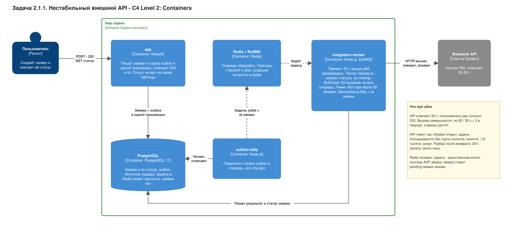
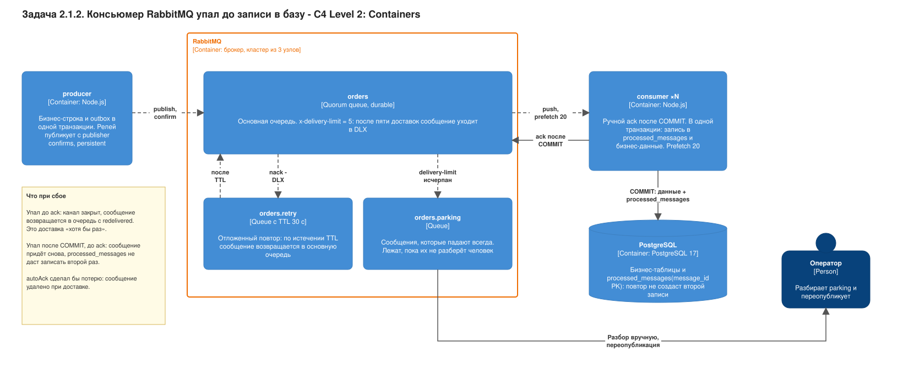
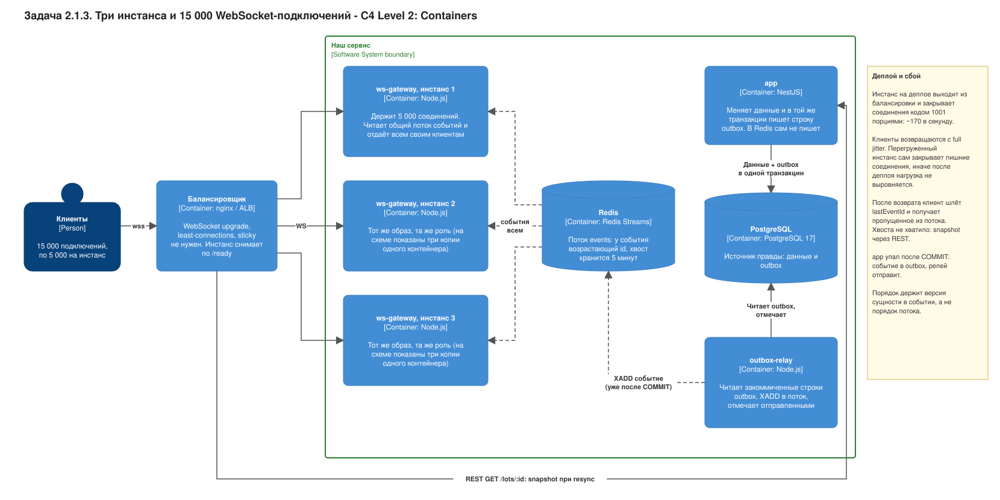
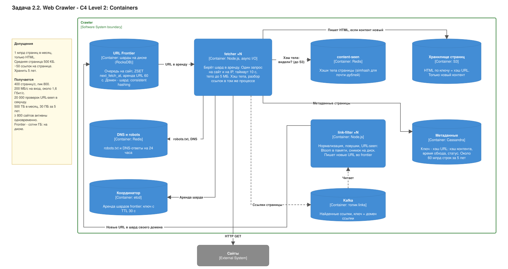

# Highload: четыре задачи на проектирование

Задание: [tasks/06 - Highload.md](<../../tasks/06 - Highload.md>), часть 2. Кода здесь нет: это ответы на вопросы с собеседования, каждый со схемой контейнеров (C4, уровень Containers) и разбором.

Принцип недели: **каждое решение с ценой, каждая цифра с допущением.** Поэтому в каждой задаче один и тот же порядок:

1. уточняющие вопросы (с них начинают на собеседовании);
2. допущения и цифры (закон Литтла: одновременных запросов = RPS × время ответа);
3. варианты с ценой и выбор;
4. схема;
5. что происходит при сбое;
6. что упрётся первым при ×10.

На схемах сплошная стрелка — синхронный вызов, пунктир — асинхронная передача, на стрелке подписано, что едет. Схемы — draw.io SVG: картинка и редактируемый исходник в одном файле.

Где решения применены к площадке из проекта — [marketplace-v4](../system-design/marketplace-v4/README.md): задача 2.1.1 стала зоной 7 (банк), задача 2.1.3 — зоной 6 (real-time). Соседние материалы: [docs/background](../background/README.md) (outbox, BullMQ, Kafka), [шпаргалка по системному дизайну](../cheatsheet/system-design.md).

| Задача                                          | Схема                                                        |
| ----------------------------------------------- | ------------------------------------------------------------ |
| [2.1.1 Нестабильный API](#211-нестабильный-api) | [unstable-api.drawio.svg](unstable-api.drawio.svg)           |
| [2.1.2 RabbitMQ](#212-rabbitmq)                 | [rabbitmq-consumer.drawio.svg](rabbitmq-consumer.drawio.svg) |
| [2.1.3 WebSocket](#213-websocket)               | [websocket-fanout.drawio.svg](websocket-fanout.drawio.svg)   |
| [2.2 Web Crawler](#22-web-crawler)              | [web-crawler.drawio.svg](web-crawler.drawio.svg)             |

---

## 2.1.1. Нестабильный API

> Нужно интегрироваться с внешним API, который иногда возвращает 500 и отвечает по 20–30 секунд. Как спроектировать интеграцию?

### Уточняющие вопросы

- Операция только читает или меняет состояние у провайдера (списание, заказ)? От этого зависит, можно ли повторять.
- Принимает ли API ключ идемпотентности (`Idempotency-Key`) и отдаёт ли статус операции по идентификатору?
- Нужен ли пользователю результат сразу или достаточно «принято, результат придёт»?
- Какая у провайдера квота (запросов в секунду) и есть ли webhook?
- Наш пиковый RPS и что делать с заявкой, если API недоступен сутки?

### Допущения и цифры

- До 20 заявок в секунду, нормальный ответ API до 1 с, при деградации 20–30 с (по условию), наш таймаут вызова 10 с.
- **Синхронно** при деградации (закон Литтла): 20 RPS × 30 с = **600 запросов висят одновременно**. Это 600 занятых обработчиков и соединений. Пул кончается, и недоступным становится не только этот эндпоинт, а весь сервис.
- За час простоя API копится 20 × 3600 = **72 000 задач**. При ~1 КБ на задачу (допущение) это ~72 МБ в Redis: хранить можно.

### Варианты

| Вариант                                                                                                                                                      | Чем платим                                                                                                                           | Когда брать                                                  |
| ------------------------------------------------------------------------------------------------------------------------------------------------------------ | ------------------------------------------------------------------------------------------------------------------------------------ | ------------------------------------------------------------ |
| **A. Синхронно в запросе**: таймаут 3 с, один повтор, circuit breaker, при отказе последнее известное значение из кэша                                       | пользователь ждёт; при деградации получает ошибку; каждый повтор удлиняет запрос; пул соединений общий с остальным API               | чтение без побочных эффектов, ответ нужен сразу (курс валют) |
| **B. Асинхронно: `202` + id.** Заявка и строка outbox в одной транзакции, воркер вызывает API с таймаутом, повторами и breaker; статус клиент читает опросом | вместо ответа статус «в обработке»; больше компонентов (outbox-relay, очередь, воркер); результат с задержкой (eventual consistency) | операция с эффектом, медленный или нестабильный API          |
| **C. B плюс webhook провайдера** вместо частых опросов                                                                                                       | публичный эндпоинт, проверка подписи, входящий повтор тоже надо переживать; опрос всё равно нужен на случай потерянного webhook      | провайдер поддерживает webhook; ускоряет B, а не заменяет    |

### Выбор

**B, а C добавляем, если провайдер умеет.** Пользователь не ждёт 30 с и не держит наш пул; заявка не пропадает, потому что лежит в PostgreSQL рядом с outbox. Это тот же путь, что у чека покупателю в проекте: [ADR 0006](../system-design/marketplace-v3/adr/0006-outbox-bullmq.md) (outbox → BullMQ), [ADR 0007](../system-design/marketplace-v3/adr/0007-idempotent-worker.md) (идемпотентный воркер); внешний API здесь — то же, что SMTP там.

Что делает воркер при вызове:

- **таймаут 10 с** (ответ дольше нам не нужен: соединение освобождается);
- **bulkhead**: не больше 20 параллельных вызовов, чтобы медленный провайдер не съел все соединения и не получил от нас лавину;
- **повторы с экспоненциальной паузой и jitter** (1, 2, 4, 8 с плюс случайная добавка, 5 попыток, как `attempts: 5` в [src/queue/queue.module.ts](../../src/queue/queue.module.ts)). Без jitter тысяча задач повторит вызов в одну и ту же секунду;
- **circuit breaker**: несколько ошибок подряд в окне — вызовов нет на 30 с, потом один пробный;
- **лимит под квоту провайдера** (rate limiter), чтобы после простоя не положить его самим.

### Какие повторы безопасны

| Ситуация                                     | Повтор                              | Почему                                                                                                      |
| -------------------------------------------- | ----------------------------------- | ----------------------------------------------------------------------------------------------------------- |
| `GET`, `PUT` и `DELETE` по id                | безопасен                           | по определению идемпотентны                                                                                 |
| `POST` с `Idempotency-Key` = id нашей заявки | безопасен                           | провайдер вернёт тот же результат, а не создаст второй                                                      |
| `POST` без ключа, ответ **500**              | опасен                              | 500 мог прийти после выполнения: операция сделана, ответ потерян                                            |
| `POST` без ключа, **таймаут**                | опасен                              | исход неизвестен: сначала спросить статус по нашему идентификатору, а если спросить нечего — разбор вручную |
| `4xx` (кроме `408` и `429`)                  | не повторять                        | запрос неверный, повтор не поможет: сразу `failed`, как `UnrecoverableError` в проекте                      |
| `429`                                        | повторять с паузой из `Retry-After` | провайдер просит подождать                                                                                  |

Если у провайдера нет ни ключа, ни статуса, то гарантии «ровно один раз» не будет: остаётся «не более одного раза» (не повторять `POST` после таймаута) и сверка по выписке.

### Что при сбое

- **API отвечает 30 с.** Пользователь уже получил `202`. Одновременно висит не больше 20 вызовов (bulkhead), каждый освобождается через 10 с. Пропускная способность воркера падает до 20 / 10 с = 2 вызова в секунду, очередь растёт, но сервис живёт.
- **API лежит час.** Breaker открыт. Важная деталь: пока он открыт, воркер **откладывает** задачу, не тратя попытку. Иначе за час задачи исчерпают пять попыток и уйдут в `failed` без вины (в BullMQ это `worker.rateLimit()` и `Worker.RateLimitError`). Копится 72 000 задач, пользователь видит «в обработке» и ожидаемый срок, срабатывает алерт по глубине очереди и возрасту старшей задачи.
- **API вернулся.** Разгребаем не быстрее квоты. При квоте 50 RPS и входящих 20 RPS запас 30 RPS: 72 000 / 30 = 2400 с, около 40 минут. Без лимита мы создали бы лавину и снова уронили бы провайдера.
- **API лежит дольше срока годности заявки.** Заявка получает статус `expired`, пользователь — уведомление, а не вечное «в обработке».
- **Redis потерян.** Заявки и outbox лежат в PostgreSQL, релей поставит задачи заново (как в [docs/background](../background/README.md)).

### Что упрётся первым при ×10

200 заявок в секунду. Первой упирается **квота провайдера**, а не наши воркеры: они масштабируются копиями, а PostgreSQL и Redis легко держат 200 вставок в секунду. Очередь растёт без предела, поэтому нужен backpressure: при глубине очереди выше порога отвечать на входе `429` или `503` вместо «принято». Дальше: договариваться о квоте, группировать запросы, если API умеет пакеты, приоритизировать (оплаченные заявки первыми).

---

## 2.1.2. RabbitMQ

> Консьюмер RabbitMQ получил сообщение и упал до сохранения в базу. Что произойдёт и как сделать систему безопаснее?

### Уточняющие вопросы

- Что делает обработчик: только пишет в базу или ещё вызывает внешний эффект (письмо, платёж)?
- Можно ли потерять сообщение? Если нет, нужны durable-очередь, persistent-сообщения и publisher confirms.
- Нужен ли порядок? С несколькими консьюмерами он теряется.
- Сколько сообщений в секунду и сколько стоит обработка одного (нужно для `prefetch`)?
- Как отличить «сообщение сломано» (не пройдёт никогда) от «временный сбой» (база недоступна)?

### Что произойдёт

| Когда упал консьюмер                                       | Что случится                                                                                                                                                       |
| ---------------------------------------------------------- | ------------------------------------------------------------------------------------------------------------------------------------------------------------------ |
| при `autoAck` (подтверждение при доставке)                 | брокер уже удалил сообщение: **оно потеряно**, в базе ничего нет                                                                                                   |
| ручной `ack` после COMMIT, упал до COMMIT                  | канал закрылся без `ack`: брокер вернёт сообщение в очередь с пометкой `redelivered` и отдаст другому консьюмеру; транзакция откатилась, повтор пишет в первый раз |
| ручной `ack` после COMMIT, упал **после** COMMIT, до `ack` | сообщение придёт снова, а запись уже есть: **дубль**, если нет защиты                                                                                              |

Вывод: с ручным подтверждением гарантия — «хотя бы раз». «Безопасно» значит **идемпотентный консьюмер**.

### Допущения

Пик 500 сообщений в секунду, обработка 20 мс. По закону Литтла одновременно в работе 500 × 0.02 = **10 транзакций**: три консьюмера с `prefetch` 20 справляются, пул соединений с базой на 10–15 хватает.

### Варианты

| Вариант                                                                                           | Чем платим                                                                                                                                           | Когда брать                                                  |
| ------------------------------------------------------------------------------------------------- | ---------------------------------------------------------------------------------------------------------------------------------------------------- | ------------------------------------------------------------ |
| **1. `autoAck`**                                                                                  | потеря при любом падении                                                                                                                             | метрики, которые можно потерять                              |
| **2. `ack` после COMMIT**                                                                         | дубли при падении между COMMIT и `ack`                                                                                                               | операция сама идемпотентна (`UPSERT` по естественному ключу) |
| **3. `ack` после COMMIT плюс `processed_messages(message_id PK)` в той же транзакции**            | одна лишняя запись и индекс на сообщение; таблицу надо чистить по сроку                                                                              | деньги, письма, любой эффект                                 |
| **4. Вариант 3 плюс quorum queue с `x-delivery-limit`, DLX, очередь повтора с TTL и parking-lot** | quorum-очередь реплицируется по Raft, поэтому медленнее и тяжелее обычной (цифры надо мерить на своей нагрузке); кто-то должен разбирать parking-lot | сообщения важны, возможны «ядовитые»                         |

### Выбор

**Вариант 4 для данных с деньгами, минимум вариант 3.** Первичный ключ `processed_messages` играет ту же роль «замка», что `deal_receipts` в [ADR 0007](../system-design/marketplace-v3/adr/0007-idempotent-worker.md): второй обработчик встанет на уникальном индексе. Сообщение должно нести собственный `message_id`, а не полагаться на номер доставки.

### Сообщение, которое падает всегда

- `nack` с `requeue=true` вернёт его в голову очереди сразу, и консьюмер крутит его по кругу на полной нагрузке. Поэтому `nack` с `requeue=false` и **dead-letter exchange**.
- Два вида ошибок:
  - **сообщение неверное** (валидация, нет сущности): сразу в `orders.parking`, без повторов (как `UnrecoverableError` в BullMQ);
  - **временный сбой** (база недоступна): в `orders.retry` с TTL 30 с, по истечении сообщение возвращается в основную очередь.
- Если консьюмер **умирает** на сообщении, `nack` не придёт. Тогда помогает счётчик доставок quorum-очереди: после `x-delivery-limit` (5) брокер сам отправляет сообщение в DLX. Для quorum-очередей у dead-letter есть режимы, и по умолчанию он «не более одного раза»: проверить в документации своей версии, нужен ли `at-least-once`.
- Parking-lot разбирает оператор: смотрит причину, чинит данные, переопубликовывает.

### Сравнение с проектом

| Вопрос                       | RabbitMQ                                      | BullMQ (воркер чеков)                                                                                                                                                                      | Kafka (архиватор)                                                                                |
| ---------------------------- | --------------------------------------------- | ------------------------------------------------------------------------------------------------------------------------------------------------------------------------------------------ | ------------------------------------------------------------------------------------------------ |
| Что подтверждает             | `ack` или `nack` на сообщение                 | обработчик вернулся (успех) или бросил исключение; задача держит lock                                                                                                                      | консьюмер коммитит **оффсет** после записи пачки в S3, а не каждое сообщение                     |
| Упал до подтверждения        | канал закрыт, сообщение возвращается сразу    | lock перестаёт продлеваться (раз в 15 с при `lockDuration` 30 с); проверка зависших раз в 30 с возвращает задачу; при `maxStalledCount: 1` второе зависание переводит в `failed`           | оффсет не двигался: после перезапуска читаем с последнего коммита                                |
| Повтор при ошибке            | `nack` + DLX + TTL                            | `attempts: 5`, экспоненциальная пауза 1, 2, 4, 8 с ([queue.module.ts](../../src/queue/queue.module.ts))                                                                                    | ошибка записи в S3: пауза 1 с … 30 с, оффсет не двигается, чтение останавливается                |
| Сообщение, что падает всегда | `x-delivery-limit` + DLX + parking            | `UnrecoverableError`: сразу `failed`; упавшие хранятся (`removeOnFail: false`), `scripts/jobs.mjs failed` и `retry`                                                                        | DLQ **нет** (известное ограничение): битое сообщение логируется и пропускается; `*.dlq` в зоне 4 |
| Защита от дубля              | `processed_messages` (надо писать самим)      | `jobId` плюс первичный ключ `deal_receipts` ([ADR 0006](../system-design/marketplace-v3/adr/0006-outbox-bullmq.md), [0007](../system-design/marketplace-v3/adr/0007-idempotent-worker.md)) | имя файла из партиции и оффсетов, `viewId`, `EXCLUDE` на `ip_bans`                               |
| Порядок                      | FIFO одной очереди, с N консьюмерами теряется | не гарантируется                                                                                                                                                                           | внутри партиции; ключ — IP                                                                       |

Общее у всех трёх: «хотя бы раз» плюс идемпотентность. Различается **где живёт состояние «обработано» и кто возвращает сообщение**: брокер по закрытию канала (RabbitMQ), брокер по истёкшему lock (BullMQ) или сам консьюмер по оффсету (Kafka).

### Что при сбое

- **Консьюмер умер до COMMIT.** Сообщение вернётся, обработается заново, дубля нет.
- **Консьюмер умер после COMMIT, до `ack`.** Сообщение придёт снова, `processed_messages` не даст записать второй раз; консьюмер повторит `ack` без записи.
- **База недоступна.** `nack` в `orders.retry`, повтор через 30 с. Консьюмер не должен подтверждать сообщение, которое не записал.
- **Брокер потерял узел.** Quorum-очередь переживает потерю одного узла из трёх; publisher confirms говорят отправителю, что сообщение принято большинством, иначе отправитель повторяет публикацию (outbox сохраняет сообщение, пока подтверждения нет).

### Что упрётся первым при ×10

5000 сообщений в секунду при 20 мс: 5000 × 0.02 = **100 одновременных транзакций**. Первой упирается **запись в базу и пул соединений**, а не брокер. Дальше: пакетная вставка, шардирование очереди по ключу (consistent-hash exchange, порядок по ключу сохраняется), а если нужно перечитывать историю или читать независимо несколькими группами, то Kafka (как для кликстрима в проекте). Таблица `processed_messages` при 5000 в секунду даёт 432 млн строк в сутки: нужна чистка по сроку или партиционирование **по дню** (здесь оно уместно: это журнал без внешних ключей на него, и уникальность нужна только внутри окна повторной доставки; для денежных таблиц проекта это не так, см. [ADR 0014](../system-design/marketplace-v4/adr/0014-partitioning-and-sharding-deferred.md)).

---

## 2.1.3. WebSocket

> Три инстанса бэкенда и 15 000 WebSocket-подключений. Как обеспечить доставку событий всем клиентам?

На схеме показаны три блока `ws-gateway`: это **один контейнер** (один образ), нарисованный три раза ради вопроса «событие на инстансе 1, клиент на инстансе 3».

### Уточняющие вопросы

- События личные (одному пользователю) или всем? Сколько подписчиков у одного события?
- Частота и размер события?
- Можно ли потерять событие и важен ли порядок?
- Нужна ли история после переподключения и за какой срок?
- Как клиент проходит авторизацию и что с токеном, который истёк, пока соединение открыто?

### Допущения и цифры

- 15 000 подключений на 3 инстанса: **5 000 на инстанс**. Память ~50 КБ на соединение (буферы и состояние, допущение): ~250 МБ на инстанс. Лимит открытых файлов (`ulimit -n`) поднять с типичных 1024 до 65 536.
- Событие «лот продан / цена изменилась»: 10 в секунду всем, ~200 байт. Исходящий поток: 15 000 × 10 = **150 000 сообщений в секунду** всего, около 50 000 на инстанс, 30 МБ/с (240 Мбит/с) всего.
- Читают общий поток всего три копии, то есть 30 чтений в секунду: для Redis это ничто. Тяжёлая часть — исходящая рассылка клиентам, а не доставка между инстансами.
- Idle-таймаут балансировщика (обычно 60 с) обрывает молчащее соединение: нужен ping/pong раз в 25–30 с.

### Варианты доставки между инстансами

| Вариант                                                                                                                                  | Чем платим                                                                                                                                          | Когда брать                                             |
| ---------------------------------------------------------------------------------------------------------------------------------------- | --------------------------------------------------------------------------------------------------------------------------------------------------- | ------------------------------------------------------- |
| **A. Redis Pub/Sub** (например, Socket.IO redis-adapter): каждая копия подписана, `PUBLISH` доходит до всех подписанных                  | fire-and-forget: копия, которая в этот момент перезапускалась или переподключалась к Redis, событие **пропустила**; повтора и истории нет           | эфемерные события («печатает», курсор)                  |
| **B. Redis Streams**: событие пишется в поток (`XADD`) с возрастающим id, копии читают (`XREAD`), клиент при возврате шлёт `lastEventId` | хвост потока занимает память (5 мин × 10 событий/с × 200 Б ≈ 600 КБ: пренебрежимо); Redis — точка отказа (Sentinel или Cluster); replay надо писать | события, которые нельзя терять при переподключении      |
| **C. Реестр «пользователь → инстанс»** и адресная доставка в канал нужного инстанса                                                      | реестр надо поддерживать (TTL, устаревшие записи после падения); лишний переход                                                                     | личные события, где адресатов мало, а подписчиков много |
| **D. Управляемый сервис** (Ably, Pusher, API Gateway WebSocket)                                                                          | деньги за соединение и сообщение, привязка к поставщику, чужие данные                                                                               | нет желания держать соединения самим                    |

### Выбор

**B, Redis Streams.** Один механизм решает обе проблемы: доставку на другой инстанс **и** повтор пропущенного после переподключения. Для эфемерных событий можно отдельно оставить A. Для площадки поток пишет `outbox-relay` после COMMIT, а не `app` напрямую: тогда нет двойной записи, как в [ADR 0006](../system-design/marketplace-v3/adr/0006-outbox-bullmq.md) (подробности — [ADR 0015](../system-design/marketplace-v4/adr/0015-realtime-ws-gateway.md)).

Путь события 1 → 3: транзакция закоммитила изменение → событие попало в поток → **все три** шлюза его читают → каждый отдаёт его своим подключённым клиентам, подписанным на этот лот.

### Что с подключениями при деплое

Rolling-деплой по одной копии:

1. `/ready` копии начинает отвечать `503`: балансировщик перестаёт слать ей новые подключения (так же, как в [graceful shutdown](../cheatsheet/system-design.md) проекта).
2. Копия закрывает соединения кодом `1001` (Going Away) порциями, а не одним залпом.
3. Клиенты переподключаются с **экспоненциальной паузой и jitter** (1 с × 2ⁿ до 30 с, ±50%). Если 5 000 клиентов вернутся в одну секунду, получим шторм авторизации. С jitter это ~170 подключений в секунду.
4. Ёмкость: пока одна копия вышла, две остальные держат по 7 500 соединений. Лимит копии надо ставить выше (запас N+1), либо на время деплоя сначала поднимать четвёртую копию.

### Что клиент получит после переподключения

- Клиент хранит `lastEventId` и присылает его при подключении; шлюз отдаёт пропущенное из потока (`XRANGE` от этого id). Дубли клиент отбрасывает по id.
- **Потеряет:** события старше хвоста потока (5 мин). Шлюз отвечает `resync`, клиент берёт состояние из PostgreSQL через REST (`GET /lots/:id`). Эфемерные события, которых нет в потоке, пропадают. Сообщения, отправленные клиентом во время разрыва, надо держать в локальной очереди клиента с ключом идемпотентности.

### Что при сбое

- **Упал шлюз.** Его клиенты переподключаются к двум остальным; пропущенное доезжает из потока.
- **Redis недоступен.** Новые события не рассылаются, соединения живут; клиент видит устаревшие данные, и после возврата Redis делает `resync`. Деньги и сделки от Redis не зависят: источник правды PostgreSQL.
- **Клиент медленный.** Исходящий буфер соединения ограничен: при переполнении соединение закрывается, иначе медленный клиент съест память копии.

### Что упрётся первым при ×10

150 000 подключений: 30 копий. Исходящий поток **1,5 млн сообщений в секунду**, около 2,4 Гбит/с. Redis при этом ни при чём: 30 копий читают 10 событий в секунду — 300 чтений. Первым упирается **исходящая рассылка шлюзов** (50 000 сообщений в секунду на копию остаются тем же потолком CPU) и лимиты балансировщика на соединения. Лекарства: подписка по лотам (событие уходит только тем, кто смотрит этот лот), объединение событий в кадр раз в 100 мс, шардирование потоков по комнатам.

---

## 2.2. Web Crawler

> Задача из главы [Design A Web Crawler](https://bytebytego.com/courses/system-design-interview/design-a-web-crawler) (ByteByteGo). Здесь — часть «с LLM»: схема и сбои. Мок-интервью в паре — отдельно, вне репозитория.

### Уточняющие вопросы и допущения

- Зачем краулер: индексация для поиска (по главе). Только HTML, без картинок, видео и JavaScript-рендеринга.
- Объём: **1 млрд страниц в месяц**, хранить 5 лет, средняя страница 500 КБ.
- Свежесть: повторный обход важных страниц чаще; приоритеты нужны, но в первом приближении не считаем их.
- Дубли: контент дублируется заметно (в главе приводится оценка ~29%), поэтому нужна проверка.
- Уважаем `robots.txt` и не перегружаем чужие сайты.

### Оценка объёмов

| Величина                              | Расчёт                                                          | Итог                                                                                                            |
| ------------------------------------- | --------------------------------------------------------------- | --------------------------------------------------------------------------------------------------------------- |
| Страниц в секунду                     | 10⁹ / (30 × 24 × 3600) = 10⁹ / 2,6·10⁶                          | ≈ **400**, пик ≈ **800**                                                                                        |
| Канал на вход                         | 400 × 500 КБ                                                    | 200 МБ/с ≈ **1,6 Гбит/с**                                                                                       |
| Хранилище за месяц                    | 10⁹ × 500 КБ                                                    | **500 ТБ**                                                                                                      |
| Хранилище за 5 лет                    | 500 ТБ × 60                                                     | **30 ПБ**                                                                                                       |
| То же со сжатием (допущение: в 5 раз) | 500 / 5 ТБ в месяц                                              | 100 ТБ в месяц, 6 ПБ за 5 лет                                                                                   |
| Одновременных загрузок                | закон Литтла: 800 × 1 с (допущение: среднее время страницы 1 с) | ≈ 800; с 5% медленных сайтов по 10 с (таймаут) ещё ≈ 400: **около 1200**, то есть 12 воркеров по 100 соединений |
| Bloom-фильтр на URL                   | m = −n·ln p / (ln 2)² для n = 10⁹, p = 1% → 9,6·10⁹ бит         | ≈ **1,2 ГБ** (10 млрд URL — 12 ГБ), около 7 хэш-функций                                                         |
| Хэши контента                         | 10⁹ × 16 Б                                                      | 16 ГБ в месяц: влезает в KV                                                                                     |
| Метаданные                            | 10⁹ × ~200 Б в месяц                                            | 200 ГБ в месяц, 60 млрд строк за 5 лет: не один PostgreSQL, нужна широкая колоночная база по ключу (Cassandra)  |
| Запас URL во frontier                 | 400 × 86 400 с × ~100 Б                                         | ≈ 3,5 ГБ на сутки вперёд                                                                                        |

### Как не скачать страницу дважды и не зациклиться

| Что                                                       | Решение                                                                                                              | Чем платим                                                                                 |
| --------------------------------------------------------- | -------------------------------------------------------------------------------------------------------------------- | ------------------------------------------------------------------------------------------ |
| Один URL в разном написании                               | нормализация: схема и хост в нижний регистр, без фрагмента `#`, порядок параметров, без `/index.html`                | возможна ошибка: два разных адреса слились                                                 |
| URL уже видели (**URL-seen**)                             | Bloom-фильтр в Redis по нормализованному URL                                                                         | ложные срабатывания 1%: **1% новых страниц никогда не скачаем**; удалять из фильтра нельзя |
| Тот же контент по другому URL (**content-seen**)          | хэш тела страницы в KV; simhash для почти-дублей                                                                     | память под хэши; simhash считается дорого                                                  |
| Бесконечные URL (**ловушки**: календарь, сессии в адресе) | максимальная длина URL, максимальная глубина, **лимит страниц на хост**, выбрасывать параметры сессий, чёрный список | можно недокачать большой настоящий сайт; ловушки приходится разбирать вручную              |

### Как не положить чужой сайт

- `robots.txt` кэшируется на 24 часа: запрещённые пути не скачиваем, `Crawl-delay` соблюдаем.
- **Очередь на каждый хост**; из одной очереди берёт только один воркер и качает **по одной странице**, с паузой ≥ 1 с. Так хост не получает параллельных запросов.
- Ответы `429` и `503` откладывают весь хост (экспоненциальная пауза), а не одну страницу.
- Цена: быстрый обход одного большого сайта невозможен (10 млн страниц с одним запросом в секунду — 115 дней): для больших сайтов договариваются отдельно.
- Хотя бы 400 хостов должны быть активны одновременно, иначе 400 страниц в секунду недостижимы.

### Очередь URL: ключ и устройство

**Ключ разделения — `hash(host)`.** Все URL одного хоста попадают в один шард frontier и к одному воркеру. Это даёт сразу три вещи: вежливость (очередь на хост у одного владельца), локальность кэшей DNS и `robots.txt`, простые счётчики лимита на хост.

| Вариант ключа             | Чем платим                                                                                 |
| ------------------------- | ------------------------------------------------------------------------------------------ |
| **`hash(host)` (выбран)** | «горячие» хосты дают перекос (у одного хоста много URL); лечится лимитом страниц на хост   |
| `hash(URL)`               | равномерно, но вежливость придётся считать общим счётчиком: хост достаётся разным воркерам |
| случайно, без ключа       | то же, что `hash(URL)`, плюс нет локальности кэшей                                         |

Устройство frontier:

- на шарде: очередь URL на каждый хост и отсортированное множество хостов по `next_fetch_at` (Redis `ZSET`): воркер берёт хост, у которого пришло время;
- **аренда (lease)**: взятый URL получает срок 60 с; не подтверждён — возвращается в очередь;
- приоритет: несколько очередей по важности (в главе — приоритизатор по PageRank, посещаемости, частоте обновлений); выбираем чаще из высоких.

### Что при сбое

- **Сайт отвечает 30 секунд.** Таймаут запроса 10 с и лимит размера тела (например, 5 МБ) освобождают соединение. Асинхронный ввод-вывод: воркер не стоит на одном сайте, пока соединение висит, качает другие хосты. Хост помечается медленным: пауза до следующего запроса растёт, приоритет падает. Повторов ограниченное число (3), потом URL откладывается на часы.
- **Воркер умер посреди загрузки.** Объект в хранилище пишется **только после полной загрузки** (по ключу = хэш URL), поэтому в хранилище не остаётся половины страницы. URL не подтверждён, аренда истекает через 60 с, URL возвращается в очередь, его берёт другой воркер. Повтор безопасен: это `GET`, запись по тому же ключу перезаписывает объект, content-seen не даст сохранить дубль.
- **Шард frontier упал.** URL этого диапазона хостов не выдаются, остальные шарды работают; frontier реплицируется, состояние обхода сохраняется, чтобы перезапуск продолжал, а не начинал с нуля.
- **Сломанная страница.** Парсер валидирует страницу и пропускает её: одна плохая страница не останавливает конвейер.

### Что упрётся первым при ×10

4000 страниц в секунду:

1. **Канал и хранилище**: 5 ПБ в месяц, ~16 Гбит/с. Первым упираемся в деньги за объём и сеть: помогают сжатие и хранение только извлечённого текста.
2. **DNS**: до 4000 запросов в секунду (кэш по хосту сокращает, но нужен свой резолвер).
3. **Ширина обхода**: при лимите «один запрос в секунду на хост» нужно **не меньше 4000 хостов, активных одновременно**. Длинный хвост мелких сайтов даёт много хостов, но мало страниц на каждый.
4. Память URL-seen (Bloom в десятки ГБ: шардировать по `hash(URL)`) и пропускная способность frontier.

### Заметка: что у меня иначе, чем в главе

Числа (400 страниц в секунду, 500 ТБ в месяц, 30 ПБ) совпадают с главой. Состав блоков тоже: frontier, загрузчик, DNS, парсер, content-seen, хранилище, извлечение ссылок, фильтр, URL-seen. Отличия:

| Что                   | В главе                                                            | У меня                                                                                    |
| --------------------- | ------------------------------------------------------------------ | ----------------------------------------------------------------------------------------- |
| Хранение frontier     | основная часть на диске, буфер в памяти, периодически сбрасывается | Redis по шардам `hash(host)`: быстрее, но дороже по памяти и нужна репликация             |
| Падение воркера       | сказано про сохранение состояния и перезапуск обхода               | явная **аренда URL** с истечением: упавший воркер не теряет URL и не блокирует хост       |
| Bloom-фильтр          | называется, размер не считается                                    | посчитан (1,2 ГБ на 10⁹), названа цена: 1% новых страниц теряется                         |
| Ловушки               | максимальная длина URL, ручной разбор                              | плюс глубина, **лимит страниц на хост**, чёрный список                                    |
| Метаданные            | «URL Storage» без выбора                                           | широкая колоночная база (Cassandra): 60 млрд строк за 5 лет не уместить в один PostgreSQL |
| Сбой медленного сайта | не разбирается                                                     | таймаут, лимит тела, пауза хоста, ограниченные повторы                                    |

Что я не разбирал: рендеринг JavaScript (в главе — server-side rendering), антиспам, аналитика.

**Где застряли в паре:** не заполнено, будет после мок-интервью (задание 2.2, пункт 2 и 2.3). Мок-интервью делается вручную, вне репозитория.

---

## Приёмка

| Критерий                                                                      | Результат                                                                                              |
| ----------------------------------------------------------------------------- | ------------------------------------------------------------------------------------------------------ |
| 2.1.1–2.1.3: по каждой задаче схема контейнеров и описание сбоев              | выполнено: три схемы и раздел «Что при сбое» у каждой                                                  |
| 2.1.1–2.1.3: минимум два варианта с ценой, выбор, уточняющие вопросы записаны | выполнено: у каждой задачи таблица вариантов (3–4), выбор и список вопросов                            |
| 2.2: схема контейнеров и описание сбоев                                       | выполнено: [схема](web-crawler.drawio.svg), раздел «Что при сбое» (сайт 30 с, воркер умер)             |
| 2.2: оценка объёмов с допущениями                                             | выполнено: таблица расчётов                                                                            |
| 2.2: заметка «где в паре застряли и что у тебя иначе, чем в главе»            | **частично**: часть «что иначе» заполнена; «где застряли в паре» **не заполнено** (нужно мок-интервью) |
| 2.2 п. 2, 2.3 мок-интервью в паре, 2.4 лайв-кодинг, часть 1 (теория)          | **не выполнено**: делается вручную вне репозитория, по решению пропущено                               |
