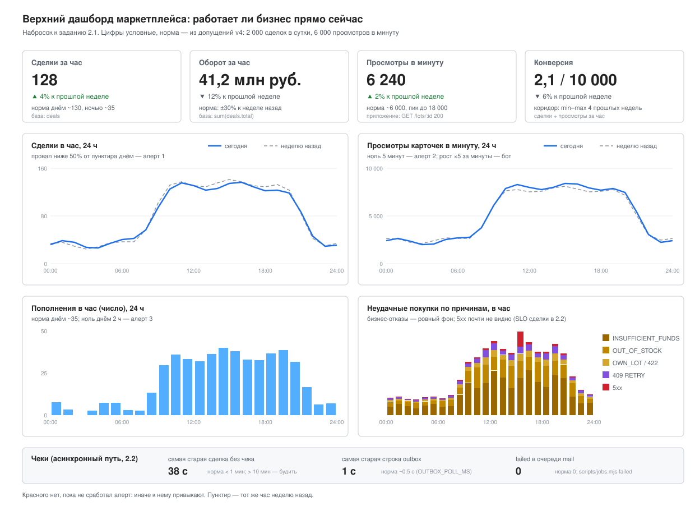

# Мониторинг и observability: дашборд, SLO, аудит-лог

Задание: [tasks/07 - Monitoring and observability.md](<../../tasks/07 - Monitoring and observability.md>), часть 2. В основном это проектирование, как в [docs/highload](../highload/README.md). Принцип тот же: **каждое решение с ценой, каждая цифра с допущением.** Метрики, SLI и алерты 2.1–2.2 при этом подключены к проекту (пункт 2.6, по желанию): Prometheus и OpenTelemetry, см. [что подключено](#что-подключено-prometheus-и-opentelemetry).

Опираюсь на то, что уже есть в проекте:

- **Логи.** pino в JSON; у каждого запроса id из заголовка `x-request-id` или новый UUID ([logger.config.ts](../../src/config/logger.config.ts)). pino-http пишет в строку завершения запроса `res.statusCode`, `responseTime` и `error_code` — машинный код из тела ошибки (`RETRY`, `OUT_OF_STOCK`, `IP_BANNED`). Под трейсингом в каждой строке ещё `trace_id` и `span_id`.
- **Данные асинхронного пути — в базе.** `outbox.created_at` и `published_at`, `deals.created_at` и `deal_receipts.sent_at` ([миграция](../../src/migrations/1761000000000-BackgroundJobs.ts)). `sent_at` — момент, когда SMTP-сервер принял письмо: строку вставляют после отправки ([receipt.job.ts](../../src/receipts/receipt.job.ts)).
- **Очередь.** BullMQ, задача повторяется 5 раз с паузами 1, 2, 4, 8 с (`JOB_ATTEMPTS`, `JOB_BACKOFF_MS`), потом остаётся в `failed`. Посмотреть их — `node scripts/jobs.mjs failed`.
- **Почта.** SMTP указывает на Mailpit. У чека заголовок `Message-ID: <receipt-<deal>@marketplace.local>` ([templates.ts](../../src/mail/templates.ts)).
- **Цифры нагрузки** — из [marketplace-v4](../system-design/marketplace-v4/README.md#оценка-нагрузки): 2 000 сделок в сутки, 100 просмотров карточек в секунду, пик ×3, около 180 тыс. пополнений в год.
- **Метрики и трейсы.** Каждый процесс отдаёт `GET /metrics` на своём порту, Prometheus собирает их и считает SLI и алерты. Трейсы идут в Jaeger. Где ниже написано «приложение», имеется в виду гистограмма `http_server_request_duration_seconds{method, route, status, code}`. Метка `code` и поле лога `error_code` — **обязательная предпосылка** SLI сделки. Без них по коду `409` не отличить `RETRY` от `INSUFFICIENT_FUNDS` и `OUT_OF_STOCK`: до этой правки pino-http писал только статус, и по логам такая разбивка не считалась.

| Задача                                                                   | Схема                                                          |
| ------------------------------------------------------------------------ | -------------------------------------------------------------- |
| [2.1 Дашборд бизнес-метрик и алерты](#21-дашборд-бизнес-метрик-и-алерты) | [business-dashboard.drawio.svg](business-dashboard.drawio.svg) |
| [2.2 SLI, SLO, SLA и алерты](#22-sli-slo-sla-и-алерты)                   | —                                                              |
| [2.3 Аудит-лог](#23-аудит-лог-действий-пользователей)                    | схема будет после черновика                                    |

---

## 2.1. Дашборд бизнес-метрик и алерты

> Верхний дашборд маркетплейса: его открывают первым, когда «что-то не так». Он отвечает на вопрос: работает ли бизнес прямо сейчас.

### Допущения

- 2 000 сделок в сутки, из них **80% днём, с 9 до 21** (допущение: покупают компании в рабочее время). Днём ≈ 1 600 / 12 ≈ **130 сделок в час**, ночью ≈ 35 в час. По выходным — допущение: вдвое меньше.
- Просмотров 100 в секунду в среднем = **6 000 в минуту**, в пике ×3 = 18 000 в минуту.
- Пополнений 180 тыс. в год ≈ 500 в сутки ≈ **20 в час** в среднем, днём около 35.
- Конверсия: 2 000 сделок / 8,6 млн просмотров в сутки ≈ **2,3 сделки на 10 000 просмотров**.

### Метрики и источник

Правило выбора источника: **факт денег — из базы, факт запроса — из приложения.** Сделка, которую приложение «провело», может откатиться в транзакции (`RETRY`, триггер), поэтому сделки и оборот считаю по закоммиченным строкам. Просмотр и отказ в базе не оставляют следа, их видит только приложение.

| #   | Метрика                         | Источник                                               | Норма                                                                                |
| --- | ------------------------------- | ------------------------------------------------------ | ------------------------------------------------------------------------------------ |
| 1   | Сделки в час, число             | база: `count(*)` из `deals` по `created_at`            | ~130 в час днём, ~35 ночью; сравнение с тем же часом неделю назад                    |
| 2   | Оборот в час, сумма сделок      | база: `sum(total)` из `deals`                          | тот же час неделю назад ±30%; одна крупная сделка сдвигает сумму, поэтому без алерта |
| 3   | Просмотры карточек в минуту     | приложение: ответы `200` на `GET /lots/:id`            | ~6 000 в минуту, пик до 18 000; по профилю суток                                     |
| 4   | Конверсия «просмотр → сделка»   | считается из 1 и 3: сделок на 10 000 просмотров за час | ~2,3; коридор — минимум и максимум того же часа за 4 прошлые недели                  |
| 5   | Пополнения в час, число и сумма | база: `wallet_operations` с `type = 'deposit'`         | ~35 в час днём; ноль днём дольше 2 ч — не норма                                      |
| 6   | Неудачные покупки по причинам   | приложение: `status` и `code` у `POST /deals`          | бизнес-отказы (`INSUFFICIENT_FUNDS`, `OUT_OF_STOCK`, `OWN_LOT`) — фон; `5xx` < 0,1%  |

Почему просмотры из приложения, а не из потока `lot-views`. Публикация в Kafka по правилу проекта не роняет запрос, а при сбое Kafka событие теряется (допущено в v3). Если считать просмотры из потока, то «Kafka лежит» выглядит как «покупатели ушли». Счётчик в приложении считает то, что увидел покупатель. Отставание `lot-views` от счётчика — отдельная техническая метрика, не на этом дашборде.

Почему неудачные покупки по причинам, а не одним числом. Рост `INSUFFICIENT_FUNDS` — это проблема пополнений (банк, зона 7 в v4), а не сделок. Рост `RETRY` (`409`) — это блокировки на горячем лоте. Рост `5xx` — это поломка. Одно число склеило бы три разные истории.

### Набросок дашборда



| Ряд      | Панель                                                                                                            | Что считаю нормой                                                           |
| -------- | ----------------------------------------------------------------------------------------------------------------- | --------------------------------------------------------------------------- |
| Верх     | 4 числа за последний час со стрелкой «к тому же часу неделю назад»: сделки, оборот, просмотры в минуту, конверсия | стрелка в пределах ±30%; цвет красный, только если сработал алерт           |
| Середина | График сделок в час за 24 ч, поверх — пунктир «неделю назад»                                                      | линии идут вместе; провал до нуля днём — не норма                           |
| Середина | График просмотров в минуту за 24 ч, поверх — пунктир «неделю назад»                                               | то же; резкий рост ×5 за минуты — бот, его режет abuse-detector (`ip-bans`) |
| Низ      | Пополнения в час (столбики) и неудачные покупки по причинам (stacked)                                             | `5xx` почти не видно; бизнес-отказы — ровный фон                            |
| Низ      | Строка статуса чеков: самая старая сделка без чека, `failed` в очереди `mail`                                     | меньше 1 минуты; `failed` = 0                                               |

Красного на дашборде нет, пока не сработал алерт: иначе к нему привыкают и перестают замечать.

### Алерты

Как выбираю порог:

- **Фиксированный**, если у нормального значения есть твёрдая граница: ноль просмотров не бывает никогда, доля `5xx` не зависит от часа.
- **От прошлой недели**, если у метрики сильный профиль по часам и дням: 130 сделок днём и 35 ночью, и фиксированный порог будет либо глух днём, либо шумен ночью. Неделя, а не вчера: вчера мог быть выходной.

| #   | Метрика и порог                                                                                    | Окно                                 | Тип порога                                                 | Кто получает                         | Первое действие                                                                                                                                                                                                                                             |
| --- | -------------------------------------------------------------------------------------------------- | ------------------------------------ | ---------------------------------------------------------- | ------------------------------------ | ----------------------------------------------------------------------------------------------------------------------------------------------------------------------------------------------------------------------------------------------------------- |
| 1   | **Сделок меньше 50% от того же окна неделю назад**, и неделю назад было не меньше 20 сделок в окне | 30 мин днём (≈ 65 сделок), 2 ч ночью | от прошлой недели: у сделок профиль по часам               | дежурный разработчик; копия продукту | Открыть просмотры и неудачные покупки на этом же дашборде. Просмотры тоже упали — проблема с трафиком (балансировщик, DNS, реклама). Просмотры в норме, а растут `5xx` или `RETRY` — ломается покупка: последний деплой, логи `POST /deals` по `request_id` |
| 2   | **Просмотров карточек ноль**                                                                       | 5 мин                                | фиксированный: ноль не бывает нормой                       | дежурный разработчик                 | Проверить снаружи `GET /ready` и `GET /lots/:id` через балансировщик. Не отвечает — балансировщик и копии `app`. Отвечает `429` всем — бан-лист (ошибочный бан по IP балансировщика)                                                                        |
| 3   | **Пополнений ноль днём**                                                                           | 2 ч, с 9 до 21 (ожидаем ≈ 70)        | фиксированный: при 35 в час ноль за 2 ч случайно не бывает | дежурный разработчик; копия финансам | Проверить, доходят ли до нас уведомления банка (логи `POST .../wallet/deposits`, статус банка). Нет запросов — проблема на стороне банка или сети, пишем банку. Есть запросы с `4xx/5xx` — ломаемся мы                                                      |

Почему порог 50% и минимум 20 сделок. При ожидании 65 сделок за 30 минут случайный провал ниже 33 почти невозможен (по Пуассону — меньше одного раза в год при проверке раз в минуту). Ночью за 30 минут ждём ~17 сделок, и случайное «8 вместо 17» бывает. Поэтому ночью окно 2 часа, а условие «было не меньше 20» не даёт алерту срабатывать на почти пустом окне.

Почему нет алерта на `5xx` при покупке здесь: это симптом надёжности, он в 2.2 как алерт на расход бюджета ошибок по SLO сделки. Два алерта на одно и то же будят дважды.

### Чем платим

- **Метрики из базы — это запросы к основной базе.** Индекса по `deals.created_at` нет. Сейчас таблица маленькая (≈ 730 тыс. строк в год), но `count(*)` раз в минуту по всей таблице растёт вместе с ней. Нужен индекс `deals (created_at)` (миграция) или запросы на реплику (зона 3 в v4), а при ×100 — агрегат по часам, который пишет scheduler.
- **Порог от прошлой недели шумит в праздники и после рекламы.** Неделю назад был праздник — сегодня «рост ×3», сегодня праздник — «провал». Лечится выключением алерта на праздники в календаре дежурств (ручная работа) или сравнением с медианой 4 прошлых недель (сложнее объяснить, почему сработало).
- **Счётчики в приложении — это код и хранилище метрик.** `prom-client`, отдельный порт `/metrics` в каждом процессе, контейнер Prometheus с диском на 35 дней, тесты на 100% покрытия. Метрики из базы (сделки, оборот, пополнения) в Prometheus не попадают: нужен экспортёр SQL-запросов или Grafana с источником Postgres. Пока это SQL по расписанию — следующий шаг.
- **Алерт 1 ночью реагирует медленнее:** окно 2 часа значит, что ночная поломка покупки будит в среднем через час. Принимаю: ночью сделок мало, и поломку покупки быстрее поймает алерт на `5xx` из 2.2.

---

## 2.2. SLI, SLO, SLA и алерты

Теория — [Service Level Objectives](https://sre.google/sre-book/service-level-objectives/), как алертить — [Alerting on SLOs](https://sre.google/workbook/alerting-on-slos/).

### Три пути

| Путь                     | SLI: хорошее / все                                                                                                                                                                             | Источник                                                                                                                                   | SLO за 28 дней | SLA (в договоре, за месяц)                    |
| ------------------------ | ---------------------------------------------------------------------------------------------------------------------------------------------------------------------------------------------- | ------------------------------------------------------------------------------------------------------------------------------------------ | -------------- | --------------------------------------------- |
| Карточка `GET /lots/:id` | ответ не `5xx`, не оборван и быстрее **300 мс** / все запросы к карточке (`404` — хороший: мы честно ответили). Отказы бана (`429 IP_BANNED`) — вне SLI, их сторожит отдельный алерт, см. ниже | приложение: `http_server_request_duration_seconds`, бакет `le="0.3"`                                                                       | **99,9%**      | 99,5% ответов без `5xx`                       |
| Сделка `POST /deals`     | ответ не `5xx`, не `409 RETRY`, не оборван и быстрее **1 с** / все запросы. Бизнес-отказы (`INSUFFICIENT_FUNDS`, `OUT_OF_STOCK`, `OWN_LOT`, `422`) — хорошие: система сработала верно          | приложение: та же гистограмма, бакет `le="1"`, метка `code`                                                                                | **99,9%**      | 99,5% запросов без `5xx`                      |
| Чек на почту             | сделки, у которых `deal_receipts.sent_at − deals.created_at` < **5 мин** / сделки старше 5 минут. `sent_at` — SMTP-сервер **принял** письмо                                                    | база: `deals LEFT JOIN deal_receipts`; быстрый сигнал — гистограмма `receipt_delivery_seconds` в worker и `receipt_oldest_missing_seconds` | **99%**        | не обещаем; если клиент требует — 98% за 24 ч |

Почему такие границы «хорошего»:

- **300 мс у карточки.** В v4 карточка — один `SELECT` по первичному ключу плюс проверка бана; на стенде это единицы миллисекунд. 300 мс — заметная пользователю задержка, а не наша медиана: SLO не должен краснеть от обычного разброса.
- **1 с у сделки.** Сделка ждёт блокировки лота и кошельков, `lock_timeout` = 4 с. Ждать 2–3 секунды на горячем лоте — уже плохо для покупателя, хоть ответ и `201`.
- **`409 RETRY` — плохой.** Для покупателя это «не получилось, нажмите ещё раз», хотя денег и товара хватало. Если считать `RETRY` хорошим, SLO будет зелёным при сплошных конфликтах блокировок.
- **У чека знаменатель — сделки старше 5 минут.** Сделка моложе 5 минут без чека ещё ни хорошая, ни плохая. Без этого SLI проседает на каждой свежей сделке.
- **`sent_at` — после SMTP, а не до.** Раньше строку `deal_receipts` вставляли первой (она же была блокировкой), письмо уходило потом, и `sent_at` был временем _начала_ отправки. Задача, начатая через 4:59 и отправленная через 5:02, засчитывалась хорошей. Теперь блокировка — строка сделки (`FOR NO KEY UPDATE`), а отметку вставляют после ответа SMTP. Цена: блокировка строки сделки держится, пока идёт письмо, но ждёт её только другая копия той же задачи (внешние ключи на `deals` берут `KEY SHARE`, который с ней не конфликтует).
- **Граница SLI чека — SMTP принял письмо, а не покупатель его получил.** Что было дальше (спам-фильтр, полный ящик, отказ чужого сервера), мы не видим. Доставку до ящика можно мерить только через провайдера: веб-хуки доставки и отказов (bounce). Это следующий шаг, если появится внешний провайдер. Пока SLI честно называет то, что меряет.
- **Оборванный запрос — плохой.** Клиент не дождался и закрыл соединение: в метке `status` он `aborted`, а не тот `200`, который сервер отдал бы потом.
- **Отказы бана — вне SLI, но не «хорошие».** Если считать быстрый `429` хорошим, то ошибочный бан IP балансировщика оставит SLI на 100%, а покупатели потеряют доступ. Если считать его плохим, бот, который продолжает стучаться после бана, сожжёт бюджет: 1 000 запросов в минуту при 6 000 настоящих — это 14% плохих, то есть ночной звонок из-за того, что защита сработала верно. Поэтому бан исключён из SLI карточки (его ответ и так не доходит до маршрута: метка `route="unmatched"`), а за ошибочными отказами следит отдельный алерт по симптому: «много отказов **и** настоящих просмотров меньше половины от прошлой недели».

### Цена девяток

Окно 28 дней = 40 320 минут. Бюджет ошибок — доля плохих событий, которую можно потратить:

| SLO    | Простоя за 28 дней | Плохих сделок из 56 000 | Что нужно, чтобы держать                                                                                                                                                                                                                             |
| ------ | ------------------ | ----------------------- | ---------------------------------------------------------------------------------------------------------------------------------------------------------------------------------------------------------------------------------------------------- |
| 99%    | 6,7 ч              | 560                     | то, что есть: одна база, Compose, `restart: unless-stopped`. Деплой с простоем в минуты укладывается                                                                                                                                                 |
| 99,9%  | 40 мин             | 56                      | несколько копий `app` за балансировщиком, деплой без простоя (graceful shutdown уже есть: `/ready` → 503, дренаж), дежурный, который отвечает за минуты. **Деплой, который ломает API на 20 минут, съедает половину месячного бюджета**              |
| 99,99% | 4 мин              | 6                       | всё, что карта v4 откладывает: копии в разных зонах, Postgres с автоматическим failover (Patroni) и проверенными учениями, Redis Sentinel, Kafka на 3 брокерах. Человек за 4 минуты даже не успеет открыть ноутбук — нужна автоматика восстановления |

Каждая следующая девятка в 10 раз уменьшает простой и требует автоматики там, где раньше хватало человека. 99,99% для площадки с 2 000 сделок в сутки не окупается: покупатель дорогого оборудования повторит покупку через 5 минут, а Patroni, три зоны и учения — это отдельная команда.

**Почему чек 99%, а не 99,9%.** Путь длиннее: outbox → relay → Redis → worker → SMTP. У внешнего SMTP своя доступность, которую мы не контролируем. Чек через 10 минут вместо 5 покупатель не заметит: сделка уже прошла, деньги списаны.

### Почему SLA ниже SLO

SLA — обещание в договоре со штрафом. SLO — внутренняя цель, по которой мы начинаем чинить. Если SLA равен SLO, первый же расход бюджета — это штраф, и нет времени отреагировать. Запас между 99,9% и 99,5% — это ≈ 40 минут против ≈ 3,5 часа простоя за месяц: два-три плохих деплоя мы чиним сами, до денег клиенту.

В SLA нет времени ответа, только `5xx`: время ответа клиент меряет у себя, вместе со своей сетью, и спорить о нём нечем. Чек в SLA не обещаем: у SMTP-провайдера своего SLA с нами пока нет, и обещать за него нельзя.

### Алерты на SLO

Многооконный burn rate из [SRE Workbook](https://sre.google/workbook/alerting-on-slos/#6-multiwindow-multi-burn-rate-alerts). Burn rate — во сколько раз быстрее нормы тратим бюджет: 1× значит, что бюджет кончится ровно через 28 дней. Алерт срабатывает, только когда порог превышен **и в длинном, и в коротком окне**: длинное отсекает случайный всплеск, короткое — гасит алерт, как только починили.

Для SLO 99,9% (бюджет 0,1%):

| Burn rate | Доля плохих | Длинное окно | Короткое окно | Тратит бюджета | Действие                                                                                                                                                                                                  |
| --------- | ----------- | ------------ | ------------- | -------------- | --------------------------------------------------------------------------------------------------------------------------------------------------------------------------------------------------------- |
| 14,4×     | > 1,44%     | 1 ч          | 5 мин         | 2% за час      | **будить.** Последний деплой за час — откатить. Нет деплоя — логи по `request_id` плохих ответов: `503 DB_TIMEOUT` → база (медленные запросы, `pg_stat_activity`), `409 RETRY` → блокировки на одном лоте |
| 6×        | > 0,6%      | 6 ч          | 30 мин        | 5% за 6 ч      | **будить.** То же, но чаще причина — деградация, а не поломка: рост времени ответа базы, одна копия `app` из нескольких отвечает медленно (смотреть разбивку по копии)                                    |
| 1×        | > 0,1%      | 3 сут        | 6 ч           | 10% за 3 сут   | **тикет**, не будить. Разобрать в рабочее время: какая доля плохих — медленные, какая — `5xx`; нужен ли индекс, пул, ещё копия                                                                            |

Для чека (SLO 99%, бюджет 1%) те же три окна и те же разы, доли вдесятеро больше: больше 14,4% опоздавших за час и больше 6% за 6 часов — будить, больше 1% за 3 дня — тикет. Чеков столько же, сколько сделок, поэтому у них тот же минимум в 5 плохих событий в длинном окне (см. ниже).

**Ошибочный бан** — отдельный алерт `LegitimateTrafficBanned`, на симптом «настоящих посетителей не пускают»:

| Условие                                                                                                                        | Окно          | Действие                                                                                                                                                                                                                     |
| ------------------------------------------------------------------------------------------------------------------------------ | ------------- | ---------------------------------------------------------------------------------------------------------------------------------------------------------------------------------------------------------------------------- |
| доля `429 IP_BANNED` среди всех ответов > 10% **и** ответов карточки (`2xx`, `404`) меньше 50% от того же времени неделю назад | 10 мин, 5 мин | **будить.** `SELECT ip, banned_from, views FROM ip_bans WHERE now() < banned_until ORDER BY views DESC`: забанен адрес балансировщика или офиса — снять бан, проверить `TRUST_PROXY` (без него `req.ip` — это балансировщик) |
| доля `429 IP_BANNED` > 10%                                                                                                     | 30 мин        | **тикет**: атака (защита работает) или бан слишком широкий                                                                                                                                                                   |

Атака бота на одиночный алерт не будит: настоящие просмотры на месте. Цена: первую неделю после запуска сравнивать не с чем, и алерт молчит. А частичный ошибочный бан (офис с NAT, 2% трафика) просмотры вдвое не роняет и виден только тикетом.

Все алерты записаны в [docker/prometheus/rules.yml](../../docker/prometheus/rules.yml), сценарии «бан балансировщика будит», «атака бота не будит», «`RETRY` плохой, `INSUFFICIENT_FUNDS` хороший», «чека нет 11 минут», «7% чеков опаздывают 6 часов — медленный расход будит, быстрый молчит» — в [rules.test.yml](../../docker/prometheus/rules.test.yml) (`promtool test rules`).

**Сделка — путь с малым трафиком.** Днём ~130 сделок в час, за 5 минут ~11. Одна медленная сделка из 11 — это 9%, выше порога 1,44%. Поэтому к условию алертов на сделку добавляю **минимум 5 плохих событий в длинном окне**. Цена: поломку, которая задела 4 сделки за час, не разбудят — её увидит тикет 1×. При настоящей поломке плохих ~130 в час, и минимум 5 набирается за 2–3 минуты.

Карточке это не нужно: 6 000 запросов в минуту.

### Асинхронный путь: API ответил `201`, а чеки не доходят

Сделка закоммичена, клиент получил ответ, а дальше всё идёт фоном: `outbox` → `outbox-relay` → очередь `mail` → `worker` → SMTP → `deal_receipts`. Метрики `POST /deals` при этом зелёные. Поэтому сигналы — из данных самого пути:

| Сигнал                                                                                                      | Где берём                                                                                                                           | Что значит                                                                 | Алерт                                                                |
| ----------------------------------------------------------------------------------------------------------- | ----------------------------------------------------------------------------------------------------------------------------------- | -------------------------------------------------------------------------- | -------------------------------------------------------------------- |
| **Самая старая сделка без чека**: `now() − min(deals.created_at)` среди сделок без строки в `deal_receipts` | база, за последние 24 ч; метрика `receipt_oldest_missing_seconds` процесса `outbox-relay`, запрос при каждом scrape                 | **симптом**: покупатель не получил чек                                     | **> 10 мин — будить** (`ReceiptMissing`). Плюс burn rate по SLO чека |
| Возраст самой старой неопубликованной строки `outbox`                                                       | база: `min(created_at) WHERE published_at IS NULL` (частичный индекс уже есть); `outbox_oldest_unpublished_seconds`                 | причина: стоит relay или недоступен Redis                                  | нет, панель на дашборде                                              |
| Неудачные запуски задач `mail`                                                                              | worker: `mail_job_failures_total{name, final}`; `final="true"` — задача сдалась и лежит в `failed` (`node scripts/jobs.mjs failed`) | причина: 5 попыток за ~15 с исчерпаны (SMTP отказывает, нет данных сделки) | нет, панель на дашборде                                              |

Почему будит только первый. Это правило «алерт на симптом, а не на причину»: покупатель страдает от чека, не дошедшего за 10 минут, а не от строки outbox. Две нижние метрики — это первое, куда смотрит дежурный, когда сработал алерт.

Одно исключение: симптом считает relay. Упал relay или он не видит базу — метрика пропадает, и тишина выглядит как «все чеки дошли». Поэтому её отсутствие дольше 10 минут тоже будит (`ReceiptPathBlind`). Ошибка запроса не превращается в 0: падает весь scrape relay, и Prometheus видит `up == 0`.

Куда смотреть по порядку:

1. Растёт возраст `outbox` → relay стоит: жив ли контейнер `outbox-relay`, доступен ли Redis.
2. `outbox` пустой, растёт `failed` → worker не может отправить: `node scripts/jobs.mjs failed` покажет причину; после починки SMTP — `node scripts/jobs.mjs retry all`.
3. Оба в норме, а чека нет → worker не берёт задачи: жив ли контейнер `worker`, не застряли ли задачи в `active`.

Почему 10 минут, а не 5. Сделка с чеком через 6 минут — плохое событие для SLI, но не повод будить человека ночью. 10 минут — это вдвое больше границы SLI, и при 5 попытках за ~15 с задача, которая не прошла за 10 минут, уже не пройдёт сама.

Цена: запрос `deals … NOT EXISTS deal_receipts` при каждом scrape (раз в 15 с) от каждой копии relay по основной базе. Без индекса по `deals.created_at` это скан таблицы; тот же индекс, что и для метрик 2.1. При росте — увеличить `scrape_interval` для relay или перенести запрос на реплику.

### Проверка пути без настоящих писем

**Локально** путь уже проверяют e2e-тесты: `RecordingMailer` подменяет SMTP, тест проводит сделку, запускает relay и worker через `startProcess` и ждёт строку в `deal_receipts` ([test/background/helpers.ts](../../test/background/helpers.ts)). В Compose SMTP указывает на Mailpit: письмо видно в веб-интерфейсе на `:8025`.

**На стейдже** — синтетическая сделка раз в 5 минут, скрипт [scripts/receipt-probe.mjs](../../scripts/receipt-probe.mjs):

1. Через API создаёт продавца и покупателя, пополняет кошелёк покупателя тестовым уведомлением банка, создаёт и публикует лот, проводит `POST /deals`.
2. Ждёт письмо через REST API Mailpit: `GET /api/v1/search?query=message-id:receipt-<deal>@marketplace.local`. SMTP стейджа указывает на Mailpit, поэтому письмо наружу не уходит.
3. Печатает время от сделки до письма. Успех — только если письмо **увидено до дедлайна** по часам скрипта: найденное после лимита (по умолчанию 300 с, граница SLI) письмо — `BAD`. У каждого HTTP-запроса свой таймаут, у поиска в Mailpit — не дольше остатка до дедлайна, так что зависший API или Mailpit не продлит проверку. `BAD` — код выхода 1. Код возврата забирает cron или CI, время пишется в метрику.

Это и есть SLI чека на стейдже: он проверяет весь путь, включая настоящий SMTP-клиент worker'а и шаблон письма, чего не видит `RecordingMailer`.

```bash
node scripts/receipt-probe.mjs [api-url] [mailpit-url] [лимит-в-секундах]
```

Проверено на стенде (Postgres, Redis и Mailpit из Compose; `app`, `outbox-relay` и `worker` на хосте):

```text
$ node scripts/receipt-probe.mjs
deal 6f8b7818-...: receipt to probe-buyer-1793771737314@probe.local after 0.5s -> GOOD

# worker остановлен
$ node scripts/receipt-probe.mjs http://localhost:3000 http://localhost:8025 10
deal 355777b8-...: no receipt in Mailpit after 10.2s -> BAD          (exit 1)
$ node scripts/jobs.mjs counts                                       -> waiting 1, failed 0
-- сигналы из таблицы выше:
oldest_deal_without_receipt = 00:00:17, oldest_unpublished_outbox = (пусто)

# worker запущен снова: задача ждала в очереди, письмо пришло через ~4 с
```

Картина совпала с разбором выше: outbox пустой, `failed` = 0, задача в `waiting` — значит, не берёт worker (шаг 3), а не relay и не SMTP.

Дедлайн проверен и с подменённым `fetch`: Mailpit находит письмо, но отвечает за 0,5 с, лимит 0,1 с → `no receipt in Mailpit after 0.1s -> BAD`, код 1. До правки тот же случай давал `after 0.5s -> GOOD`, код 0.

Чем платим: каждый прогон создаёт в базе стейджа две компании, лот и сделку, их надо исключать из бизнес-метрик (по домену `@probe.local` или флагу у компании). Раз в 5 минут — это 288 сделок в сутки, журнал денег стейджа растёт; append-only таблицы чистить нельзя, только пересоздавать стейдж. На продакшене синтетическую сделку не делаем: это движение денег.

### Что подключено: Prometheus и OpenTelemetry

| Что                          | Где                                                                                                                                                                                                                                            | Зачем                                                                               |
| ---------------------------- | ---------------------------------------------------------------------------------------------------------------------------------------------------------------------------------------------------------------------------------------------- | ----------------------------------------------------------------------------------- |
| `/metrics` в каждом процессе | [metrics.module.ts](../../src/observability/metrics.module.ts), порт `METRICS_PORT` (в Compose 9464 внутри сети)                                                                                                                               | метрики Node (CPU, память, event loop, GC) у всех семи процессов                    |
| HTTP-гистограмма             | [http-metrics.ts](../../src/observability/http-metrics.ts): `method`, `route` (шаблон, `/lots/:id`), `status` (или `aborted`), `code`                                                                                                          | SLI карточки и сделки, разбивка отказов 2.1                                         |
| Метрики пути чека            | `receipt_delivery_seconds` ([receipt.job.ts](../../src/receipts/receipt.job.ts)), `mail_job_failures_total`, `receipt_oldest_missing_seconds`, `outbox_oldest_unpublished_seconds` ([pipeline-gauges.ts](../../src/outbox/pipeline-gauges.ts)) | SLI чека и сигналы асинхронного пути                                                |
| Prometheus                   | [docker/prometheus](../../docker/prometheus/), UI `:9090`                                                                                                                                                                                      | scrape, recording rules SLI, алерты, хранение 35 дней                               |
| Трейсы                       | [entrypoints/tracing.ts](../../src/entrypoints/tracing.ts) через `NODE_OPTIONS=--import`, Jaeger UI `:16686`                                                                                                                                   | HTTP → Nest → SQL одним трейсом; спан на каждую задачу worker'а; `trace_id` в логах |

Проверено на стенде: `POST /companies` — трейс из 17 спанов (HTTP, middleware, `pg.query:INSERT`, `COMMIT`); задача чека в worker — трейс `mail deal-receipt` с её SQL; в строке лога `trace_id`, `span_id` и `error_code: LOT_NOT_FOUND`; `receipt_delivery_seconds_count 1`.

Решения и чем платим:

- **Отдельный порт, а не маршрут API.** Scrape не идёт через балансировщик, бан и лог запросов, а фоновые процессы без HTTP-сервера получают такой же эндпоинт. Цена — ещё один порт на контейнер и по цели на процесс в [prometheus.yml](../../docker/prometheus/prometheus.yml). При нескольких копиях `app` статический список заменяет service discovery.
- **Метка `route` — шаблон, а не путь.** Middleware Nest висит на маршруте-шаблоне, и `req.baseUrl` там — сам путь запроса с id лота. Если взять его в метку, каждый лот станет отдельным рядом, и Prometheus захлебнётся. Ответы middleware (бан) и неизвестные пути помечены `unmatched`; тест проверяет, что ни один UUID в метки не попал.
- **Pull, а не push.** Prometheus сам знает, кто не ответил (`up == 0`), и процессу не нужен адрес сборщика. Цена: короткоживущий процесс (`kafka-init`) не успеет попасть в scrape — для него метрик и нет.
- **Трейсы теряемы.** Экспорт пачками, недоступный Jaeger не тормозит запрос. При остановке последнюю пачку дописывает `TracingShutdown`. Сэмплирования нет: при 100 просмотрах в секунду это ~1 500 спанов в секунду. Для продакшена — `OTEL_TRACES_SAMPLER=parentbased_traceidratio` с долей 1–10% (дешевле, но редкий медленный запрос может не попасть в выборку) или tail-sampling в OTel Collector (сохраняет медленные и ошибочные трейсы, но это отдельный сервис).
- **`requireParentSpan` для pg и Redis.** Relay опрашивает outbox дважды в секунду, BullMQ постоянно ходит в Redis. Без родительского спана каждый такой опрос стал бы отдельным трейсом и забил бы Jaeger.
- **Трейс сделки не связан с трейсом её чека.** Между ними строка outbox и задача в Redis. Чтобы связать, нужно писать `traceparent` в строку outbox (миграция) и в данные задачи. Это следующий шаг.
- **Нет Alertmanager и Grafana.** Сработавшие алерты видны в UI Prometheus, но никого не будят. Маршрутизация «`severity: page` → PagerDuty, `ticket` → трекер» — это Alertmanager и его конфиг. Дашборд 2.1 — это Grafana с источниками Prometheus и Postgres. Оба — следующий шаг, не нужный, чтобы проверить SLI.
- **Покрытие.** Загрузчик трейсинга лежит в `src/entrypoints/` и, как остальные точки входа, исключён из покрытия: он только собирает SDK до загрузки приложения. Проверяется запуском, см. выше. Логика вокруг него (сброс спанов, спаны worker'а, метрики) покрыта тестами.

```bash
docker compose up -d --build   # + prometheus (:9090) и jaeger (:16686)
docker run --rm -v "$PWD/docker/prometheus:/p" -w /p --entrypoint promtool \
  prom/prometheus:v3.5.0 test rules rules.test.yml   # логика алертов
```

---

## 2.3. Аудит-лог действий пользователей

> Маркетплейс вырос в платформу: сотни сущностей и таблиц. Нужен централизованный журнал действий — кто, что, когда и над чем сделал. Роли: администратор платформы, администратор организации, модератор, продавец и покупатель, поддержка. Ищут с фильтрами по пользователю, объекту, роли и типу действия. Гигабайты событий в сутки, хранить годами.

По заданию решение сначала набрасывается без подсказок, потом обсуждается. Ниже каркас: пункты — это критерии приёмки, под каждым — вопросы, на которые черновик должен ответить. **Черновик — моё решение, его ещё нет.**

### 1. Уточняющие вопросы к бизнесу

- Сколько хранить по закону и по договору? Разный ли срок для разных типов действий?
- Кто вправе удалить запись? Как это сочетается с правом пользователя на удаление персональных данных?
- Какая задержка допустима от действия до появления в журнале: секунды, минуты?
- Нужен ли экспорт для внешнего аудитора, в каком виде?
- …

### 2. Допущения и 3 сценария объёма

| Сценарий            | Событий в сутки / объём | Решение | Порог перехода к следующему |
| ------------------- | ----------------------- | ------- | --------------------------- |
| Сегодня             |                         |         |                             |
| ×10 через год       |                         |         |                             |
| ×100 через три года |                         |         |                             |

### 3. Поля события

Что нужно, чтобы через год разобрать спор? Чего в журнал не класть ([OWASP Logging Cheat Sheet](https://cheatsheetseries.owasp.org/cheatsheets/Logging_Cheat_Sheet.html))?

### 4. Кто что видит

Матрица «роль → чьи действия и какие поля». Что видит сам пользователь, когда его забанили или сняли объявление?

### 5. Как не потерять событие

Действие прошло, а запись в журнал — нет. Как исключить и чем платим?

### 6. Неизменяемость

Кто может исправить или удалить запись — и как это заметят?

### 7. Где хранить: два варианта с ценой и выбор

Как работают поиск и фильтры при таком объёме?

### 8. Что упрётся первым при ×10

### 9. Чем отличается от технических логов

### Схема контейнеров

Будет после черновика.

---

## Приёмка

| Критерий                                                                 | Результат                                                                                                                                                                                                                                     |
| ------------------------------------------------------------------------ | --------------------------------------------------------------------------------------------------------------------------------------------------------------------------------------------------------------------------------------------- |
| 2.1: 4–6 бизнес-метрик, у каждой источник                                | выполнено: 6 метрик, источник и правило выбора                                                                                                                                                                                                |
| 2.1: набросок дашборда, панели и норма на каждой                         | выполнено: [схема](business-dashboard.drawio.svg) и таблица панелей                                                                                                                                                                           |
| 2.1: 2–3 алерта: метрика, порог, окно, кто получает, первое действие     | выполнено: 3 алерта, у каждого выбор типа порога                                                                                                                                                                                              |
| 2.2: 2–3 пути: SLI, источник, SLO с окном, SLA ниже SLO                  | выполнено: карточка, сделка, чек                                                                                                                                                                                                              |
| 2.2: алерты на симптомы, у каждого действие дежурного                    | выполнено: burn rate в трёх окнах; асинхронный путь будит только по симптому                                                                                                                                                                  |
| 2.2: асинхронный путь покрыт SLI                                         | выполнено: SLI чека по времени, когда SMTP принял письмо; сигналы пути — метрики; проверка через Mailpit — скрипт [receipt-probe.mjs](../../scripts/receipt-probe.mjs) с дедлайном и таймаутами, прогнан на стенде в обе стороны (GOOD и BAD) |
| 2.6 (по желанию): метрики, трейсы, логи с `trace_id`                     | выполнено: Prometheus (SLI и алерты 2.2 — правила с тестами promtool), OpenTelemetry → Jaeger, `trace_id` и `error_code` в логах pino                                                                                                         |
| 2.3: все критерии                                                        | **не выполнено**: каркас готов, черновик решения пишется вручную                                                                                                                                                                              |
| 2.4 лайв-кодинг, 2.5 мок-интервью и ревью в паре, часть 1 (теория вслух) | **не выполнено**: делается вручную вне репозитория                                                                                                                                                                                            |
