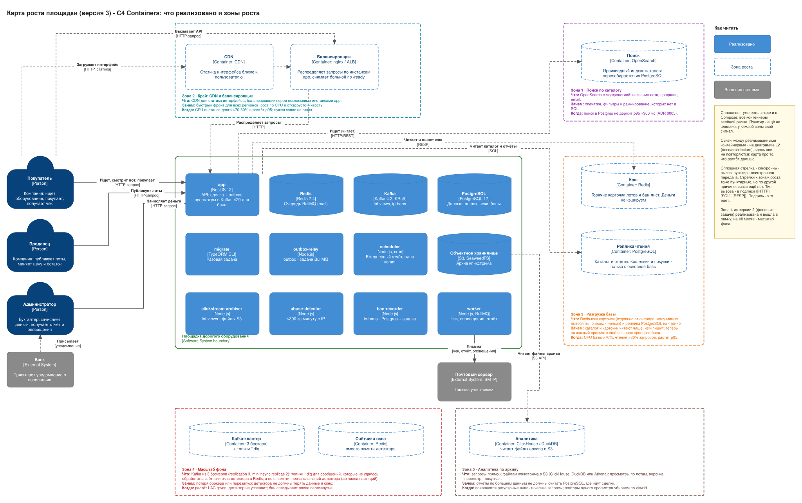

# Системный дизайн: площадка дорогого оборудования, версия 3

Доработка карты роста из [версии 2](../marketplace-v2/README.md) после занятия 05 (фоновые задачи). Систему по-прежнему не меняем: те же продавцы и покупатели (компании), тот же администратор. Но зона 4 из версии 2 («Фоновые задачи») **реализована и вошла в зелёную рамку**, а на карте появились Kafka, архив кликстрима, детектор абьюза и планировщик.

## Карта роста

Исходник и картинка — один файл [`growth-map.drawio.svg`](growth-map.drawio.svg), его можно открыть и править в draw.io.

C4-диаграммы реализованного лежат в [`docs/architecture/`](../../architecture/) и растут вместе с проектом, здесь они не дублируются:

- [L1 — System Context](<../../architecture/L1 - System Context.drawio.svg>): роли, банк и почтовый сервер.
- [L2 — Containers](<../../architecture/L2 - Containers.drawio.svg>): все контейнеры и связи. Сплошная стрелка — синхронный вызов, пунктир — асинхронная передача, на каждой подписано, что едет (HTTP-запрос, SQL, задача, событие, письмо).
- [Deployment — Docker Compose](<../../architecture/Deployment - Docker Compose.drawio.svg>): порты, образы, тома, зависимости запуска.

Что делает каждый процесс, как проверено руками и чего система не гарантирует — в [docs/background](../../background/README.md).

## Что изменилось по сравнению с версией 2

- **Зона 4 реализована.** Очередь переехала из «таблицы в PostgreSQL» в **Redis + BullMQ**, воркер — **отдельный контейнер**. Между базой и очередью — **transactional outbox**: сделка и строка `outbox` в одной транзакции, релей переносит строки в очередь (ADR 0006). Версия 2 допускала для старта очередь в PostgreSQL; мы пошли сразу в Redis, потому что задание тоже того требует, и закрыли двойную запись outbox'ом.
- **Появилась Kafka** — лог событий для кликстрима: просмотры карточек лотов (`lot-views`) и баны (`ip-bans`). Её читают независимые группы: архив, детектор и регистратор банов (ADR 0008).
- **S3 теперь используется:** архив кликстрима (ADR 0009). Фото лотов по-прежнему не загружаются.
- **Новые процессы** (один образ, свои контейнеры): `outbox-relay`, `worker`, `clickstream-archiver`, `abuse-detector`, `ban-recorder`, `scheduler` и разовая `kafka-init`.
- **Новая внешняя система — почтовый сервер.** Письма: чек покупателю, оповещение о бане и отчёт администратору. В Compose это Mailpit.
- **API стал независим от Redis и Kafka.** Покупка пишет строку outbox, просмотр уходит в буфер: ни то ни другое не ждёт брокера. Это записано в `docker-compose.yml` (`app` не зависит от `redis`, `kafka`, `mailpit`) и проверяется тестом.
- **Бан по IP — через базу.** API проверяет `ip_bans` на каждый запрос и отвечает 429.
- **На месте старой зоны 4 — две новые зоны:** «Масштаб фона» (Kafka на три брокера, DLQ, счётчики детектора в Redis) и «Аналитика по архиву» (запросы к файлам в S3). Зоны 1–3 не менялись; в зону 3 добавлен сигнал: запрос проверки бана на каждый запрос API.

### Проверка по списку «единого вида»

| Пункт                                                                        | Где на карте                                                                                               |
| ---------------------------------------------------------------------------- | ---------------------------------------------------------------------------------------------------------- |
| первая версия читается отдельно от зон роста                                 | сплошное в зелёной рамке — уже в коде; пунктир — ещё нет (легенда «Реализовано»)                           |
| на System Context роли: покупатель, продавец, администратор; система по делу | [L1](<../../architecture/L1 - System Context.drawio.svg>)                                                  |
| у контейнера технология и назначение                                         | вторая строка `[Container: ...]` и описание в каждом блоке                                                 |
| у стрелки видно, кто читает и кто пишет                                      | подпись на каждой стрелке; связи реализованного — на [L2](<../../architecture/L2 - Containers.drawio.svg>) |
| файлы сразу в объектном хранилище                                            | S3 в рамке: архив кликстрима; фото лотов — по схеме v2, ещё не загружаются                                 |
| видно, кто выполняет фон и где очередь                                       | `worker`, `outbox-relay`, `scheduler` и очередь в Redis (BullMQ); Kafka отдельно, для событий              |
| не рисовать то, чем не управляем                                             | браузера и DNS нет; банк и почтовый сервер — внешние системы                                               |

## Данные: где что лежит

Строки, которые не изменились с [версии 2](../marketplace-v2/README.md#данные-где-что-лежит) (кошельки, сделки, журнал, история лотов, фото лотов, каталог для поиска), остаются прежними. Ниже — что добавилось и что изменилось.

| Данные                                 | Хранилище                                                                  | Почему здесь                                                                                                         | Какие нужны гарантии                                                                                                                                                                                                                                                                                                                                                                                           |
| -------------------------------------- | -------------------------------------------------------------------------- | -------------------------------------------------------------------------------------------------------------------- | -------------------------------------------------------------------------------------------------------------------------------------------------------------------------------------------------------------------------------------------------------------------------------------------------------------------------------------------------------------------------------------------------------------- |
| **Событие «сделка для чека» (outbox)** | PostgreSQL, таблица `outbox`                                               | должно быть записано **в той же транзакции**, что и сделка: либо обе строки, либо ни одной; в Redis так нельзя       | ACID вместе со сделкой; `UNIQUE (kind, aggregate_id)`: одна сделка — одно событие; частичный индекс по неотправленным; растёт — нужна чистка старых отправленных                                                                                                                                                                                                                                               |
| **Метка «чек отправлен»**              | PostgreSQL, `deal_receipts`, append-only                                   | идемпотентность воркера: первичный ключ — замок; метка и письмо в одной транзакции                                   | `PRIMARY KEY (deal_id)`, `FOREIGN KEY` на сделку; нельзя менять и удалять; окно «письмо принято, COMMIT не прошёл» (см. ADR 0007)                                                                                                                                                                                                                                                                              |
| **Очередь задач**                      | **Redis + BullMQ**, очередь `mail` (вместо таблицы в PostgreSQL)           | задач много и они короткие, нужны повторы, задержки и состояния «упала»; PostgreSQL остаётся под деньги              | «хотя бы раз» + идемпотентные задачи; **перезапуск и падение Redis не теряют принятую задачу**: AOF с `appendfsync always` и том (строку outbox релей помечает отправленной сразу после `add`, поэтому одних снимков Redis мало); потеря тома — восстановление из outbox (`published_at = NULL`); `attempts=5`, экспоненциальная пауза, упавшие хранятся; выполненные хранятся сутки (дедупликация по `jobId`) |
| **Просмотры лотов**                    | Kafka, топик `lot-views`, 3 партиции, ключ — IP, хранение 7 суток          | их читают независимо архив и детектор; хранить каждый в PostgreSQL дорого; нужен лог, а не очередь                   | не более одного раза: допустима потеря (аналитика); порядок внутри партиции (нужен детектору); ≈ 185 байт на событие, ≈ 34 ГБ на 7 суток при 100/с и 3 репликах                                                                                                                                                                                                                                                |
| **Баны IP**                            | Kafka `ip-bans` (событие) → PostgreSQL `ip_bans` (состояние)               | событие — как факт для разных потребителей; состояние нужно API на каждый запрос, ему нужен индекс, а не чтение лога | `EXCLUDE USING gist (ip WITH =, период WITH &&)`: нет пересекающихся банов одного IP; событие бана — чистая функция входа (replay безопасен); проверка в API — один индексный запрос                                                                                                                                                                                                                           |
| **Архив кликстрима**                   | S3, `clickstream/date=<день>/<партиция>-<первый>-<последний оффсет>.jsonl` | дёшево и долговечно, для аналитики по файлам; Kafka хранит 7 суток, S3 — бессрочно                                   | коммит оффсета **после** записи (и до следующей пачки партиции); имя из партиции, первого и последнего оффсета: опоздавший `PUT` не затрёт чужой файл, повтор с другой нарезкой заменяет файл первого запуска; редкий дубль при ребалансе убирается по `viewId`                                                                                                                                                |
| **Счётчики окна детектора**            | память процесса `abuse-detector`                                           | состояние верно, потому что ключ топика — IP: все просмотры адреса у одной копии; не нужна запись на каждый просмотр | оффсет коммитится на начало окна, после перезапуска минута перечитывается и окно восстанавливается; в группе постоянный `LAG` порядка окна; для длинных окон — Redis (зона 4)                                                                                                                                                                                                                                  |
| **Письма**                             | почтовый сервер (в Compose — Mailpit)                                      | отправка — внешний эффект, он не в транзакции                                                                        | `Message-ID` постоянный (`receipt-<сделка>`) — защита от дубля на стороне получателя; чек: один раз (ADR 0007); отчёт и оповещение: лишняя копия безвредна                                                                                                                                                                                                                                                     |

## Кто пишет и что будет при замене (для проверки в паре)

Заготовка к вопросам «кто пишет сюда?» и «что будет, если этот контейнер заменили?». Строки для PostgreSQL, S3, app и реплики — как в [версии 2](../marketplace-v2/README.md#кто-пишет-и-что-будет-при-замене-для-проверки-в-паре) с поправками ниже.

| Контейнер            | Кто пишет                                                                                 | Что будет, если заменить                                                                                                                                                 |
| -------------------- | ----------------------------------------------------------------------------------------- | ------------------------------------------------------------------------------------------------------------------------------------------------------------------------ |
| PostgreSQL           | app (сделки, outbox), worker (метка чека), ban-recorder (баны), миграции                  | как в v2; плюс: outbox и `ip_bans` держатся на транзакциях и `EXCLUDE`, на другую базу без них не переехать                                                              |
| Redis (очередь)      | outbox-relay, ban-recorder, scheduler (ставят задачи); worker (берёт, помечает)           | замена на Postgres-очередь (pg-boss, BullMQ 6 на Postgres) убирает проблему двойной записи, outbox станет не нужен; задачи идемпотентны, строки outbox переживут простой |
| Kafka                | app (`lot-views`), abuse-detector (`ip-bans`)                                             | замена на RabbitMQ потеряет независимые группы с историей: нового потребителя придётся подключать к своей очереди, а перечитать прошлое будет нельзя                     |
| S3                   | clickstream-archiver (файлы кликстрима); позже браузер продавца (фото) и воркер (очистка) | любое S3-совместимое хранилище: ключи объектов остаются; Compose использует SeaweedFS, прод — управляемый S3                                                             |
| outbox-relay         | только он переводит строки outbox в очередь                                               | несколько копий безопасны (`SKIP LOCKED`); остановка копит строки, но ничего не теряет                                                                                   |
| worker               | отправляет письма, пишет метку чека                                                       | масштабируется копиями; идемпотентность держит индекс, а не число воркеров                                                                                               |
| clickstream-archiver | пишет файлы в S3 и коммитит оффсет своей группы                                           | замена на Kafka Connect S3 sink сохранит смысл; имена файлов тогда определит он                                                                                          |
| abuse-detector       | читает `lot-views`, пишет `ip-bans`                                                       | копий до 3 (по партициям); замена на Redis-счётчики убирает перечитывание окна при перезапуске                                                                           |
| ban-recorder         | пишет `ip_bans`, ставит задачу `ip-ban-alert`                                             | повтор события безопасен (`EXCLUDE`, `jobId`)                                                                                                                            |
| scheduler            | ставит задачу `daily-report`                                                              | **только одна копия**; замена на `upsertJobScheduler` BullMQ снимет это ограничение (ADR 0011)                                                                           |

## Решения (ADR)

Формат: контекст → варианты → выбор → последствия. Решения 0001–0005 остаются в силе, они в [версии 2](../marketplace-v2/README.md#решения-adr).

| №    | Решение                                                                                     |
| ---- | ------------------------------------------------------------------------------------------- |
| 0006 | [Чек покупателю: transactional outbox и BullMQ на Redis](adr/0006-outbox-bullmq.md)         |
| 0007 | [Идемпотентный воркер: уникальный индекс как замок](adr/0007-idempotent-worker.md)          |
| 0008 | [Кликстрим: Kafka, ключ — IP, хранение 7 суток](adr/0008-clickstream-kafka.md)              |
| 0009 | [Архив кликстрима: пачки, имя из оффсета, коммит после записи](adr/0009-archive-batches.md) |
| 0010 | [Детектор абьюза: отдельный консьюмер, окно по времени события](adr/0010-abuse-detector.md) |
| 0011 | [Планировщик: отдельный контейнер в одной копии](adr/0011-scheduler-single-copy.md)         |

Схема данных, ограничения и транзакции из ранних решений: [docs/db](../../db/README.md). Фоновые процессы, расчёт диска, проверка руками: [docs/background](../../background/README.md).

## Что изменилось после критики напарника

Заполняется после встречи пары: что спросил напарник («кто пишет сюда?», «что будет, если этот контейнер заменили?»), какие блоки и решения поменялись. Встреча ещё не состоялась, поэтому здесь пока ничего не записано.
