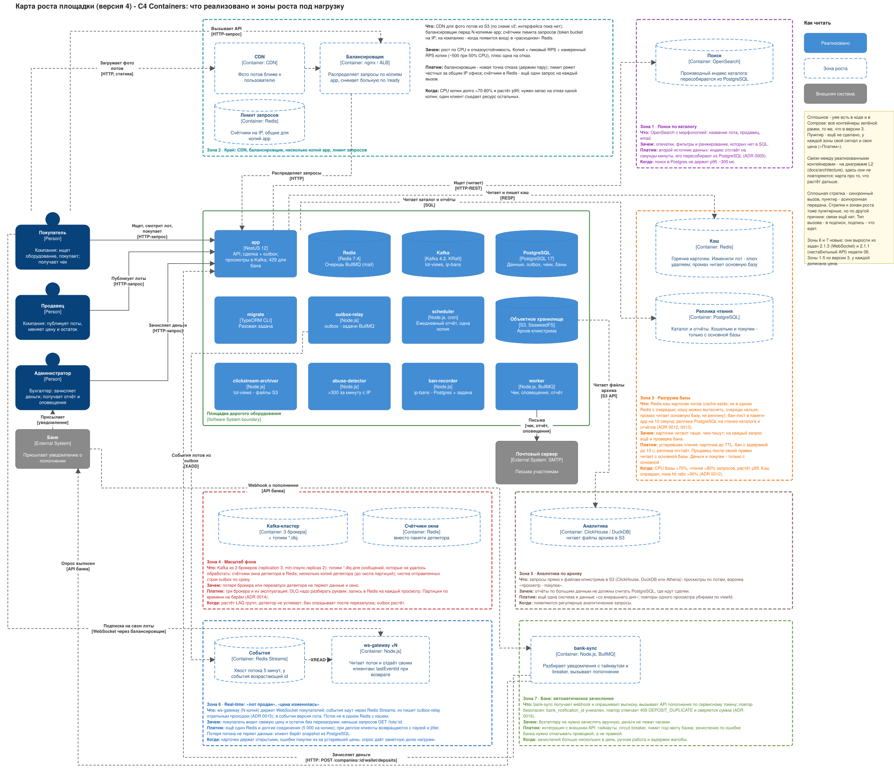

# Системный дизайн: площадка дорогого оборудования, версия 4

Доработка карты роста из [версии 3](../marketplace-v3/README.md) после занятия 06 (highload). Систему по-прежнему не меняем: те же продавцы и покупатели (компании), тот же администратор, **в коде ничего не добавилось**. Версия 4 — это карта роста под нагрузку: цифры с допущениями, у каждой зоны цена («Платим») и сигнал («Когда»), а из разбора задач недели выросли две новые зоны.

## Карта роста

Исходник и картинка — один файл [`growth-map.drawio.svg`](growth-map.drawio.svg), его можно открыть и править в draw.io.

C4-диаграммы реализованного лежат в [`docs/architecture/`](../../architecture/) и в этой неделе **не менялись**: новых контейнеров в коде нет.

- [L1 — System Context](<../../architecture/L1 - System Context.drawio.svg>)
- [L2 — Containers](<../../architecture/L2 - Containers.drawio.svg>)
- [Deployment — Docker Compose](<../../architecture/Deployment - Docker Compose.drawio.svg>)

Разбор четырёх задач недели (нестабильный API, RabbitMQ, WebSocket, Web Crawler) со схемами — в [docs/highload](../../highload/README.md).

## Что изменилось по сравнению с версией 3

- **Реализовано то же, что в v3.** Сплошным нарисовано то же самое: зелёная рамка, 12 контейнеров. Пунктир — не сделано.
- **У каждой зоны появилась цена.** Строка «Платим» в каждой зоне: чем расплачиваемся за решение (новая точка отказа, устаревшие данные, ещё одна система). Принцип недели: решение без цены не засчитывается.
- **Зона 2 стала шире:** к CDN и балансировщику добавлен **лимит запросов** (счётчики в Redis) и расчёт числа копий `app` от измеренной пропускной способности одной копии.
- **Зона 3 конкретизирована:** кэш карточек (cache-aside, инвалидация при изменении, [ADR 0012](adr/0012-cache-cards-and-bans.md)), бан-лист в памяти копии на 10 с и реплика чтения с правилом «читать со своей записи» ([ADR 0013](adr/0013-read-replica-routing.md)).
- **Зона 4 дополнена чисткой `outbox`** и записью, почему партиции по времени для денег не берём ([ADR 0014](adr/0014-partitioning-and-sharding-deferred.md)).
- **Новая зона 6, real-time:** `ws-gateway` и Redis Streams ([ADR 0015](adr/0015-realtime-ws-gateway.md)) — из задачи 2.1.3.
- **Новая зона 7, банк:** `bank-sync` вызывает уже существующий API пополнения ([ADR 0016](adr/0016-bank-api-integration.md)) — из задачи 2.1.1.
- **Стрелки зон 6 и 7** идут вдоль левого края карты (`outbox-relay` → поток событий; покупатель → `ws-gateway`; банк ↔ `bank-sync` → `app`) и по нижнему краю: так они не пересекают зоны.

### Проверка по списку «единого вида»

| Пункт                                                                        | Где на карте                                                                                               |
| ---------------------------------------------------------------------------- | ---------------------------------------------------------------------------------------------------------- |
| первая версия читается отдельно от зон роста                                 | сплошное в зелёной рамке — уже в коде; пунктир — ещё нет (легенда «Реализовано»)                           |
| на System Context роли: покупатель, продавец, администратор; система по делу | [L1](<../../architecture/L1 - System Context.drawio.svg>)                                                  |
| у контейнера технология и назначение                                         | вторая строка `[Container: ...]` и описание в каждом блоке                                                 |
| у стрелки видно, кто читает и кто пишет                                      | подпись на каждой стрелке; связи реализованного — на [L2](<../../architecture/L2 - Containers.drawio.svg>) |
| файлы сразу в объектном хранилище                                            | S3 в рамке: архив кликстрима; фото лотов — по схеме v2, ещё не загружаются                                 |
| видно, кто выполняет фон и где очередь                                       | `worker`, `outbox-relay`, `scheduler`, очередь в Redis; Kafka отдельно, для событий                        |
| не рисовать то, чем не управляем                                             | браузера и DNS нет; банк и почтовый сервер — внешние системы                                               |

## Оценка нагрузки

Все цифры — допущения. Измеренное в проекте помечено отдельно.

| Величина                             | Допущение или расчёт                                                                                                                                                                              | Итог                                        |
| ------------------------------------ | ------------------------------------------------------------------------------------------------------------------------------------------------------------------------------------------------- | ------------------------------------------- |
| Компании, лоты                       | 5 000 компаний, 50 000 лотов                                                                                                                                                                      | —                                           |
| Просмотры карточек                   | 100 в секунду в среднем (как в [docs/background](../../background/README.md)), пик ×3                                                                                                             | **300 в секунду** в пике                    |
| Каталог (`GET /lots`)                | допущение                                                                                                                                                                                         | 100 в секунду в пике                        |
| Всего запросов к API в пике          | 300 + 100                                                                                                                                                                                         | **400 в секунду**                           |
| Сделки                               | оборудование дорогое: 2 000 в день, в пике 1 в секунду                                                                                                                                            | 0,02 в секунду в среднем                    |
| Пополнения                           | 500 в день                                                                                                                                                                                        | —                                           |
| Пропускная способность копии `app`   | **измерено:** 1011 запросов в секунду на `GET /lots/:id` с проверкой бана и отправкой в Kafka, одна копия на стенде Compose (строка ниже). Планируем загрузку CPU до 50%: ~500 в секунду на копию | ≈ 500 RPS на копию                          |
| Число копий `app`                    | 400 / 500 — одной хватает по CPU; плюс одна на отказ (N+1)                                                                                                                                        | **2 копии**                                 |
| Запросов к базе в секунду            | проверка бана (1 `SELECT`) на каждый запрос, карточка — 1 `SELECT`, каталог — 1: ~400 + ~300 + ~100                                                                                               | **≈ 800**                                   |
| Пул соединений к базе (закон Литтла) | 800 запросов в секунду × ~2 мс на точечный запрос (допущение) ≈ 2 занятых соединения                                                                                                              | пул 10 на копию с запасом                   |
| Строк журнала денег в год            | 2 000 сделок × 365 × 2 строки + ~180 тыс. пополнений                                                                                                                                              | **≈ 1,6 млн, около 160 МБ**                 |
| Кликстрим в сутки                    | 100 × 86 400 × 185 Б (**185 Б измерено**)                                                                                                                                                         | 1,6 ГБ в сутки в S3                         |
| Kafka на 7 суток, три реплики        | 1,6 ГБ × 7 × 3                                                                                                                                                                                    | **33,6 ГБ** (совпадает с docs/background)   |
| Просмотры за прогон скрипта          | **измерено:** `scripts/clickstream-load.mjs`, 100 000 просмотров за 99 с                                                                                                                          | ≈ 1011 запросов в секунду на стенде Compose |

Почему копий не считаем по Литтлу «одновременных запросов на копию»: для Node это неверная модель. Запрос, который ждёт базу, почти ничего не стоит (не держит поток), и копия может держать сотни ожидающих запросов. Предел копии — **CPU-время на запрос**, поэтому число копий = пиковый RPS ÷ измеренный RPS копии при целевой загрузке. Закон Литтла здесь задаёт **размер пула к базе**: одновременных запросов к базе = запросов к базе в секунду × время запроса. Оговорка к замеру: стенд — одна машина, генератор нагрузки на ней же, поэтому 1011 — оценка порядка величины, а не паспорт копии; на целевом железе мерить заново.

Горячий лот при покупке сериализуется блокировкой `SELECT ... FOR UPDATE`: при транзакции ~20 мс это порядка 50 покупок в секунду на один лот, на порядки выше ожидаемых 1 в секунду.

### Что упрётся первым

Потолки, от которых считаем (допущения, пока не измерены на целевом железе):

| Ресурс                        | Потолок                                                                                                     | Сейчас в пике      | При ×10             |
| ----------------------------- | ----------------------------------------------------------------------------------------------------------- | ------------------ | ------------------- |
| CPU копии `app`               | ~500 RPS при 50% CPU (от замера 1011)                                                                       | 400 RPS: 1 копия   | 4000 RPS: 8 копий   |
| PostgreSQL, точечные `SELECT` | десятки тысяч в секунду на 8 vCPU (порядок `pgbench -S`; допущение — 20 000 при 70% CPU)                    | 800 в секунду: ~4% | 8 000: ~40%         |
| Соединения PostgreSQL         | `max_connections` = 100 по умолчанию                                                                        | 2 копии × 10 = 20  | 9 копий × 10 = 90   |
| Запись денег                  | сотни транзакций покупки в секунду (одна строка лота под блокировкой ~20 мс — 50 в секунду на **один** лот) | 1 в секунду в пике | 10 в секунду в пике |

**Сейчас:** не упирается ничего. Первым из потолков придёт **CPU `app`**, и он же самый дешёвый: добавить копию.

**При ×10** (3000 карточек и 1000 каталога в секунду, 20 000 сделок в день):

1. **CPU `app`:** 4000 / 500 = 8 копий плюс одна на отказ, **9 копий**; значит балансировщик и лимит запросов (зона 2).
2. **Соединения базы, раньше её CPU:** 9 копий по пулу 10 — это 90 соединений при `max_connections` 100, а ещё миграции, релей, `ban-recorder`, `worker`. Лечится уменьшением пула (по Литтлу каждой копии нужно ~3 соединения: 10 000 запросов в секунду × 2 мс / 9) или PgBouncer перед базой.
3. **CPU базы** — ~40% по допущению, ещё не упор. Кэш и бан-лист в памяти (зона 3) включаем по сигналу «CPU базы > 70%», а не заранее.
4. Дальше: реплика чтения для каталога (зона 3); чистка `outbox` и очереди (зона 4).
5. Запись денег (0,2 сделки в секунду в среднем, 10 в пике) всё ещё далеко от потолка одной базы. Шардирование не нужно.

Порядок от дешёвого к дорогому: индексы и запросы (сделано) → копии `app` и балансировщик → пул и PgBouncer → кэш бана и карточек → реплика → партиции и архив (по сигналу) → шардирование (последнее).

### Цена Redis: пять ролей

В карте роста Redis появляется в пяти ролях. У каждой свои требования к сохранности, и смешивать их в одном экземпляре нельзя (кэшу можно вытеснять данные, очереди нельзя):

| Роль                  | Зона | Потеря данных                                           | Что нужно                                      |
| --------------------- | ---- | ------------------------------------------------------- | ---------------------------------------------- |
| очередь BullMQ (есть) | —    | недопустима: задача — единственная копия после `outbox` | AOF `always`, `noeviction`, Sentinel (3 узла)  |
| поток событий         | 6    | допустима ценой `resync` клиентов                       | `noeviction`, реплика; можно делить с очередью |
| кэш карточек          | 3    | допустима: холодный старт                               | `allkeys-lru`, без диска, без HA               |
| лимит запросов        | 2    | допустима: лимит на миг ослабнет                        | без диска; можно делить с кэшем                |
| окно детектора        | 4    | нежелательна: бан опоздает до минуты                    | реплика; можно делить с очередью               |

Пять отдельных экземпляров с HA — это ~15 процессов Redis. Разумный минимум — **два**: «надёжный» (очередь, поток, окно детектора: `noeviction`, AOF, Sentinel из трёх узлов) и «расходный» (кэш и лимиты: вытеснение, без диска, один узел с перезапуском). Плата — общий ресурс внутри каждого: всплеск записи в поток задерживает очередь, и это надо видеть по метрике задержки команд.

## При разделении сети (CAP и PACELC)

Если связь между `app` и основной базой пропала, система выбирает по данным:

| Данные                                | Выбор                    | Что делаем                                                                                                           |
| ------------------------------------- | ------------------------ | -------------------------------------------------------------------------------------------------------------------- |
| деньги: покупки, кошельки, пополнения | **согласованность** (CP) | отказываем: `503 DB_TIMEOUT` или `409 RETRY` (уже так в проекте); лучше отказ, чем неверный баланс                   |
| каталог, карточка лота, просмотры     | **доступность** (AP)     | отвечаем из кэша или с реплики, пусть данные чуть устарели; просмотр, не дошедший до Kafka, теряется (допущено в v3) |
| бан-лист                              | доступность              | живём на последнем известном (10 с в памяти); без базы бан не обновится                                              |

PACELC, «else»-часть, когда сети всё хорошо: для денег выбираем согласованность ценой задержки (читаем только основную базу под блокировкой), для каталога — задержку ценой свежести (кэш и реплика).

## Данные: где что лежит

Строки, которые не изменились с [версии 3](../marketplace-v3/README.md#данные-где-что-лежит) (кошельки, сделки, журнал, история лотов, очередь, Kafka, архив, баны), остаются прежними. Ниже — что добавилось и что изменилось.

| Данные                     | Хранилище                                                                | Почему здесь                                                                | Какие нужны гарантии                                                                                                                                                                          |
| -------------------------- | ------------------------------------------------------------------------ | --------------------------------------------------------------------------- | --------------------------------------------------------------------------------------------------------------------------------------------------------------------------------------------- |
| **Кэш карточек лотов**     | Redis («расходный» экземпляр), зона 3                                    | горячее чтение; кэшу можно вытеснять данные, очереди нельзя                 | не источник правды; устаревание до TTL 60 с (ADR 0012); промах читает основную базу, не реплику; деньги не кэшируем                                                                           |
| **Бан-лист в копии `app`** | память процесса, ответ на 10 с                                           | запрос к `ip_bans` на каждый запрос слишком дорог при росте                 | задержка бана и разбана до 10 с у каждой копии; источник правды остаётся `ip_bans`                                                                                                            |
| **Реплика чтения**         | PostgreSQL, потоковая репликация                                         | каталог и отчёты не должны делить базу с деньгами                           | асинхронна и отстаёт; продавец читает свою запись с основной; при отставании > 5 с чтение возвращается на основную базу (ADR 0013)                                                            |
| **Лимит запросов**         | Redis (счётчики), зона 2                                                 | счётчик должен быть общим для всех копий `app`                              | допустима потеря счётчика (лимит на миг ослабнет); не должен тормозить запрос: короткий таймаут, при отказе пропускаем                                                                        |
| **События для real-time**  | Redis Streams («надёжный» экземпляр, не с кэшем), зона 6                 | у события есть id, клиент может запросить пропущенное; Pub/Sub так не умеет | хвост 5 минут; потеря потока не теряет данные (клиент берёт snapshot из PostgreSQL); пишет `outbox-relay` (ADR 0015)                                                                          |
| **Уведомления банка**      | очередь BullMQ + `wallet_operations` (уникальный `bank_notification_id`) | идемпотентность уже в базе, новая таблица не нужна                          | «хотя бы раз» + уникальный индекс; повтор отвечает `409 DEPOSIT_DUPLICATE` (новый код), успех только при совпадении суммы и компании; неопознанные платежи разбирает администратор (ADR 0016) |
| **`outbox`**               | PostgreSQL                                                               | как в v3                                                                    | добавляется **чистка** отправленных строк старше 30 суток (`DELETE` пачками), не партиции (ADR 0014)                                                                                          |

## Кто пишет и что будет при замене (для проверки в паре)

Строки для PostgreSQL, Redis (очередь), Kafka, S3, `outbox-relay`, `worker`, `scheduler` и остальных реализованных контейнеров — как в [версии 3](../marketplace-v3/README.md#кто-пишет-и-что-будет-при-замене-для-проверки-в-паре). Ниже — зоны роста.

| Контейнер               | Кто пишет                                                                             | Что будет, если заменить                                                                                                                                                         |
| ----------------------- | ------------------------------------------------------------------------------------- | -------------------------------------------------------------------------------------------------------------------------------------------------------------------------------- |
| Кэш карточек (Redis)    | `app` при промахе; `app` же удаляет ключ при изменении лота                           | убрать кэш: всё работает, база получает больше чтения; потерянный ключ — просто промах; потеря всего кэша — холодный старт, нужен single-flight                                  |
| Лимит запросов (Redis)  | все копии `app`                                                                       | заменить на лимит в nginx: проще, но счётчик на копию, а не общий (лимит эффективно умножается на число копий)                                                                   |
| Реплика чтения          | только репликация PostgreSQL                                                          | убрать реплику: чтение идёт на основную базу; заменить на другую базу нельзя без пересмотра отчётов                                                                              |
| Redis Streams (события) | `outbox-relay` (свой проход, отдельно от чеков)                                       | заменить на Kafka: id есть (партиция, оффсет), но выше задержка и чтение с произвольного оффсета на каждый reconnect; заменить на Pub/Sub: теряем повтор пропущенного (ADR 0015) |
| ws-gateway              | ничего не пишет в базу; читает поток, пишет в сокеты                                  | копий N, без состояния кроме сокетов; перезапуск копии — клиенты возвращаются сами; потеря потока — `resync`                                                                     |
| bank-sync               | через `app` (сервисный токен): `wallet_operations` (пополнение); BullMQ (свои задачи) | несколько копий безопасны: уникальный индекс; замена на ручное зачисление — вернуться к текущему состоянию                                                                       |
| Балансировщик           | не пишет данные                                                                       | замена CDN или балансировщика не меняет данные; балансировщик — новая точка отказа, нужна пара                                                                                   |

## Решения (ADR)

Формат: контекст → варианты → выбор → последствия. Решения 0001–0005 — в [версии 2](../marketplace-v2/README.md#решения-adr), 0006–0011 — в [версии 3](../marketplace-v3/README.md#решения-adr). Новые имеют статус «предложено»: они описывают зоны роста, а не код.

| №    | Решение                                                                                              |
| ---- | ---------------------------------------------------------------------------------------------------- |
| 0012 | [Кэш карточек лотов и бан-листа](adr/0012-cache-cards-and-bans.md)                                   |
| 0013 | [Реплика чтения: что читаем с неё и как жить с отставанием](adr/0013-read-replica-routing.md)        |
| 0014 | [Партиционирование журналов и шардирование отложены](adr/0014-partitioning-and-sharding-deferred.md) |
| 0015 | [Real-time: ws-gateway и Redis Streams](adr/0015-realtime-ws-gateway.md)                             |
| 0016 | [Автоматическое зачисление: интеграция с API банка](adr/0016-bank-api-integration.md)                |

Схема данных, ограничения и транзакции из ранних решений: [docs/db](../../db/README.md). Фоновые процессы: [docs/background](../../background/README.md). Задачи недели 06: [docs/highload](../../highload/README.md).

## Что изменилось после критики напарника

Заполняется после встречи пары: что спросил напарник («кто пишет сюда?», «что будет, если этот контейнер заменили?»), какие блоки и решения поменялись. Встреча ещё не состоялась, поэтому здесь пока ничего не записано.
